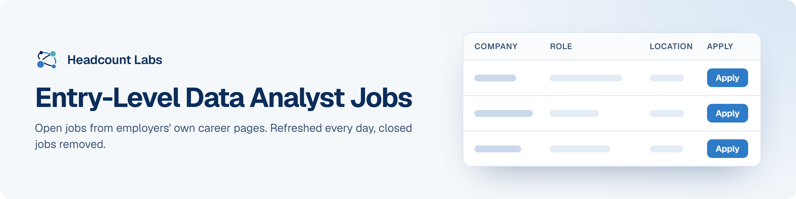

# Entry-Level Data Analyst Jobs

Junior, associate and entry-level data and business analyst jobs in the US.

**265 open jobs** · 45 new since the last update · 6 removed because they closed or left the employer's board · updated October 19, 2026 at 5:38 AM EDT

This list is built and refreshed every day by [Headcount Labs](https://headcountlabs.com/?utm_source=github&utm_medium=job-list&utm_campaign=entry-level-data-analyst-jobs), which reads jobs straight from employers' own career pages and job boards. Every job here was still listed on its source board when we last read that board, within the past 3 days, and was posted in the past 30 days. Copies of the same job are merged into one row, and jobs that close are removed at the next update.

Want this data in your own app or agent? Use the [Headcount Labs jobs API](https://headcountlabs.com/docs/?utm_source=github&utm_medium=job-list&utm_campaign=entry-level-data-analyst-jobs) (free tier) or the [open dataset](https://huggingface.co/datasets/HeadcountLabs/job-postings) on Hugging Face.

**Jump to:** [Posted in the last 7 days (123)](#posted-in-the-last-7-days) · [Posted 8 to 30 days ago (142)](#posted-8-to-30-days-ago)

**Columns.** *Apply* opens the original posting on the employer's site. *Details* opens the job on Headcount Labs, with every posting we found for it. *Remote* shows what the employer states; a dash means the posting doesn't say. *Pay* is the range the employer published.

## Posted in the last 7 days

| Company | Role | Location | Remote | Pay | Posted | Apply | Details |
| --- | --- | --- | --- | --- | --- | :---: | :---: |
| **Thatcher Company** | SUPPLY CHAIN - Procurement Analyst I | Salt Lake City, UT | On-site | — | Oct 17 |  | <a href="https://headcountlabs.com/catalog/jobs/343fedc7-6ded-4e6d-8b62-77981152e76d?utm_source=github&utm_medium=job-list&utm_campaign=entry-level-data-analyst-jobs">via Headcount Labs</a> |
| **Raymond James Financial, Inc.** | 2027 Investment Banking Analyst I Diversified Industrials McLean, VA | Mc Lean, VA | — | — | Oct 17 |  | <a href="https://headcountlabs.com/catalog/jobs/57b3f3a0-27d9-4c3f-b451-8e68c21db1db?utm_source=github&utm_medium=job-list&utm_campaign=entry-level-data-analyst-jobs">via Headcount Labs</a> |
| **NextEra Energy** | Business Analyst I - External Affairs &amp; Economic Development | Juno Beach, FL | — | — | Oct 17 |  | <a href="https://headcountlabs.com/catalog/jobs/59effdd5-b699-4fb7-aa3e-6b02d295c71b?utm_source=github&utm_medium=job-list&utm_campaign=entry-level-data-analyst-jobs">via Headcount Labs</a> |
| **Bunzl** | Junior Business Analyst - Strategic Insights Team | St. Louis, MO | Hybrid | — | Oct 17 |  | <a href="https://headcountlabs.com/catalog/jobs/58ee85d7-734e-4383-98e2-6edd1c0ab740?utm_source=github&utm_medium=job-list&utm_campaign=entry-level-data-analyst-jobs">via Headcount Labs</a> |
| **Bausch+Lomb Companies Inc.** | Financial Analyst I | US-NJ-Bridgewater | — | $60k–$75k/yr | Oct 17 |  | <a href="https://headcountlabs.com/catalog/jobs/f82b69c6-e8ad-46a2-a9dd-4354eeaec0fa?utm_source=github&utm_medium=job-list&utm_campaign=entry-level-data-analyst-jobs">via Headcount Labs</a> |
| **Artemis Consulting** | Junior Financial Analyst/Consultant | Arlington, VA | On-site | $55k–$80k/yr | Oct 17 |  | <a href="https://headcountlabs.com/catalog/jobs/05f49df7-3fd8-4718-9bb5-9c37da34385c?utm_source=github&utm_medium=job-list&utm_campaign=entry-level-data-analyst-jobs">via Headcount Labs</a> |
| **Ace IT Careers** | Associate Software Test Analyst | 

6 locations
Detroit, MI Kansas City, MO Nashville, TN Newark, NJ Richmond, VA United States
 | Remote | — | Oct 17 |  | <a href="https://headcountlabs.com/catalog/jobs/0376756f-9503-4546-bacb-632646ea1ff6?utm_source=github&utm_medium=job-list&utm_campaign=entry-level-data-analyst-jobs">via Headcount Labs</a> |
| **ZenPoint Solutions LLC** | Business Analyst I | United States | On-site | $65k–$80k/yr | Oct 16 |  | <a href="https://headcountlabs.com/catalog/jobs/04cd3843-2c0f-4602-919a-920641ebc172?utm_source=github&utm_medium=job-list&utm_campaign=entry-level-data-analyst-jobs">via Headcount Labs</a> |
| **WTW** | Early Careers: Corporate Risk and Broking (CRB) Graduate Development Program Analyst – Alternative Risk Transfer (ART)– NY - 2027 | New York, NY | Hybrid | $36/hr | Oct 16 |  | <a href="https://headcountlabs.com/catalog/jobs/8ac13d41-e200-4d54-b743-a70c7164f482?utm_source=github&utm_medium=job-list&utm_campaign=entry-level-data-analyst-jobs">via Headcount Labs</a> |
| **ULSA University of Louisville** | IT Systems Analyst I | Louisville, KY | — | — | Oct 16 |  | <a href="https://headcountlabs.com/catalog/jobs/1a7fdce9-1571-4424-b5cf-5acc4d327eec?utm_source=github&utm_medium=job-list&utm_campaign=entry-level-data-analyst-jobs">via Headcount Labs</a> |
| **UF Health** | EMR, Application Analyst I | Gainesville, FL | — | — | Oct 16 |  | <a href="https://headcountlabs.com/catalog/jobs/ae063bc3-c3d7-4cad-ad8f-6bf8ba5d50aa?utm_source=github&utm_medium=job-list&utm_campaign=entry-level-data-analyst-jobs">via Headcount Labs</a> |
| **STRIDE BANK NA** | IS Security Analyst I | Oklahoma City, OK | — | — | Oct 16 |  | <a href="https://headcountlabs.com/catalog/jobs/5eace275-ed7f-4587-af6d-7d32699e0cb4?utm_source=github&utm_medium=job-list&utm_campaign=entry-level-data-analyst-jobs">via Headcount Labs</a> |
| **Softheon** | Business Operations Analyst I | 

6 locations
Connecticut Florida Georgia New Jersey New York Pennsylvania
 | Remote | — | Oct 16 |  | <a href="https://headcountlabs.com/catalog/jobs/8991e9f9-75ed-4b90-9d8a-e59b0db03dfa?utm_source=github&utm_medium=job-list&utm_campaign=entry-level-data-analyst-jobs">via Headcount Labs</a> |
| **Segra** | Financial Analyst I | 

4 locations
Kansas City, MO Dallas, TX Plano, TX Atlanta, GA
 | Hybrid | $55k–$69k/yr | Oct 16 |  | <a href="https://headcountlabs.com/catalog/jobs/b8a2d078-4a7a-46d3-9d57-dd1c52d2e783?utm_source=github&utm_medium=job-list&utm_campaign=entry-level-data-analyst-jobs">via Headcount Labs</a> |
| **Ruchman** | Junior Program Analyst | Clarksburg, WV | — | — | Oct 16 |  | <a href="https://headcountlabs.com/catalog/jobs/90bba6f8-c64c-4899-82e5-68ea0e97a770?utm_source=github&utm_medium=job-list&utm_campaign=entry-level-data-analyst-jobs">via Headcount Labs</a> |
| **Raymond James &amp; Associates, Inc.** | 2027 Investment Banking Analyst I Diversified Industrials McLean, VA | Mc Lean, VA | — | $70k–$105k/yr | Oct 16 |  | <a href="https://headcountlabs.com/catalog/jobs/08d4320b-3728-4a0d-838a-9153bea77445?utm_source=github&utm_medium=job-list&utm_campaign=entry-level-data-analyst-jobs">via Headcount Labs</a> |
| **One Federal Solution** | Entry-Level Financial Analyst | Austin | On-site | — | Oct 16 |  | <a href="https://headcountlabs.com/catalog/jobs/724e48a2-ba1c-43b3-ad26-9086d7d73cb2?utm_source=github&utm_medium=job-list&utm_campaign=entry-level-data-analyst-jobs">via Headcount Labs</a> |
| **Novant Health** | Revenue Cycle Process Improvement Analyst I | Charlotte, NC | — | — | Oct 16 |  | <a href="https://headcountlabs.com/catalog/jobs/bf7f0b66-58c8-41cc-905b-a212db329268?utm_source=github&utm_medium=job-list&utm_campaign=entry-level-data-analyst-jobs">via Headcount Labs</a> |
| **Niagara Bottling, LLC** | IT Systems Functional Analyst I - Oracle MFG Module | Diamond Bar, CA | — | $84k–$122k/yr | Oct 16 |  | <a href="https://headcountlabs.com/catalog/jobs/4750b314-e980-459a-91f7-9261fdc22cc6?utm_source=github&utm_medium=job-list&utm_campaign=entry-level-data-analyst-jobs">via Headcount Labs</a> |
| **Niagara Bottling, LLC** | IT Functional Analyst I - Oracle Master Data Management | Diamond Bar, CA | — | $84k–$122k/yr | Oct 16 |  | <a href="https://headcountlabs.com/catalog/jobs/43facf35-6173-4792-bac5-26f13e6f3153?utm_source=github&utm_medium=job-list&utm_campaign=entry-level-data-analyst-jobs">via Headcount Labs</a> |
| **Nevada Heart &amp; Vascular Center** | athenaOne Applications Systems Analyst- Junior | United States | Remote | — | Oct 16 |  | <a href="https://headcountlabs.com/catalog/jobs/f3a246e2-5a23-4ebe-bd54-846d35200941?utm_source=github&utm_medium=job-list&utm_campaign=entry-level-data-analyst-jobs">via Headcount Labs</a> |
| **LSI Solutions** | Quality Analyst I - Evenings (2:30pm - 11:00pm) M-F | Victor, NY | On-site | $21–$27/hr | Oct 16 |  | <a href="https://headcountlabs.com/catalog/jobs/07552ec7-195a-4ece-9ed5-f9f1d3096f4a?utm_source=github&utm_medium=job-list&utm_campaign=entry-level-data-analyst-jobs">via Headcount Labs</a> |
| **LabCorp** | Operations Reporting Analyst I | Graham, NC | — | — | Oct 16 |  | <a href="https://headcountlabs.com/catalog/jobs/c5c1e059-b831-49ce-a63d-470df5a0db7d?utm_source=github&utm_medium=job-list&utm_campaign=entry-level-data-analyst-jobs">via Headcount Labs</a> |
| **J29, Inc** | Dispute Resolution Analyst I | Millersville, MD | Remote | $16.25–$18.25/hr | Oct 16 |  | <a href="https://headcountlabs.com/catalog/jobs/51ff6a5c-f143-444c-a208-3842ddc3c4f8?utm_source=github&utm_medium=job-list&utm_campaign=entry-level-data-analyst-jobs">via Headcount Labs</a> |
| **GM Financial** | Credit Review Analyst I - Auto Finance Fraud | Fort Worth, TX | Hybrid | — | Oct 16 |  | <a href="https://headcountlabs.com/catalog/jobs/e7eb55cd-fba9-4026-990a-3f45a3ed2fe4?utm_source=github&utm_medium=job-list&utm_campaign=entry-level-data-analyst-jobs">via Headcount Labs</a> |
| **Global Payment Holding Company** | Information Security Assurance Analyst I | 

4 locations
ATLANTA, GA CINCINNATI, OH JEFFERSONVILLE, IN ALPHARETTA, GA
 | Hybrid | — | Oct 16 |  | <a href="https://headcountlabs.com/catalog/jobs/a1df17b4-18f2-4322-9f0e-1f847a746ebf?utm_source=github&utm_medium=job-list&utm_campaign=entry-level-data-analyst-jobs">via Headcount Labs</a> |
| **GEOGRAPHIC SOLUTIONS INC** | Governance, Risk &amp; Compliance Analyst I | Palm Harbor, FL | — | — | Oct 16 |  | <a href="https://headcountlabs.com/catalog/jobs/6dae6d0c-73bb-427a-9ef4-e41e58b0630a?utm_source=github&utm_medium=job-list&utm_campaign=entry-level-data-analyst-jobs">via Headcount Labs</a> |
| **Freeport McMoRan** | Control Systems Analyst I | Bayard, NM | — | $75k–$104k/yr | Oct 16 |  | <a href="https://headcountlabs.com/catalog/jobs/5e26b45a-47c1-4d41-b647-f3b5c331bb2b?utm_source=github&utm_medium=job-list&utm_campaign=entry-level-data-analyst-jobs">via Headcount Labs</a> |
| **ePlus** | Service Desk Analyst I (Shift Sat-Wed 4pm-1am EST), Req #1470 | Virginia Beach, VA | Remote | $16.83–$24.04/hr | Oct 16 |  | <a href="https://headcountlabs.com/catalog/jobs/ed5792c3-8e67-427f-9aeb-811984a0ce29?utm_source=github&utm_medium=job-list&utm_campaign=entry-level-data-analyst-jobs">via Headcount Labs</a> |
| **Cydcor** | Analyst I, Billing &amp; Payments | Agoura Hills, CA | Hybrid | — | Oct 16 |  | <a href="https://headcountlabs.com/catalog/jobs/bc513ba9-3514-413d-ab07-c638c65c63d9?utm_source=github&utm_medium=job-list&utm_campaign=entry-level-data-analyst-jobs">via Headcount Labs</a> |
| **CUC Corporate Brand** | Energy Analyst I | 

5 locations
United States Florida Salisbury, MD Delaware Pennsylvania
 | — | — | Oct 16 |  | <a href="https://headcountlabs.com/catalog/jobs/dbf330f3-45be-4929-8337-ffb865553d62?utm_source=github&utm_medium=job-list&utm_campaign=entry-level-data-analyst-jobs">via Headcount Labs</a> |
| **Commonwealth Rolled Products** | Financial Analyst (Entry-Level) | Lewisport, KY | — | — | Oct 16 |  | <a href="https://headcountlabs.com/catalog/jobs/bac400e9-230f-49df-91fa-7f27b3112db0?utm_source=github&utm_medium=job-list&utm_campaign=entry-level-data-analyst-jobs">via Headcount Labs</a> |
| **City of San Diego** | Finance Analyst I | San Diego, CA | — | $81k–$98k/yr | Oct 16 |  | <a href="https://headcountlabs.com/catalog/jobs/cb1979d0-5b04-4847-a924-a5b04dcc345d?utm_source=github&utm_medium=job-list&utm_campaign=entry-level-data-analyst-jobs">via Headcount Labs</a> |
| **Children’s Hospital of Philadelphia** | IRB Analyst I | 

2 locations
Philadelphia, PA United States
 | Remote | $63k–$80k/yr | Oct 16 |  | <a href="https://headcountlabs.com/catalog/jobs/8cd98b47-904f-49a7-b15c-31be017f078f?utm_source=github&utm_medium=job-list&utm_campaign=entry-level-data-analyst-jobs">via Headcount Labs</a> |
| **Chickasaw Aerospace, LLC** | Data Analyst I | United States | Remote | $54k–$110k/yr | Oct 16 |  | <a href="https://headcountlabs.com/catalog/jobs/30bcd522-9835-4afa-85f1-da65091f3f42?utm_source=github&utm_medium=job-list&utm_campaign=entry-level-data-analyst-jobs">via Headcount Labs</a> |
| **Associated Universities Inc.** | Scientific Data Analyst I - 2year Term | GREEN BANK, WV | On-site | $27.44–$32.33/hr | Oct 16 |  | <a href="https://headcountlabs.com/catalog/jobs/30ace695-433f-481a-8988-041ac62498d6?utm_source=github&utm_medium=job-list&utm_campaign=entry-level-data-analyst-jobs">via Headcount Labs</a> |
| **Aspirion** | Entry Level Claims Analyst - Motor Vehicle Accident (Hybrid) | Englewood, CO | Hybrid | — | Oct 16 |  | <a href="https://headcountlabs.com/catalog/jobs/369a68e1-9a01-4353-894d-f728b8746cfc?utm_source=github&utm_medium=job-list&utm_campaign=entry-level-data-analyst-jobs">via Headcount Labs</a> |
| **Arcata Associates, Inc.** | Computer Systems Analyst I | Las Vegas, NV | — | $37.88/hr | Oct 16 |  | <a href="https://headcountlabs.com/catalog/jobs/63ea4a23-6cf2-4153-9611-77b5e0fb02da?utm_source=github&utm_medium=job-list&utm_campaign=entry-level-data-analyst-jobs">via Headcount Labs</a> |
| **AMERICAN SYSTEMS** | SOC Analyst I | Monterey, CA | — | $38.72–$40/hr | Oct 16 |  | <a href="https://headcountlabs.com/catalog/jobs/fa7068a5-48c3-4175-8c1f-439cdb961f86?utm_source=github&utm_medium=job-list&utm_campaign=entry-level-data-analyst-jobs">via Headcount Labs</a> |
| **American Express** | Project Analyst I | 

2 locations
Atlanta, GA New York, NY
 | Hybrid | $66k–$102k/yr | Oct 16 |  | <a href="https://headcountlabs.com/catalog/jobs/67005fd8-eea3-4abe-8571-07f5df99b061?utm_source=github&utm_medium=job-list&utm_campaign=entry-level-data-analyst-jobs">via Headcount Labs</a> |
| **Alliance** | External Clinical Quality Analyst I (Full-time Remote, North Carolina Based) | 

5 locations
North Carolina Morrisville, NC Charlotte, NC Smithfield, NC Fayetteville, NC
 | Remote | $29.54–$37.66/hr | Oct 16 |  | <a href="https://headcountlabs.com/catalog/jobs/a59979bc-27a5-4166-b07d-9626b377a19e?utm_source=github&utm_medium=job-list&utm_campaign=entry-level-data-analyst-jobs">via Headcount Labs</a> |
| **Akima, LLC** | IT Analyst I (Active Secret Clearance) | Alexandria, VA | — | $65k–$72k/yr | Oct 16 |  | <a href="https://headcountlabs.com/catalog/jobs/7862f80e-107d-4f13-8fc1-c22e0b060286?utm_source=github&utm_medium=job-list&utm_campaign=entry-level-data-analyst-jobs">via Headcount Labs</a> |
| **2K Vegas** | Data Test Analyst I | Las Vegas, NV | On-site | — | Oct 16 |  | <a href="https://headcountlabs.com/catalog/jobs/d799274e-720e-461c-b813-1aa455f5ef1b?utm_source=github&utm_medium=job-list&utm_campaign=entry-level-data-analyst-jobs">via Headcount Labs</a> |
| **TRISO-X** | Analyst I, Business | Oak Ridge, TN | — | $65k–$87k/yr | Oct 15 |  | <a href="https://headcountlabs.com/catalog/jobs/dd21fe75-4763-4c46-a941-ae8dd32396bd?utm_source=github&utm_medium=job-list&utm_campaign=entry-level-data-analyst-jobs">via Headcount Labs</a> |
| **Tenva** | Vendor Accounting Analyst I | Greenville, SC | Hybrid | — | Oct 15 |  | <a href="https://headcountlabs.com/catalog/jobs/f5a89d95-86ac-4d93-af1d-dafd7b7adce5?utm_source=github&utm_medium=job-list&utm_campaign=entry-level-data-analyst-jobs">via Headcount Labs</a> |
| **Systems Planning and Analysis** | Operations Research Analyst - Junior/Journeyman | Chantilly, VA | — | $105k/yr | Oct 15 |  | <a href="https://headcountlabs.com/catalog/jobs/ddd9fadd-96ba-4205-8a3e-74515de1e6da?utm_source=github&utm_medium=job-list&utm_campaign=entry-level-data-analyst-jobs">via Headcount Labs</a> |
| **State of Utah Office of the Governor** | Information Analyst I | Taylorsville, UT | — | — | Oct 15 |  | <a href="https://headcountlabs.com/catalog/jobs/77df3f20-75fd-4b01-b16f-3a5faa6ad79b?utm_source=github&utm_medium=job-list&utm_campaign=entry-level-data-analyst-jobs">via Headcount Labs</a> |
| **SOUTH PLAINS ELECTRIC COOPERATIVE** | IT Support Analyst I | Lubbock, TX | On-site | $5k–$8k | Oct 15 |  | <a href="https://headcountlabs.com/catalog/jobs/cdaeee48-cb7b-4822-8f2f-71b9d8276c8d?utm_source=github&utm_medium=job-list&utm_campaign=entry-level-data-analyst-jobs">via Headcount Labs</a> |
| **Solstice Advanced Materials** | Logistics Analyst I | Baton Rouge, LA | On-site | $55k–$69k/yr | Oct 15 |  | <a href="https://headcountlabs.com/catalog/jobs/57aa2564-83ab-4534-b5fa-d1d403543000?utm_source=github&utm_medium=job-list&utm_campaign=entry-level-data-analyst-jobs">via Headcount Labs</a> |
| **Security Credit Union** | Junior Financial Analyst - Hybrid | Holly, MI | Hybrid | — | Oct 15 |  | <a href="https://headcountlabs.com/catalog/jobs/308ae78c-9ae7-4572-ad95-81bb454c1eda?utm_source=github&utm_medium=job-list&utm_campaign=entry-level-data-analyst-jobs">via Headcount Labs</a> |
| **Replimune** | Analyst I, Analytical Services | Framingham, MA | On-site | — | Oct 15 |  | <a href="https://headcountlabs.com/catalog/jobs/32c9363f-fad9-41a3-9941-4a2b79269f30?utm_source=github&utm_medium=job-list&utm_campaign=entry-level-data-analyst-jobs">via Headcount Labs</a> |
| **Praescient Analytics** | Full Motion Video (FMV) Intelligence Analyst, Junior | McLean, VA | — | — | Oct 15 |  | <a href="https://headcountlabs.com/catalog/jobs/75e8ae6e-0fa7-4138-a4f2-347bad143af6?utm_source=github&utm_medium=job-list&utm_campaign=entry-level-data-analyst-jobs">via Headcount Labs</a> |
| **Performance Food Group** | IT Service Desk Analyst I | Richmond, VA | — | — | Oct 15 |  | <a href="https://headcountlabs.com/catalog/jobs/5a27b5c6-dd9f-433f-9f82-1f0a251e1f20?utm_source=github&utm_medium=job-list&utm_campaign=entry-level-data-analyst-jobs">via Headcount Labs</a> |
| **ONE Gas** | Security Analyst I, Cyber Security | Tulsa, OK | Hybrid | — | Oct 15 |  | <a href="https://headcountlabs.com/catalog/jobs/4d79339c-2eb2-4a49-90ba-da583738ad62?utm_source=github&utm_medium=job-list&utm_campaign=entry-level-data-analyst-jobs">via Headcount Labs</a> |
| **Oak Harbor Freight Lines** | Pricing - Analyst I Field Accounts | Auburn, WA | On-site | — | Oct 15 |  | <a href="https://headcountlabs.com/catalog/jobs/0b099f2b-0ee1-4297-aea0-d3697b303e8d?utm_source=github&utm_medium=job-list&utm_campaign=entry-level-data-analyst-jobs">via Headcount Labs</a> |
| **Mount Sinai Health Systems** | Data Analyst I-Geriatric and Palliative Care | New York, NY | — | — | Oct 15 |  | <a href="https://headcountlabs.com/catalog/jobs/14d80ef3-1b9a-4239-ae5d-2e2d9cd4fbe4?utm_source=github&utm_medium=job-list&utm_campaign=entry-level-data-analyst-jobs">via Headcount Labs</a> |
| **Landstar System, Inc.** | A/R Analyst I | Jacksonville, FL | Remote | $18–$22/yr | Oct 15 |  | <a href="https://headcountlabs.com/catalog/jobs/6a2c9f74-fcf1-428d-bbad-3521ec7bf25c?utm_source=github&utm_medium=job-list&utm_campaign=entry-level-data-analyst-jobs">via Headcount Labs</a> |
| **Job Listings** | Credit Analyst I | 

6 locations
Glasgow, MT Great Falls, MT Helena, MT Missoula, MT Bozeman, MT Billings, MT
 | On-site | — | Oct 15 |  | <a href="https://headcountlabs.com/catalog/jobs/4100c365-9b0a-48f4-971f-df75e109a9cd?utm_source=github&utm_medium=job-list&utm_campaign=entry-level-data-analyst-jobs">via Headcount Labs</a> |
| **Jackson National Life Insurance** | Financial Analyst I, Asset Liability Management | Lansing, MI | — | — | Oct 15 |  | <a href="https://headcountlabs.com/catalog/jobs/324fea7e-58ab-40e3-969b-d555f2894a3d?utm_source=github&utm_medium=job-list&utm_campaign=entry-level-data-analyst-jobs">via Headcount Labs</a> |
| **Horizon Healthcare Services, Inc** | Specialist, Business Systems Analyst I | Newark, NJ | Hybrid | $98k–$133k/yr | Oct 15 |  | <a href="https://headcountlabs.com/catalog/jobs/6ba0764f-2be5-40b1-8a4a-267be20a7d47?utm_source=github&utm_medium=job-list&utm_campaign=entry-level-data-analyst-jobs">via Headcount Labs</a> |
| **Gas South** | Marketing Analyst I | Atlanta, Georgia or Gainesville, FL | — | $76k–$81k/yr | Oct 15 |  | <a href="https://headcountlabs.com/catalog/jobs/467aab1e-8812-4019-967e-5be772d61f0f?utm_source=github&utm_medium=job-list&utm_campaign=entry-level-data-analyst-jobs">via Headcount Labs</a> |
| **First Citizens Bank** | Fraud Prevention Analyst I (Remote) | 

3 locations
Raleigh, NC Jacksonville, FL Phoenix, AZ
 | Remote | — | Oct 15 |  | <a href="https://headcountlabs.com/catalog/jobs/665ca955-8d27-45c8-85bd-cecf30fd6d6c?utm_source=github&utm_medium=job-list&utm_campaign=entry-level-data-analyst-jobs">via Headcount Labs</a> |
| **Denver Health and Hospital Authority** | Pharmacy IT Analyst I ***Must Live In or Relocate to Colorado*** | Warehouse | — | $67k–$101k/yr | Oct 15 |  | <a href="https://headcountlabs.com/catalog/jobs/d65aa163-afbf-45c8-b0a0-db7abf9f9197?utm_source=github&utm_medium=job-list&utm_campaign=entry-level-data-analyst-jobs">via Headcount Labs</a> |
| **CrowdStrike, Inc.** | Analyst I, Falcon Complete (Hybrid, San Antonio) | 

2 locations
Texas San Antonio, TX
 | — | $85k–$120k/yr | Oct 15 |  | <a href="https://headcountlabs.com/catalog/jobs/57c88b34-0644-4e6c-b368-962156c9a325?utm_source=github&utm_medium=job-list&utm_campaign=entry-level-data-analyst-jobs">via Headcount Labs</a> |
| **CrowdStrike, Inc.** | Analyst I, Falcon Complete GovCloud (Hybrid, St. Louis) | 

2 locations
Saint Louis Saint Louis, MO
 | Hybrid | $85k–$120k/yr | Oct 15 |  | <a href="https://headcountlabs.com/catalog/jobs/9bcce906-fe42-4616-8c6c-1e0c7e493faf?utm_source=github&utm_medium=job-list&utm_campaign=entry-level-data-analyst-jobs">via Headcount Labs</a> |
| **CORVEL CORP** | Bill Review Analyst I | Charlotte, NC | Remote | $13.38–$23.42/hr | Oct 15 |  | <a href="https://headcountlabs.com/catalog/jobs/a29ac83a-ba20-403d-8b51-7ee15fe48260?utm_source=github&utm_medium=job-list&utm_campaign=entry-level-data-analyst-jobs">via Headcount Labs</a> |
| **Commerce.com US, Inc.** | Security Governance Risk &amp; Compliance Analyst I | United States | Remote | $50k–$73k/yr | Oct 15 |  | <a href="https://headcountlabs.com/catalog/jobs/17337ba7-e310-4a57-bf70-8ada975ac356?utm_source=github&utm_medium=job-list&utm_campaign=entry-level-data-analyst-jobs">via Headcount Labs</a> |
| **Collier County** | Management Analyst I - GMCD - Operations &amp; Regulatory Management | Naples, FL | — | $61k–$99k/yr | Oct 15 |  | <a href="https://headcountlabs.com/catalog/jobs/b0071eab-437b-48da-983b-cbd065b1207a?utm_source=github&utm_medium=job-list&utm_campaign=entry-level-data-analyst-jobs">via Headcount Labs</a> |
| **Collier County** | Applications Analyst I - Human Resources | Florida | — | $64k–$103k/yr | Oct 15 |  | <a href="https://headcountlabs.com/catalog/jobs/28fdfc61-671e-4f44-9de9-45c039905c05?utm_source=github&utm_medium=job-list&utm_campaign=entry-level-data-analyst-jobs">via Headcount Labs</a> |
| **City of Cedar Hill** | Information Systems Analyst I | Texas | — | $57k–$84k/yr | Oct 15 |  | <a href="https://headcountlabs.com/catalog/jobs/347d2f95-cf5b-4033-a73a-c3788b7ba345?utm_source=github&utm_medium=job-list&utm_campaign=entry-level-data-analyst-jobs">via Headcount Labs</a> |
| **Chewy, Inc.** | Business Intelligence Analyst I | 

11 locations
Wilkes-Barre, PA Clayton, IN Belton, MO Dayton, OH Goodyear, AZ Houston, TX Jessup, PA Lewisberry, PA Ocala, FL Reno, NV Salisbury, NC
 | — | — | Oct 15 |  | <a href="https://headcountlabs.com/catalog/jobs/4abe1938-3f0f-4b38-b9f6-21205db1e47c?utm_source=github&utm_medium=job-list&utm_campaign=entry-level-data-analyst-jobs">via Headcount Labs</a> |
| **Cherokee Federal** | Management Analyst I | Crane, IN | On-site | — | Oct 15 |  | <a href="https://headcountlabs.com/catalog/jobs/ff291e8d-be4c-4549-b607-c20e041db44f?utm_source=github&utm_medium=job-list&utm_campaign=entry-level-data-analyst-jobs">via Headcount Labs</a> |
| **Cherokee Federal** | Junior Payroll Analyst | McLean, VA | On-site | — | Oct 15 |  | <a href="https://headcountlabs.com/catalog/jobs/4bacaca1-ddc6-4928-9dcd-cd3699115c0c?utm_source=github&utm_medium=job-list&utm_campaign=entry-level-data-analyst-jobs">via Headcount Labs</a> |
| **CAMPBELL OIL COMPANY INC** | Analyst I, Financial | Elizabethtown, NC | — | — | Oct 15 |  | <a href="https://headcountlabs.com/catalog/jobs/80763660-70ff-41dd-b7ce-29e3e7e110e4?utm_source=github&utm_medium=job-list&utm_campaign=entry-level-data-analyst-jobs">via Headcount Labs</a> |
| **Burlington Coat Factory Whse. Corp.** | Financial Analyst I | Burlington Corporate | Hybrid | $50k–$65k/yr | Oct 15 |  | <a href="https://headcountlabs.com/catalog/jobs/c14466cb-4c08-4f0e-b8a1-5394879c9b82?utm_source=github&utm_medium=job-list&utm_campaign=entry-level-data-analyst-jobs">via Headcount Labs</a> |
| **Burlington** | Financial Analyst I | Burlington, NJ | — | $50k–$65k/yr | Oct 15 |  | <a href="https://headcountlabs.com/catalog/jobs/6edebc6b-2bf7-428b-8020-5e3428cc384f?utm_source=github&utm_medium=job-list&utm_campaign=entry-level-data-analyst-jobs">via Headcount Labs</a> |
| **Behavioral Innovations** | Business Systems Analyst I | Plano, TX | — | — | Oct 15 |  | <a href="https://headcountlabs.com/catalog/jobs/23438208-d7a0-4e0d-8438-68f458b00daf?utm_source=github&utm_medium=job-list&utm_campaign=entry-level-data-analyst-jobs">via Headcount Labs</a> |
| **AAFES** | Application Sys Prog Analyst I (HR &amp; Payroll Support) | AAFES Headquarters, TX | — | — | Oct 15 |  | <a href="https://headcountlabs.com/catalog/jobs/b7ed2ef7-3a96-48e1-9870-2b0d2e807063?utm_source=github&utm_medium=job-list&utm_campaign=entry-level-data-analyst-jobs">via Headcount Labs</a> |
| **Williams WPC-I, LLC.** | Accounting Analyst I | United States | — | — | Oct 14 |  | <a href="https://headcountlabs.com/catalog/jobs/199a9f56-0875-43d7-94b7-91dea4ec6649?utm_source=github&utm_medium=job-list&utm_campaign=entry-level-data-analyst-jobs">via Headcount Labs</a> |
| **University Corporation for Atmospheric Research** | Budget Analyst I | Boulder, CO | — | $64k–$80k/yr | Oct 14 |  | <a href="https://headcountlabs.com/catalog/jobs/a9e7df84-3b37-4ac4-bbb7-f3c639858b80?utm_source=github&utm_medium=job-list&utm_campaign=entry-level-data-analyst-jobs">via Headcount Labs</a> |
| **TSTC** | Junior Analyst | Springfield, VA | Hybrid | $50k–$75k/yr | Oct 14 |  | <a href="https://headcountlabs.com/catalog/jobs/0f1fc2db-70b0-4c9e-b823-49cfb8f16d90?utm_source=github&utm_medium=job-list&utm_campaign=entry-level-data-analyst-jobs">via Headcount Labs</a> |
| **Town of Windsor (CO)** | GIS Analyst I | Windsor, CO | — | $65k–$92k/yr | Oct 14 |  | <a href="https://headcountlabs.com/catalog/jobs/94d3a191-bdd5-4159-92ea-0cb571b8ef3a?utm_source=github&utm_medium=job-list&utm_campaign=entry-level-data-analyst-jobs">via Headcount Labs</a> |
| **Texas A&amp;M University - Corpus Christi** | Security Analyst I | Corpus Christi, TX | — | $4k/mo | Oct 14 |  | <a href="https://headcountlabs.com/catalog/jobs/10c43f75-df70-4036-ace1-fd27b1edb942?utm_source=github&utm_medium=job-list&utm_campaign=entry-level-data-analyst-jobs">via Headcount Labs</a> |
| **TELESOFT LLC DBA CALERO** | Junior MDM Analyst - US | Rochester, NY | — | $20–$21/hr | Oct 14 |  | <a href="https://headcountlabs.com/catalog/jobs/c95439b5-3389-4d51-a36a-b52e8e06ad16?utm_source=github&utm_medium=job-list&utm_campaign=entry-level-data-analyst-jobs">via Headcount Labs</a> |
| **SelectQuote, Inc.** | Telecommunications Support Analyst I | United States | Remote | — | Oct 14 |  | <a href="https://headcountlabs.com/catalog/jobs/14922c6b-40e8-4e41-b3a8-e9076a5a00c0?utm_source=github&utm_medium=job-list&utm_campaign=entry-level-data-analyst-jobs">via Headcount Labs</a> |
| **ScionHealth, Inc.** | IT Analyst I (Onsite) | Andalusia-Andalusia Health, AL | On-site | — | Oct 14 |  | <a href="https://headcountlabs.com/catalog/jobs/020e9bcd-d268-4082-8ab0-1b69c1aa9cfa?utm_source=github&utm_medium=job-list&utm_campaign=entry-level-data-analyst-jobs">via Headcount Labs</a> |
| **Robert Half Inc.** | Billing Analyst I | 

2 locations
United States California
 | Remote | $49k–$72k/yr | Oct 14 |  | <a href="https://headcountlabs.com/catalog/jobs/25e59195-f262-4de2-a706-976c73b9c6fa?utm_source=github&utm_medium=job-list&utm_campaign=entry-level-data-analyst-jobs">via Headcount Labs</a> |
| **Kennedy Krieger Institute** | Behavior Analyst I (Neurobehavioral Unit Inpatient Therapy) | Baltimore, MD | — | — | Oct 14 |  | <a href="https://headcountlabs.com/catalog/jobs/de279666-0ffa-4016-a30c-2c8db6de45ea?utm_source=github&utm_medium=job-list&utm_campaign=entry-level-data-analyst-jobs">via Headcount Labs</a> |
| **HUMAN TOUCH LLC** | Business Analyst - Junior | McLean, VA | Remote | $80k–$100k/yr | Oct 14 |  | <a href="https://headcountlabs.com/catalog/jobs/d1919099-3033-45e7-b5be-01faed8d37d6?utm_source=github&utm_medium=job-list&utm_campaign=entry-level-data-analyst-jobs">via Headcount Labs</a> |
| **Howard County Government** | Community Ambassador Coordinator - (Administrative Analyst I) - County Admin., Human Rights &amp; Equity | Columbia, MD | — | $63k–$122k/yr | Oct 14 |  | <a href="https://headcountlabs.com/catalog/jobs/ab18c212-c363-45e0-8dde-9fa4e3117486?utm_source=github&utm_medium=job-list&utm_campaign=entry-level-data-analyst-jobs">via Headcount Labs</a> |
| **FRANKLIN PRIMARY HEALTH CENTER INC** | HIT ANALYST I | MOBILE, AL | — | — | Oct 14 |  | <a href="https://headcountlabs.com/catalog/jobs/10c97721-1466-4a7c-9710-bf29d0ae5c1b?utm_source=github&utm_medium=job-list&utm_campaign=entry-level-data-analyst-jobs">via Headcount Labs</a> |
| **Edward Elmhurst Healthcare** | Business Analyst I - IT Asset Management | United States | — | $31.91–$49.45/hr | Oct 14 |  | <a href="https://headcountlabs.com/catalog/jobs/f04d59e3-6921-44c0-8437-15a8b61f77da?utm_source=github&utm_medium=job-list&utm_campaign=entry-level-data-analyst-jobs">via Headcount Labs</a> |
| **Duke University Health System** | Prospect Management Analyst I | North Carolina | — | — | Oct 14 |  | <a href="https://headcountlabs.com/catalog/jobs/da564bd7-27ac-4575-a5e4-d7bd94cdc927?utm_source=github&utm_medium=job-list&utm_campaign=entry-level-data-analyst-jobs">via Headcount Labs</a> |
| **Community Financial System, Inc.** | Junior Analyst: Treasury Management &amp; Government Banking (Part Time - 20 hrs. per week) | Latham, NY | — | — | Oct 14 |  | <a href="https://headcountlabs.com/catalog/jobs/f3e837fc-06d5-4f67-bdfc-fe93c18e4375?utm_source=github&utm_medium=job-list&utm_campaign=entry-level-data-analyst-jobs">via Headcount Labs</a> |
| **Charles River Laboratories** | Research Analyst I - Lab Sciences | Reno, NV | — | $24/hr | Oct 14 |  | <a href="https://headcountlabs.com/catalog/jobs/552793f6-84af-4d22-bcb9-f2bade531f8b?utm_source=github&utm_medium=job-list&utm_campaign=entry-level-data-analyst-jobs">via Headcount Labs</a> |
| **Bastion Technologies** | Junior Stress Analyst (BT-26194) | Houston, TX | On-site | — | Oct 14 |  | <a href="https://headcountlabs.com/catalog/jobs/c5837f30-fb72-47e9-b8f9-98b6f950948d?utm_source=github&utm_medium=job-list&utm_campaign=entry-level-data-analyst-jobs">via Headcount Labs</a> |
| **AAFES** | Financial Analyst I | AAFES Headquarters, TX | — | — | Oct 14 |  | <a href="https://headcountlabs.com/catalog/jobs/cd3e9013-3d85-4e64-95ad-dcc71e8376ab?utm_source=github&utm_medium=job-list&utm_campaign=entry-level-data-analyst-jobs">via Headcount Labs</a> |
| **AAFES** | Business Analyst I | AAFES Headquarters, TX | — | — | Oct 14 |  | <a href="https://headcountlabs.com/catalog/jobs/bd44b598-2a22-48d0-8473-1fb04fa95505?utm_source=github&utm_medium=job-list&utm_campaign=entry-level-data-analyst-jobs">via Headcount Labs</a> |
| **WTW** | Early Careers: Corporate Risk and Broking (CRB) Graduate Development Program Analyst – Mahoney Placement – Dallas - 2027 | Dallas, TX | Hybrid | $36/hr | Oct 13 |  | <a href="https://headcountlabs.com/catalog/jobs/b2bbf9dd-dd86-4bf8-b9af-f7e55d74ccef?utm_source=github&utm_medium=job-list&utm_campaign=entry-level-data-analyst-jobs">via Headcount Labs</a> |
| **WTW** | Early Careers: Corporate Risk and Broking (CRB) Graduate Development Program Analyst – Risk &amp; Analytics - Enterprise Risk Consulting – NY - 2027 | New York, NY | Hybrid | $36/hr | Oct 13 |  | <a href="https://headcountlabs.com/catalog/jobs/5213a68c-99b3-4514-b695-04b8b62220f3?utm_source=github&utm_medium=job-list&utm_campaign=entry-level-data-analyst-jobs">via Headcount Labs</a> |
| **WTW** | Early Careers: Corporate Risk and Broking (CRB) Graduate Development Program Analyst – Client Advocacy, Personal Lines Placement – NY - 2027 | New York, NY | Hybrid | $36/hr | Oct 13 |  | <a href="https://headcountlabs.com/catalog/jobs/0c7a5c33-1b5c-44e6-81f6-138a33fd2eb4?utm_source=github&utm_medium=job-list&utm_campaign=entry-level-data-analyst-jobs">via Headcount Labs</a> |
| **SUTTON BANK** | Contract Management Analyst I | Attica, OH | — | — | Oct 13 |  | <a href="https://headcountlabs.com/catalog/jobs/56eadf9a-0995-4d09-9b7b-66dc80f8911d?utm_source=github&utm_medium=job-list&utm_campaign=entry-level-data-analyst-jobs">via Headcount Labs</a> |
| **Medpace, Inc.** | Junior Business Intelligence Analyst | Cincinnati, OH | — | — | Oct 13 |  | <a href="https://headcountlabs.com/catalog/jobs/bd7a713d-977f-4a37-b074-fc301f5aba22?utm_source=github&utm_medium=job-list&utm_campaign=entry-level-data-analyst-jobs">via Headcount Labs</a> |
| **Green Expert Technology Inc.** | Junior Acquisition Analyst | Washington, DC | — | — | Oct 13 |  | <a href="https://headcountlabs.com/catalog/jobs/6597b191-14cf-405b-aaa7-137772e64a6b?utm_source=github&utm_medium=job-list&utm_campaign=entry-level-data-analyst-jobs">via Headcount Labs</a> |
| **Goldbelt, Inc.** | Data Analyst I (SB) | Hire | Remote | $80k–$90k/yr | Oct 13 |  | <a href="https://headcountlabs.com/catalog/jobs/51fb3e0b-1eac-4d4c-94d3-7caa276dbc76?utm_source=github&utm_medium=job-list&utm_campaign=entry-level-data-analyst-jobs">via Headcount Labs</a> |
| **FSA Federal** | Junior Financial Analyst Supporting the USMS | Seattle, WA | — | $63k–$70k/yr | Oct 13 |  | <a href="https://headcountlabs.com/catalog/jobs/9c7d0b66-a033-49bb-b2ce-aed29b3a1153?utm_source=github&utm_medium=job-list&utm_campaign=entry-level-data-analyst-jobs">via Headcount Labs</a> |
| **Duty First Consulting** | Health Policy Implementation Analyst I | Vienna, VA | Hybrid | $58k/yr | Oct 13 |  | <a href="https://headcountlabs.com/catalog/jobs/5277ed4b-ff9f-4551-8e91-8318459397af?utm_source=github&utm_medium=job-list&utm_campaign=entry-level-data-analyst-jobs">via Headcount Labs</a> |
| **DAP Health** | Temporary Part-Time Junior Data Analyst | Fully, CA | Remote | $28.92–$32.53/hr | Oct 13 |  | <a href="https://headcountlabs.com/catalog/jobs/ccc5e0ab-09e1-4e9e-855f-45ecafd444a2?utm_source=github&utm_medium=job-list&utm_campaign=entry-level-data-analyst-jobs">via Headcount Labs</a> |
| **Credit Union of Denver** | Junior BI (Business Intelligence) Analyst | Lakewood, CO | — | $35.44–$37.31/hr | Oct 13 |  | <a href="https://headcountlabs.com/catalog/jobs/aa88bbb6-6931-4f4a-a4d6-f0551ab20de6?utm_source=github&utm_medium=job-list&utm_campaign=entry-level-data-analyst-jobs">via Headcount Labs</a> |
| **Aon** | Early Careers: Junior Cyber Risk Analyst | 

2 locations
New York, NY Chicago, IL
 | — | $82k–$90k/yr | Oct 13 |  | <a href="https://headcountlabs.com/catalog/jobs/02bec65b-f08a-4811-a3ea-9033aa1300e5?utm_source=github&utm_medium=job-list&utm_campaign=entry-level-data-analyst-jobs">via Headcount Labs</a> |
| **AMERICAN BUSINESS FORMS INC** | Commissions Analyst I | Glenwood, MN | — | $45k–$55k/yr | Oct 13 |  | <a href="https://headcountlabs.com/catalog/jobs/302c1d00-899f-47b3-8c06-baa9ff3fc973?utm_source=github&utm_medium=job-list&utm_campaign=entry-level-data-analyst-jobs">via Headcount Labs</a> |
| **1100 Endeavor Health Clinical Operations** | Applications Analyst I - Ambulatory/Beacon | United States | — | $35.10–$54.41/hr | Oct 13 |  | <a href="https://headcountlabs.com/catalog/jobs/16648332-a119-4ed6-b932-bc100dbc13f2?utm_source=github&utm_medium=job-list&utm_campaign=entry-level-data-analyst-jobs">via Headcount Labs</a> |
| **THRESHOLD ENTERPRISES LTD** | QC Laboratory Analyst I | Scotts Valley, CA | — | $24/hr | Oct 12 |  | <a href="https://headcountlabs.com/catalog/jobs/772618dd-85ea-485b-bfb2-1b0cd73b03ab?utm_source=github&utm_medium=job-list&utm_campaign=entry-level-data-analyst-jobs">via Headcount Labs</a> |
| **Texas Children's** | Technical Support Analyst I | Houston, TX | On-site | — | Oct 12 |  | <a href="https://headcountlabs.com/catalog/jobs/4f7a664a-61fb-4113-a0c5-06be227fbf26?utm_source=github&utm_medium=job-list&utm_campaign=entry-level-data-analyst-jobs">via Headcount Labs</a> |
| **Spirit AeroSystems** | Entry-Level Production Control Analyst | Wichita, KS | — | — | Oct 12 |  | <a href="https://headcountlabs.com/catalog/jobs/8b053f75-4da8-4f3f-99d1-028642d68b39?utm_source=github&utm_medium=job-list&utm_campaign=entry-level-data-analyst-jobs">via Headcount Labs</a> |
| **R1 RCM Holdco Inc.** | Privacy Analyst I | Texas | Remote | $54k–$79k/yr | Oct 12 |  | <a href="https://headcountlabs.com/catalog/jobs/628d0503-d97b-475f-9ad2-f66b5e6c690e?utm_source=github&utm_medium=job-list&utm_campaign=entry-level-data-analyst-jobs">via Headcount Labs</a> |
| **Pacific Life Insurance Company** | Junior Public Credit Analyst | United States | — | $103k–$126k/yr | Oct 12 |  | <a href="https://headcountlabs.com/catalog/jobs/589e08a1-16de-4160-b0e7-89de157f1758?utm_source=github&utm_medium=job-list&utm_campaign=entry-level-data-analyst-jobs">via Headcount Labs</a> |
| **MyMichigan Health** | EpicCare Ambulatory Analyst I | Midland, MI | — | — | Oct 12 |  | <a href="https://headcountlabs.com/catalog/jobs/9cf56829-9927-43e8-bf90-739e04f06353?utm_source=github&utm_medium=job-list&utm_campaign=entry-level-data-analyst-jobs">via Headcount Labs</a> |
| **Keefe Group** | IT Support Analyst I | 

3 locations
ST. LOUIS, MO KCN MO KEEFE, MO KCN 99200 - CORPRT, MO
 | — | $19.23–$24.04/hr | Oct 12 |  | <a href="https://headcountlabs.com/catalog/jobs/dfec0015-1703-4960-83ae-b32d075f182f?utm_source=github&utm_medium=job-list&utm_campaign=entry-level-data-analyst-jobs">via Headcount Labs</a> |
| **Generac Power Systems Inc** | Compensation Analyst I | Waukesha, WI | — | — | Oct 12 |  | <a href="https://headcountlabs.com/catalog/jobs/775a849c-a23d-4a67-b0f8-1993fbb193cd?utm_source=github&utm_medium=job-list&utm_campaign=entry-level-data-analyst-jobs">via Headcount Labs</a> |
| **Everest Global Services, Inc.** | Accounting Analyst I | Warren, NJ | Hybrid | $51k–$65k/yr | Oct 12 |  | <a href="https://headcountlabs.com/catalog/jobs/767379cf-9c89-491f-9017-adeaeca23e7e?utm_source=github&utm_medium=job-list&utm_campaign=entry-level-data-analyst-jobs">via Headcount Labs</a> |
| **Boeing** | Entry-Level Production Control Analyst | Wichita, KS | — | — | Oct 12 |  | <a href="https://headcountlabs.com/catalog/jobs/12434b82-5a93-4e60-8bc4-cc35e3a9cb05?utm_source=github&utm_medium=job-list&utm_campaign=entry-level-data-analyst-jobs">via Headcount Labs</a> |
| **100 Horizon Healthcare Services, Inc** | GP Appeals Analyst I | Hopewell, NJ | Remote | $63k–$84k/yr | Oct 12 |  | <a href="https://headcountlabs.com/catalog/jobs/d134d3de-44cc-4a29-8fe5-0ec71957b9a1?utm_source=github&utm_medium=job-list&utm_campaign=entry-level-data-analyst-jobs">via Headcount Labs</a> |

## Posted 8 to 30 days ago

| Company | Role | Location | Remote | Pay | Posted | Apply | Details |
| --- | --- | --- | --- | --- | --- | :---: | :---: |
| **Hartford HealthCare** | ITS Application Analyst I / IS Clinical Care Systems | Farmington, CT | — | — | Oct 11 |  | <a href="https://headcountlabs.com/catalog/jobs/ff0b0886-bde0-47c8-80c1-800a8cbf9a33?utm_source=github&utm_medium=job-list&utm_campaign=entry-level-data-analyst-jobs">via Headcount Labs</a> |
| **Hartford HealthCare** | ITS Application Analyst I / IS Care Connect | Farmington, CT | — | — | Oct 11 |  | <a href="https://headcountlabs.com/catalog/jobs/ea3be6ec-04ad-4ad4-a59b-86c805d4ca90?utm_source=github&utm_medium=job-list&utm_campaign=entry-level-data-analyst-jobs">via Headcount Labs</a> |
| **Hartford HealthCare** | ITS Application Analyst I / IS Special Projects | Farmington, CT | — | — | Oct 11 |  | <a href="https://headcountlabs.com/catalog/jobs/957403fb-d989-4fb9-b912-53c38fed745a?utm_source=github&utm_medium=job-list&utm_campaign=entry-level-data-analyst-jobs">via Headcount Labs</a> |
| **Mount Sinai Health Systems** | Management Analyst I- Access Center, Hicksville, Long Island, New York, Full Time, Days | Greenlawn, NY | — | — | Oct 10 |  | <a href="https://headcountlabs.com/catalog/jobs/01b8bee9-c91c-4f09-a984-6466e86b8282?utm_source=github&utm_medium=job-list&utm_campaign=entry-level-data-analyst-jobs">via Headcount Labs</a> |
| **Charles River Laboratories** | Research Analyst I - Formulations | 

2 locations
Ashland, OH Mattawan, MI
 | — | — | Oct 10 |  | <a href="https://headcountlabs.com/catalog/jobs/cf1db9ad-a9b0-4ae8-9894-18e6cc97bee9?utm_source=github&utm_medium=job-list&utm_campaign=entry-level-data-analyst-jobs">via Headcount Labs</a> |
| **USF University of South Florida** | Oracle Reporting Analyst I | Tampa, FL | On-site | $65k/yr | Oct 9 |  | <a href="https://headcountlabs.com/catalog/jobs/cb9bbe59-277a-409e-9e66-7919de646029?utm_source=github&utm_medium=job-list&utm_campaign=entry-level-data-analyst-jobs">via Headcount Labs</a> |
| **TCOM, L.P.** | Business Analyst I | Columbia, MD | — | $70k/yr | Oct 9 |  | <a href="https://headcountlabs.com/catalog/jobs/9bda65ee-9520-4a64-8783-1ee64c7ba377?utm_source=github&utm_medium=job-list&utm_campaign=entry-level-data-analyst-jobs">via Headcount Labs</a> |
| **Port of Seattle** | Information Security Engineer/Analyst I | Seattle, WA | — | $108k/yr | Oct 9 |  | <a href="https://headcountlabs.com/catalog/jobs/97d8ad85-3793-462c-b8db-7b672d423fbe?utm_source=github&utm_medium=job-list&utm_campaign=entry-level-data-analyst-jobs">via Headcount Labs</a> |
| **LE002 Onterris Payroll, LLC** | Environmental Analyst I - Laboratories | Durham, NC | — | $21–$26/hr | Oct 9 |  | <a href="https://headcountlabs.com/catalog/jobs/7af051ac-452b-4ae9-9bf3-ded6bee476fa?utm_source=github&utm_medium=job-list&utm_campaign=entry-level-data-analyst-jobs">via Headcount Labs</a> |
| **LAM Lennar Associates Mgmt LLC** | LTG - Systems Analyst I, IT Special Operations | Irvine, CA | Remote | $34.49–$46/hr | Oct 9 |  | <a href="https://headcountlabs.com/catalog/jobs/44238bce-5930-429a-8ca2-0eb69933c7e4?utm_source=github&utm_medium=job-list&utm_campaign=entry-level-data-analyst-jobs">via Headcount Labs</a> |
| **HEB** | Business Analyst I - Assortment &amp; Space Planning | San Antonio, TX | — | — | Oct 9 |  | <a href="https://headcountlabs.com/catalog/jobs/9d8a078e-eb09-4fce-9f32-902d5b5692ca?utm_source=github&utm_medium=job-list&utm_campaign=entry-level-data-analyst-jobs">via Headcount Labs</a> |
| **Farm Credit Council** | Credit Analyst I | Mechanicsville, VA | — | — | Oct 9 |  | <a href="https://headcountlabs.com/catalog/jobs/882d1deb-1745-4716-a562-8b9fa898713f?utm_source=github&utm_medium=job-list&utm_campaign=entry-level-data-analyst-jobs">via Headcount Labs</a> |
| **Creative Artists Agency** | Junior Analyst CAA Books | New York, NY | — | $66k–$70k/yr | Oct 9 |  | <a href="https://headcountlabs.com/catalog/jobs/66025acd-5faa-40a7-bf9c-83e5ec68ee89?utm_source=github&utm_medium=job-list&utm_campaign=entry-level-data-analyst-jobs">via Headcount Labs</a> |
| **Colorado Public Employees' Retirement Association** | Information Security Analyst I | Denver, CO | — | $72k–$88k/yr | Oct 9 |  | <a href="https://headcountlabs.com/catalog/jobs/f4621653-4966-4bbc-b15a-29166ec30a2f?utm_source=github&utm_medium=job-list&utm_campaign=entry-level-data-analyst-jobs">via Headcount Labs</a> |
| **Charles River** | Research Analyst I - Formulations | 

2 locations
Ohio Michigan
 | — | $21/hr | Oct 9 |  | <a href="https://headcountlabs.com/catalog/jobs/47cc3f62-9f29-4b64-b450-d232598bc810?utm_source=github&utm_medium=job-list&utm_campaign=entry-level-data-analyst-jobs">via Headcount Labs</a> |
| **Businessolver** | Product Quality Analyst I (Remote) | United States | Remote | — | Oct 9 |  | <a href="https://headcountlabs.com/catalog/jobs/1497e7ce-d0db-4b79-be11-774495e6d34b?utm_source=github&utm_medium=job-list&utm_campaign=entry-level-data-analyst-jobs">via Headcount Labs</a> |
| **AMERICAN BANK NATIONAL ASSOCIATION** | Credit Analyst I (Full Time) - Bryan, S Texas | Bryan, TX | — | — | Oct 9 |  | <a href="https://headcountlabs.com/catalog/jobs/2641f379-bda8-4a43-9495-ef7a4a58ef76?utm_source=github&utm_medium=job-list&utm_campaign=entry-level-data-analyst-jobs">via Headcount Labs</a> |
| **First Citizens Bank** | Financial Analyst I, Treasury Operations (Hybrid) | 

2 locations
Raleigh, NC Morristown, NJ
 | Hybrid | $80k–$106k/yr | Oct 8 |  | <a href="https://headcountlabs.com/catalog/jobs/393f8b6b-919c-442d-8634-baf991f2dd5a?utm_source=github&utm_medium=job-list&utm_campaign=entry-level-data-analyst-jobs">via Headcount Labs</a> |
| **ENGINEERING SERVICES NETWORK INC** | Junior Data Analyst | Portsmouth, VA | — | $40k–$43k/yr | Oct 8 |  | <a href="https://headcountlabs.com/catalog/jobs/7accc695-3880-417e-80bc-a64bdee08227?utm_source=github&utm_medium=job-list&utm_campaign=entry-level-data-analyst-jobs">via Headcount Labs</a> |
| **Empire Truck Sales** | Junior Credit Analyst - S&amp;G &#124; Jackson, MS (37387) | Richland, MS | On-site | — | Oct 8 |  | <a href="https://headcountlabs.com/catalog/jobs/3402a957-bb5f-41b3-8aac-d0edd76af292?utm_source=github&utm_medium=job-list&utm_campaign=entry-level-data-analyst-jobs">via Headcount Labs</a> |
| **Dutch Ridge Consulting Group** | Operations Analyst I | District of Columbia, DC | On-site | — | Oct 8 |  | <a href="https://headcountlabs.com/catalog/jobs/7d3401b3-537f-416a-ac02-d227b73c3065?utm_source=github&utm_medium=job-list&utm_campaign=entry-level-data-analyst-jobs">via Headcount Labs</a> |
| **City of Cocoa** | SCADA Analyst I - Utilities/Dyal | Christmas, FL | — | $30.43/hr | Oct 8 |  | <a href="https://headcountlabs.com/catalog/jobs/f8c3659b-e8f7-4538-bcc8-3af6d6560717?utm_source=github&utm_medium=job-list&utm_campaign=entry-level-data-analyst-jobs">via Headcount Labs</a> |
| **CIG Financial, LLC** | Compliance Analyst I | Irving, TX | Hybrid | — | Oct 8 |  | <a href="https://headcountlabs.com/catalog/jobs/4f3d5c7d-d7df-4dc0-b9da-f618e5770738?utm_source=github&utm_medium=job-list&utm_campaign=entry-level-data-analyst-jobs">via Headcount Labs</a> |
| **CareSource** | Actuarial Analyst I | United States | Remote | $63k–$100k/yr | Oct 8 |  | <a href="https://headcountlabs.com/catalog/jobs/d4bae768-2380-4744-9457-d4a169c2a952?utm_source=github&utm_medium=job-list&utm_campaign=entry-level-data-analyst-jobs">via Headcount Labs</a> |
| **Canacre** | Junior GIS Analyst | 

2 locations
Toronto Calgary
 | Remote | $45k–$60k/yr | Oct 8 |  | <a href="https://headcountlabs.com/catalog/jobs/abdf67e6-3190-444e-a15b-2f210a2ed88f?utm_source=github&utm_medium=job-list&utm_campaign=entry-level-data-analyst-jobs">via Headcount Labs</a> |
| **100 Horizon Healthcare Services, Inc** | Underwriter Business Analyst I | Newark, NJ | Remote | $56k–$75k/yr | Oct 8 |  | <a href="https://headcountlabs.com/catalog/jobs/b58c30c6-9767-45d9-b104-6db88941199e?utm_source=github&utm_medium=job-list&utm_campaign=entry-level-data-analyst-jobs">via Headcount Labs</a> |
| **Wounded Warrior Project, Inc** | QA Testing Systems Analyst I | Jacksonville, FL | Hybrid | — | Oct 7 |  | <a href="https://headcountlabs.com/catalog/jobs/275434a8-dd9d-4087-9e95-1df3e5d5195a?utm_source=github&utm_medium=job-list&utm_campaign=entry-level-data-analyst-jobs">via Headcount Labs</a> |
| **Whoop** | Business Analyst I, Healthcare Product | Boston, MA | On-site | — | Oct 7 |  | <a href="https://headcountlabs.com/catalog/jobs/d446d915-d808-4e5d-9a2a-6542bacf1e62?utm_source=github&utm_medium=job-list&utm_campaign=entry-level-data-analyst-jobs">via Headcount Labs</a> |
| **USAA Life Insurance Company** | Decision Science Analyst I (Mid-Level) – Life Company Data and Analytics - Digital Experience &amp; Experimentation Analyst | 

3 locations
United States Charlotte, NC Plano East
 | Hybrid | $94k–$179k/yr | Oct 7 |  | <a href="https://headcountlabs.com/catalog/jobs/e4918f87-3b0e-44d9-8bbf-cf9c3ce883a5?utm_source=github&utm_medium=job-list&utm_campaign=entry-level-data-analyst-jobs">via Headcount Labs</a> |
| **U.S. Venture, Inc.** | Accounting Analyst I | 

2 locations
Appleton, WI 222 W College Ave
 | On-site | — | Oct 7 |  | <a href="https://headcountlabs.com/catalog/jobs/07f8fd6f-c3aa-4320-8b41-a17e44c4cbe6?utm_source=github&utm_medium=job-list&utm_campaign=entry-level-data-analyst-jobs">via Headcount Labs</a> |
| **The Marzetti Company** | QA Analyst I | Altoona, IA | — | — | Oct 7 |  | <a href="https://headcountlabs.com/catalog/jobs/7fa37e54-75a0-4294-a603-e19cc1e51ec1?utm_source=github&utm_medium=job-list&utm_campaign=entry-level-data-analyst-jobs">via Headcount Labs</a> |
| **Redwood Credit Union** | SBA/Commercial Credit Analyst I | 

2 locations
Napa, CA Santa Rosa, CA
 | On-site | $34–$46/hr | Oct 7 |  | <a href="https://headcountlabs.com/catalog/jobs/0cd38b84-c875-4a2f-90ce-2b76772e05f2?utm_source=github&utm_medium=job-list&utm_campaign=entry-level-data-analyst-jobs">via Headcount Labs</a> |
| **MEDICAL PRIORITY CONSULTANTS INC** | Logic Configuration Analyst I | SALT LAKE CITY, UT | Hybrid | — | Oct 7 |  | <a href="https://headcountlabs.com/catalog/jobs/25c64e09-048f-4dd9-9171-84259711a626?utm_source=github&utm_medium=job-list&utm_campaign=entry-level-data-analyst-jobs">via Headcount Labs</a> |
| **Goldbelt, Inc.** | Data Analyst I (ERIB) | 

2 locations
United States Hire
 | Remote | $80k–$90k/yr | Oct 7 |  | <a href="https://headcountlabs.com/catalog/jobs/bf6dc11c-56b9-4744-ae46-3ec5181a68a1?utm_source=github&utm_medium=job-list&utm_campaign=entry-level-data-analyst-jobs">via Headcount Labs</a> |
| **Estes Express Lines** | Pricing Analyst I | Richmond, VA | — | $22.94–$34.13/hr | Oct 7 |  | <a href="https://headcountlabs.com/catalog/jobs/b28207ff-5027-4f3d-b313-64fe839e61f4?utm_source=github&utm_medium=job-list&utm_campaign=entry-level-data-analyst-jobs">via Headcount Labs</a> |
| **Default** | CENTRAL INPUT ANALYST I | Miles City, MT | — | — | Oct 7 |  | <a href="https://headcountlabs.com/catalog/jobs/3582d6d6-77eb-498d-a4b0-ccfa51a6ebf3?utm_source=github&utm_medium=job-list&utm_campaign=entry-level-data-analyst-jobs">via Headcount Labs</a> |
| **Citizens** | Investment Strategy &amp; Research Analyst I | 

2 locations
Boston, MA New York, NY
 | On-site | — | Oct 7 |  | <a href="https://headcountlabs.com/catalog/jobs/733ea7a1-7228-48a4-8bcf-72cf636c8a31?utm_source=github&utm_medium=job-list&utm_campaign=entry-level-data-analyst-jobs">via Headcount Labs</a> |
| **Boise Cascade** | IT Planning Procurement Analyst I | Boise, ID | On-site | $52k–$62k/yr | Oct 7 |  | <a href="https://headcountlabs.com/catalog/jobs/65e1e9a9-4aca-48ac-91d2-94acf2df920d?utm_source=github&utm_medium=job-list&utm_campaign=entry-level-data-analyst-jobs">via Headcount Labs</a> |
| **Alfa Insurance Corporate Careers** | FAST Analyst I | Montgomery, AL | — | — | Oct 7 |  | <a href="https://headcountlabs.com/catalog/jobs/4563dab9-eb7d-4e03-a2cd-b302770ee2e1?utm_source=github&utm_medium=job-list&utm_campaign=entry-level-data-analyst-jobs">via Headcount Labs</a> |
| **AECOM** | Project Controls Analyst I | San Diego, CA | — | $70k–$90k/yr | Oct 7 |  | <a href="https://headcountlabs.com/catalog/jobs/f3a06bf0-544d-43da-ad33-ba8ac16b2e0c?utm_source=github&utm_medium=job-list&utm_campaign=entry-level-data-analyst-jobs">via Headcount Labs</a> |
| **Accenture Federal Services** | Attack Sensing &amp; Warning Analyst Junior | Leesburg, VA | — | $66k–$126k/yr | Oct 7 |  | <a href="https://headcountlabs.com/catalog/jobs/44f7b1d6-8a86-4f43-a471-aa51c10fe427?utm_source=github&utm_medium=job-list&utm_campaign=entry-level-data-analyst-jobs">via Headcount Labs</a> |
| **USF University of South Florida** | Client Experience Analyst I | Tampa, FL | On-site | $60k–$65k/yr | Oct 6 |  | <a href="https://headcountlabs.com/catalog/jobs/f90c6578-d899-407c-a079-c78cddc09189?utm_source=github&utm_medium=job-list&utm_campaign=entry-level-data-analyst-jobs">via Headcount Labs</a> |
| **Systems Planning and Analysis** | Cybersecurity Analyst - Junior/Journeyman | El Segundo, CA | — | $120k/yr | Oct 6 |  | <a href="https://headcountlabs.com/catalog/jobs/0d8e18d3-999b-4761-8da5-ae315e36dd60?utm_source=github&utm_medium=job-list&utm_campaign=entry-level-data-analyst-jobs">via Headcount Labs</a> |
| **PenBay Technology Group LLC** | Legal Analyst I | Alexandria, VA | — | — | Oct 6 |  | <a href="https://headcountlabs.com/catalog/jobs/061f63ac-bddd-4ac2-a112-25fa0e0f7a71?utm_source=github&utm_medium=job-list&utm_campaign=entry-level-data-analyst-jobs">via Headcount Labs</a> |
| **Mayo Clinic** | Systems Analyst I-Rev Cycle-Cyber Security-Hybrid | Rochester, MN | Hybrid | $27.99–$37.78/hr | Oct 6 |  | <a href="https://headcountlabs.com/catalog/jobs/fd77c39b-2043-40ea-b84d-2e3386265514?utm_source=github&utm_medium=job-list&utm_campaign=entry-level-data-analyst-jobs">via Headcount Labs</a> |
| **Lone Star National Bank** | FID Analyst I | McAllen, TX | — | — | Oct 6 |  | <a href="https://headcountlabs.com/catalog/jobs/dd641861-3866-4aa5-b128-b64e7d5b31d9?utm_source=github&utm_medium=job-list&utm_campaign=entry-level-data-analyst-jobs">via Headcount Labs</a> |
| **IERUS Technologies, Inc.** | Junior Radar Analyst | Woburn, MA | On-site | $93k–$114k/yr | Oct 6 |  | <a href="https://headcountlabs.com/catalog/jobs/db2cdf55-d2ae-45d5-a2c0-212b06502495?utm_source=github&utm_medium=job-list&utm_campaign=entry-level-data-analyst-jobs">via Headcount Labs</a> |
| **HEB** | Supply Chain Analyst I | San Antonio, TX | — | — | Oct 6 |  | <a href="https://headcountlabs.com/catalog/jobs/fb9a44b8-79cf-41db-9b65-1ee70639c0ec?utm_source=github&utm_medium=job-list&utm_campaign=entry-level-data-analyst-jobs">via Headcount Labs</a> |
| **HEB** | Supply Chain Analyst I - Store Inventory Management Strategy | San Antonio, TX | — | — | Oct 6 |  | <a href="https://headcountlabs.com/catalog/jobs/32e5885d-e362-45d7-8472-8265c22c9e0a?utm_source=github&utm_medium=job-list&utm_campaign=entry-level-data-analyst-jobs">via Headcount Labs</a> |
| **Goldbelt, Inc.** | Junior Program Analyst | District of Columbia | — | $107k–$117k/yr | Oct 6 |  | <a href="https://headcountlabs.com/catalog/jobs/0ea977fb-60e2-4c79-9b9e-f404ce3f1eba?utm_source=github&utm_medium=job-list&utm_campaign=entry-level-data-analyst-jobs">via Headcount Labs</a> |
| **Evolver Corporate** | IT Systems &amp; Security Analyst I | Reston, VA | On-site | $60k–$75k/yr | Oct 6 |  | <a href="https://headcountlabs.com/catalog/jobs/f96f03cd-c64b-4255-a4bb-eed016c40be0?utm_source=github&utm_medium=job-list&utm_campaign=entry-level-data-analyst-jobs">via Headcount Labs</a> |
| **DK Crown Holdings Inc.** | Analyst I, Customer Economics | 

2 locations
New York, NY Boston, MA
 | — | $69k–$83k/yr | Oct 6 |  | <a href="https://headcountlabs.com/catalog/jobs/5280e13b-a7bd-4182-b661-db45fae86345?utm_source=github&utm_medium=job-list&utm_campaign=entry-level-data-analyst-jobs">via Headcount Labs</a> |
| **Charles River Laboratories** | Research Analyst I | Mattawan, MI | — | $23.50/hr | Oct 6 |  | <a href="https://headcountlabs.com/catalog/jobs/69589baa-dfa6-41ef-8c30-596be02d88c3?utm_source=github&utm_medium=job-list&utm_campaign=entry-level-data-analyst-jobs">via Headcount Labs</a> |
| **Alliant** | Benefits Analyst I | 

6 locations
San Diego, CA San Francisco, CA Sacramento, CA Irvine, CA Walnut Creek, CA Los Angeles, CA
 | On-site | — | Oct 6 |  | <a href="https://headcountlabs.com/catalog/jobs/7b868e84-0671-4dea-92a3-ceb9d37bc014?utm_source=github&utm_medium=job-list&utm_campaign=entry-level-data-analyst-jobs">via Headcount Labs</a> |
| **76 Insperity Payroll Services, L.L.C.** | HCM Analyst I | 

11 locations
Kingwood, TX Alabama Austin, TX Bryan, TX Dallas, TX Frisco, TX Fort Worth, TX Houston, TX Louisiana Madison, WI San Antonio, TX
 | Hybrid | — | Oct 6 |  | <a href="https://headcountlabs.com/catalog/jobs/4ce6f054-3b5a-4471-b478-e835ab0aebf6?utm_source=github&utm_medium=job-list&utm_campaign=entry-level-data-analyst-jobs">via Headcount Labs</a> |
| **WinnCompanies** | Financial Analyst I (Lowell Regional Operations) | 

2 locations
Lowell, MA Braintree, MA
 | Hybrid | $26.67–$33.66/hr | Oct 5 |  | <a href="https://headcountlabs.com/catalog/jobs/06d0b2a9-c363-4606-b4ab-810d083e1c47?utm_source=github&utm_medium=job-list&utm_campaign=entry-level-data-analyst-jobs">via Headcount Labs</a> |
| **Sapience AI Corporation** | Junior Data Analysis &amp; Research Analyst | Seattle, WA | — | $78k–$85k/yr | Oct 5 |  | <a href="https://headcountlabs.com/catalog/jobs/f6654f39-f4c1-4852-8648-bc8b3f495b13?utm_source=github&utm_medium=job-list&utm_campaign=entry-level-data-analyst-jobs">via Headcount Labs</a> |
| **RHEEM MANUFACTURING CO** | Marketing Insights Analyst I | 

5 locations
Oxnard, CA Fort Smith, AR O'Fallon, MO San Antonio, TX Montgomery, AL
 | Hybrid | $53k–$91k/yr | Oct 5 |  | <a href="https://headcountlabs.com/catalog/jobs/db30975d-596a-404f-bf2e-86f41ebb66ec?utm_source=github&utm_medium=job-list&utm_campaign=entry-level-data-analyst-jobs">via Headcount Labs</a> |
| **Rentschler Biopharma Inc.** | Quality Control Analyst I - Microbiology | Milford, MA | — | $60k–$70k/yr | Oct 5 |  | <a href="https://headcountlabs.com/catalog/jobs/70b36a47-732f-4016-bf0c-a8628dde1992?utm_source=github&utm_medium=job-list&utm_campaign=entry-level-data-analyst-jobs">via Headcount Labs</a> |
| **ITC Defense Corp.** | Logistics Analyst, Junior | Gulfport, MS | On-site | — | Oct 5 |  | <a href="https://headcountlabs.com/catalog/jobs/3add7487-51bd-49d7-97ff-0156e63cfffa?utm_source=github&utm_medium=job-list&utm_campaign=entry-level-data-analyst-jobs">via Headcount Labs</a> |
| **Datalab USA** | Programmer Analyst - (entry-level data analyst/data scientist) Marketing Analytics | Germantown, MD | Hybrid | $65k–$75k/yr | Oct 5 |  | <a href="https://headcountlabs.com/catalog/jobs/d4428a1d-214d-4f60-bec2-11118487284b?utm_source=github&utm_medium=job-list&utm_campaign=entry-level-data-analyst-jobs">via Headcount Labs</a> |
| **Charles River** | Research Analyst I | Michigan | — | $23.50/hr | Oct 5 |  | <a href="https://headcountlabs.com/catalog/jobs/204282e9-66a2-4972-9a0c-e7427ca7c0c6?utm_source=github&utm_medium=job-list&utm_campaign=entry-level-data-analyst-jobs">via Headcount Labs</a> |
| **ChanceLight Programs - All** | Junior Business Analyst | Brentwood, TN | On-site | — | Oct 5 |  | <a href="https://headcountlabs.com/catalog/jobs/b4ccb27f-5e7d-40a3-aae1-115b0086ca96?utm_source=github&utm_medium=job-list&utm_campaign=entry-level-data-analyst-jobs">via Headcount Labs</a> |
| **Akima, LLC** | Junior Program Analyst | Indian Head, MD | — | $60k–$85k/yr | Oct 5 |  | <a href="https://headcountlabs.com/catalog/jobs/d0b06470-73f0-4e6c-b46d-cdce42dbe2b7?utm_source=github&utm_medium=job-list&utm_campaign=entry-level-data-analyst-jobs">via Headcount Labs</a> |
| **Tria Federal** | Junior Application Service Desk Analyst | Vienna, VA | — | $40k–$45k/yr | Oct 2 |  | <a href="https://headcountlabs.com/catalog/jobs/8fa437d7-7d5b-435d-990b-7a1e26275641?utm_source=github&utm_medium=job-list&utm_campaign=entry-level-data-analyst-jobs">via Headcount Labs</a> |
| **Sysmex** | Analyst I, Service Contracts | Lincolnshire, IL | — | $58k–$63k/yr | Oct 2 |  | <a href="https://headcountlabs.com/catalog/jobs/b5830a8a-4e7f-4d33-934e-88a94a20bf84?utm_source=github&utm_medium=job-list&utm_campaign=entry-level-data-analyst-jobs">via Headcount Labs</a> |
| **New York State Environmental Facilities Corporation** | Financial Analyst I | Albany, NY | On-site | $70k–$75k/yr | Oct 2 |  | <a href="https://headcountlabs.com/catalog/jobs/3d47e1a7-8976-474a-8dd8-5eff54164cd0?utm_source=github&utm_medium=job-list&utm_campaign=entry-level-data-analyst-jobs">via Headcount Labs</a> |
| **Medpace, Inc.** | Entry-Level Business Systems Analyst - Accounting | Cincinnati, OH | — | — | Oct 2 |  | <a href="https://headcountlabs.com/catalog/jobs/4c3bb232-cdab-48e4-a8f1-dcb3f3c7d335?utm_source=github&utm_medium=job-list&utm_campaign=entry-level-data-analyst-jobs">via Headcount Labs</a> |
| **DEFTEC CORPORATION** | CWMD Junior Intelligence Analyst | Washington, DC | — | $90k–$99k/yr | Oct 2 |  | <a href="https://headcountlabs.com/catalog/jobs/02289b97-e9a1-44c0-ba98-84208c5f1ab0?utm_source=github&utm_medium=job-list&utm_campaign=entry-level-data-analyst-jobs">via Headcount Labs</a> |
| **Children’s Hospital** | Clinical Systems Analyst I / Information Technology | Omaha, NE | Remote | — | Oct 2 |  | <a href="https://headcountlabs.com/catalog/jobs/0f0528b2-9639-4cf4-afca-87a121945dd8?utm_source=github&utm_medium=job-list&utm_campaign=entry-level-data-analyst-jobs">via Headcount Labs</a> |
| **MIDFLORIDA Credit Union** | Data Analyst I | Lakeland, FL | — | — | Oct 1 |  | <a href="https://headcountlabs.com/catalog/jobs/d3a5a3f5-0356-4bbc-a2dd-f1fc187c6426?utm_source=github&utm_medium=job-list&utm_campaign=entry-level-data-analyst-jobs">via Headcount Labs</a> |
| **Mariner Finance** | Treasury Analyst I | Nottingham, MD | — | $58k/yr | Oct 1 |  | <a href="https://headcountlabs.com/catalog/jobs/4c89062a-7970-4755-9683-0bbace9eb3c9?utm_source=github&utm_medium=job-list&utm_campaign=entry-level-data-analyst-jobs">via Headcount Labs</a> |
| **Govcio LLC** | Junior Management Analyst (NSGS) | Alexandria, VA | — | $47k–$63k/yr | Oct 1 |  | <a href="https://headcountlabs.com/catalog/jobs/d0edf075-95b8-490c-a64e-9887f93f7df9?utm_source=github&utm_medium=job-list&utm_campaign=entry-level-data-analyst-jobs">via Headcount Labs</a> |
| **Glacier Bancorp, Inc.** | Credit Analyst I | 

5 locations
Sheridan, WY Cody, WY Powell, WY Evanston, WY Rock Springs, WY
 | — | — | Oct 1 |  | <a href="https://headcountlabs.com/catalog/jobs/3914d10b-65ff-4379-bac5-5fd85023f28f?utm_source=github&utm_medium=job-list&utm_campaign=entry-level-data-analyst-jobs">via Headcount Labs</a> |
| **Direct Communications** | GIS Analyst I | Chubbuck, ID | On-site | $25–$27/hr | Oct 1 |  | <a href="https://headcountlabs.com/catalog/jobs/af3a3c9f-d6c0-4bda-9606-9d74e352ca62?utm_source=github&utm_medium=job-list&utm_campaign=entry-level-data-analyst-jobs">via Headcount Labs</a> |
| **Diamondback E&amp;P LLC** | Analyst I Desktop Support | Oklahoma City, OK | — | — | Oct 1 |  | <a href="https://headcountlabs.com/catalog/jobs/6df8db3d-df4e-4266-812a-a8d8b77e8bb7?utm_source=github&utm_medium=job-list&utm_campaign=entry-level-data-analyst-jobs">via Headcount Labs</a> |
| **CRS** | Data Operations Analyst I - (US Only) | United States | Remote | $65k–$77k/yr | Oct 1 |  | <a href="https://headcountlabs.com/catalog/jobs/3fed1911-6ff6-4a45-82eb-62f8e2ff10fe?utm_source=github&utm_medium=job-list&utm_campaign=entry-level-data-analyst-jobs">via Headcount Labs</a> |
| **CorVel** | Bill Review Analyst I | Oklahoma City, OK | Remote | $13.38–$23.42/hr | Oct 1 |  | <a href="https://headcountlabs.com/catalog/jobs/6ce23ec5-32ed-433c-83a3-e36dc62bb298?utm_source=github&utm_medium=job-list&utm_campaign=entry-level-data-analyst-jobs">via Headcount Labs</a> |
| **CITY OF DELAND** | Environmental Analyst I | DeLand, FL | — | — | Oct 1 |  | <a href="https://headcountlabs.com/catalog/jobs/61491a35-5690-4b62-9ff5-8542ecc36f07?utm_source=github&utm_medium=job-list&utm_campaign=entry-level-data-analyst-jobs">via Headcount Labs</a> |
| **Cherokee Insights** | Junior Cyber Analyst | Quantico, VA | On-site | $80k–$90k/yr | Oct 1 |  | <a href="https://headcountlabs.com/catalog/jobs/1bbff382-3c40-4734-bc7a-4dadcf80ec85?utm_source=github&utm_medium=job-list&utm_campaign=entry-level-data-analyst-jobs">via Headcount Labs</a> |
| **Akima, LLC** | Supply Analyst I (Secret Clearance Required) | Arlington, VA | — | $80k–$82k/yr | Oct 1 |  | <a href="https://headcountlabs.com/catalog/jobs/c9f7efae-7cb7-4663-9e73-d90c948591ac?utm_source=github&utm_medium=job-list&utm_campaign=entry-level-data-analyst-jobs">via Headcount Labs</a> |
| **York Space Systems** | Orbital Analyst I | Greenwood Village, CO | On-site | — | Sep 30 |  | <a href="https://headcountlabs.com/catalog/jobs/eac093e2-6566-4a1d-a658-f98cafb7a4eb?utm_source=github&utm_medium=job-list&utm_campaign=entry-level-data-analyst-jobs">via Headcount Labs</a> |
| **Yoh** | Help Desk Analyst I | Topeka, KS | — | $22–$24/hr | Sep 30 |  | <a href="https://headcountlabs.com/catalog/jobs/834439c8-98e8-41d1-bbb2-fa596299ea8a?utm_source=github&utm_medium=job-list&utm_campaign=entry-level-data-analyst-jobs">via Headcount Labs</a> |
| **TP Mechanical** | Entry Level Finance Analyst | Cincinnati, OH | On-site | — | Sep 30 |  | <a href="https://headcountlabs.com/catalog/jobs/fdf03e6c-91a1-453f-b1e1-f95e819ed385?utm_source=github&utm_medium=job-list&utm_campaign=entry-level-data-analyst-jobs">via Headcount Labs</a> |
| **The City of Atlanta** | ATL311 Business Systems Analyst I | Atlanta, GA | Hybrid | $68k–$78k/yr | Sep 30 |  | <a href="https://headcountlabs.com/catalog/jobs/d6615c32-b781-4527-b7bb-c2f57ee295bf?utm_source=github&utm_medium=job-list&utm_campaign=entry-level-data-analyst-jobs">via Headcount Labs</a> |
| **PAA/CABS** | Business Intelligence Analyst I | Charlotte, NC | Hybrid | — | Sep 30 |  | <a href="https://headcountlabs.com/catalog/jobs/6cc60284-2a16-49d3-bf0c-ef4bae56d8b2?utm_source=github&utm_medium=job-list&utm_campaign=entry-level-data-analyst-jobs">via Headcount Labs</a> |
| **Mativ Holdings** | Tax Analyst I | United States | Hybrid | — | Sep 30 |  | <a href="https://headcountlabs.com/catalog/jobs/1236729d-b5b8-4047-b7c6-af1a4f94a0c8?utm_source=github&utm_medium=job-list&utm_campaign=entry-level-data-analyst-jobs">via Headcount Labs</a> |
| **Golden Valley Health Centers** | Epic Application Analyst I (Atwater) | City of Atwater, CA | — | $34.98–$37.43/hr | Sep 30 |  | <a href="https://headcountlabs.com/catalog/jobs/584237e3-1495-4df6-9908-8b796bc1e168?utm_source=github&utm_medium=job-list&utm_campaign=entry-level-data-analyst-jobs">via Headcount Labs</a> |
| **Fanatics Betting &amp; Gaming** | Quantitative Analyst I | Denver, CO | Hybrid | $1/hr | Sep 30 |  | <a href="https://headcountlabs.com/catalog/jobs/6c37d51b-f273-4d98-8efc-545e6d2e9ea8?utm_source=github&utm_medium=job-list&utm_campaign=entry-level-data-analyst-jobs">via Headcount Labs</a> |
| **Available Staff Positions** | Epic Application Analyst I (Atwater) | Atwater, CA | On-site | $34.98–$37.43/hr | Sep 30 |  | <a href="https://headcountlabs.com/catalog/jobs/4983c90e-84f4-40fd-8f9e-acc9e3d8e34c?utm_source=github&utm_medium=job-list&utm_campaign=entry-level-data-analyst-jobs">via Headcount Labs</a> |
| **Zelis** | Analyst I, IT Operations | 

5 locations
Tempe, AZ Creve Coeur, MO Cottonwood Heights, UT Phoenix, AZ Saint Louis, MO
 | — | — | Sep 29 |  | <a href="https://headcountlabs.com/catalog/jobs/bdcedaba-7dd7-421c-afbc-f2849e8ad978?utm_source=github&utm_medium=job-list&utm_campaign=entry-level-data-analyst-jobs">via Headcount Labs</a> |
| **Universal Engineering Sciences** | Business Analyst I | Houston, TX | — | — | Sep 29 |  | <a href="https://headcountlabs.com/catalog/jobs/8daf1eb1-d9a6-48a9-8efa-f98c7160d664?utm_source=github&utm_medium=job-list&utm_campaign=entry-level-data-analyst-jobs">via Headcount Labs</a> |
| **SUTTON BANK** | Third Party Risk Analyst I | Attica, OH | — | — | Sep 29 |  | <a href="https://headcountlabs.com/catalog/jobs/d91f7c24-cb47-4ed4-89dd-07c5a180ce84?utm_source=github&utm_medium=job-list&utm_campaign=entry-level-data-analyst-jobs">via Headcount Labs</a> |
| **Publicis Groupe Holdings B.V** | Junior Digital Media Analyst | Overland Park, KS | — | $40k–$48k/yr | Sep 29 |  | <a href="https://headcountlabs.com/catalog/jobs/60d5b692-1cd3-43ac-92be-b80375086abb?utm_source=github&utm_medium=job-list&utm_campaign=entry-level-data-analyst-jobs">via Headcount Labs</a> |
| **MartinFed** | Junior SOC Analyst (DoD Secret Clearance) | Huntsville, AL | On-site | — | Sep 29 |  | <a href="https://headcountlabs.com/catalog/jobs/edc3e2c4-478d-4f07-a368-c5960fb04158?utm_source=github&utm_medium=job-list&utm_campaign=entry-level-data-analyst-jobs">via Headcount Labs</a> |
| **1100 Endeavor Health Clinical Operations** | Applications Analyst I - MyChart | United States | — | $35.10–$54.41/hr | Sep 29 |  | <a href="https://headcountlabs.com/catalog/jobs/7408691b-f3b5-4122-b0b8-d895fe8a4257?utm_source=github&utm_medium=job-list&utm_campaign=entry-level-data-analyst-jobs">via Headcount Labs</a> |
| **1 Overlake Medical Center &amp; Clinics** | Revenue Cycle System Analyst I | United States | Hybrid | $75k–$112k/yr | Sep 29 |  | <a href="https://headcountlabs.com/catalog/jobs/b3db6c57-6f17-4532-ac67-9496f67dde67?utm_source=github&utm_medium=job-list&utm_campaign=entry-level-data-analyst-jobs">via Headcount Labs</a> |
| **Technology Security Associates, Inc.** | Junior Program Protection Security Analyst | Patuxent River, MD | — | $60k–$70k/yr | Sep 28 |  | <a href="https://headcountlabs.com/catalog/jobs/8a71f2c7-7979-450e-b8d0-962b40142f3e?utm_source=github&utm_medium=job-list&utm_campaign=entry-level-data-analyst-jobs">via Headcount Labs</a> |
| **Saco &amp; Biddeford Savings Institution** | Credit Analyst I | Saco, ME | — | — | Sep 28 |  | <a href="https://headcountlabs.com/catalog/jobs/9d3d6eb8-7dca-4ebb-a58f-f2e3d295b1c7?utm_source=github&utm_medium=job-list&utm_campaign=entry-level-data-analyst-jobs">via Headcount Labs</a> |
| **OzarksGo** | Cybersecurity Analyst I | Fayetteville, AR | — | — | Sep 28 |  | <a href="https://headcountlabs.com/catalog/jobs/f63ac578-d496-4644-8462-b39aa42b456c?utm_source=github&utm_medium=job-list&utm_campaign=entry-level-data-analyst-jobs">via Headcount Labs</a> |
| **NBH Bank** | Business Analytics and Network Strategy - Data Analyst I | Kansas City, MO | On-site | — | Sep 28 |  | <a href="https://headcountlabs.com/catalog/jobs/857b2332-b9e2-4a32-a3da-fa797ac21f63?utm_source=github&utm_medium=job-list&utm_campaign=entry-level-data-analyst-jobs">via Headcount Labs</a> |
| **LHH** | IS Business Analyst I | San Diego, CA | Hybrid | $30–$36/hr | Sep 28 |  | <a href="https://headcountlabs.com/catalog/jobs/cf178762-d590-4a1c-a21e-3c55b67a828e?utm_source=github&utm_medium=job-list&utm_campaign=entry-level-data-analyst-jobs">via Headcount Labs</a> |
| **ITC Defense Corp.** | Program Analyst, Junior | Lexington Partk`, MD | On-site | $35k–$65k/yr | Sep 28 |  | <a href="https://headcountlabs.com/catalog/jobs/4adc2c5d-b74e-4acb-a04c-696c13a09a63?utm_source=github&utm_medium=job-list&utm_campaign=entry-level-data-analyst-jobs">via Headcount Labs</a> |
| **Eurofins** | Analyst I - Eurofins Environmental Testing South Central, Stafford, TX | Stafford, TX | — | $20–$21/hr | Sep 28 |  | <a href="https://headcountlabs.com/catalog/jobs/324dfb3d-9978-4cb0-ad84-16f05e217d56?utm_source=github&utm_medium=job-list&utm_campaign=entry-level-data-analyst-jobs">via Headcount Labs</a> |
| **Eurofins** | Laboratory Analyst I - Eurofins Environment Testing - Charlotte, NC | Charlotte, NC | — | $20/hr | Sep 28 |  | <a href="https://headcountlabs.com/catalog/jobs/16be4f35-3811-4cab-bb7b-bbcc1170d8d3?utm_source=github&utm_medium=job-list&utm_campaign=entry-level-data-analyst-jobs">via Headcount Labs</a> |
| **Duke** | Research Analyst I | Durham, NC | — | — | Sep 28 |  | <a href="https://headcountlabs.com/catalog/jobs/6caf897c-688c-4f18-9645-9711a77dd485?utm_source=github&utm_medium=job-list&utm_campaign=entry-level-data-analyst-jobs">via Headcount Labs</a> |
| **City Of Atlanta** | Data/Reporting Analyst I | Atlanta, GA | On-site | $50k–$57k/yr | Sep 28 |  | <a href="https://headcountlabs.com/catalog/jobs/d2d39cac-07ab-49b1-8f7e-254be3be58bb?utm_source=github&utm_medium=job-list&utm_campaign=entry-level-data-analyst-jobs">via Headcount Labs</a> |
| **Bank of Hawaii** | Fraud Prevention Analyst I | Honolulu, HI | On-site | $18.36–$29.21/hr | Sep 28 |  | <a href="https://headcountlabs.com/catalog/jobs/910fa879-416f-46d3-ba84-d2de914e552a?utm_source=github&utm_medium=job-list&utm_campaign=entry-level-data-analyst-jobs">via Headcount Labs</a> |
| **Aspire Indiana Health, Inc.** | IT Systems Analyst I | Carmel, IN | — | — | Sep 28 |  | <a href="https://headcountlabs.com/catalog/jobs/7635b296-64c8-4cad-9d5f-3c3d1e4c0530?utm_source=github&utm_medium=job-list&utm_campaign=entry-level-data-analyst-jobs">via Headcount Labs</a> |
| **Duke Careers** | Lab Research Analyst I | Durham, NC | — | — | Sep 27 |  | <a href="https://headcountlabs.com/catalog/jobs/571d08ee-035d-4a66-ae6c-139b03cab695?utm_source=github&utm_medium=job-list&utm_campaign=entry-level-data-analyst-jobs">via Headcount Labs</a> |
| **Mission Driven Research** | AFSIM Analyst Junior (MSIC) | Huntsville, AL | — | — | Sep 25 |  | <a href="https://headcountlabs.com/catalog/jobs/f35780ea-8927-41b1-b578-6464c0d971cc?utm_source=github&utm_medium=job-list&utm_campaign=entry-level-data-analyst-jobs">via Headcount Labs</a> |
| **Lightcast** | Economic Research Analyst / Junior Data Scientist - 1089 | Moscow, ID | On-site | — | Sep 25 |  | <a href="https://headcountlabs.com/catalog/jobs/5090ca73-e299-424e-a1e0-70ae5b2685ae?utm_source=github&utm_medium=job-list&utm_campaign=entry-level-data-analyst-jobs">via Headcount Labs</a> |
| **GREGORY POOLE EQUIPMENT COMPANY** | Inventory Control Analyst I (On-site Raleigh NC) | Raleigh, NC | On-site | — | Sep 25 |  | <a href="https://headcountlabs.com/catalog/jobs/a2ca175d-30fb-482b-85c0-2961357a2dfc?utm_source=github&utm_medium=job-list&utm_campaign=entry-level-data-analyst-jobs">via Headcount Labs</a> |
| **General Atomics and Affiliated Companies** | Project Control Analyst I | Poway, CA | — | — | Sep 25 |  | <a href="https://headcountlabs.com/catalog/jobs/b395f9a7-b0ec-423e-a6f4-8111e2da5daa?utm_source=github&utm_medium=job-list&utm_campaign=entry-level-data-analyst-jobs">via Headcount Labs</a> |
| **Fred Hutch** | Bioinformatics Analyst I - Part Time | Seattle, WA | — | $33.42–$50.12/hr | Sep 25 |  | <a href="https://headcountlabs.com/catalog/jobs/381f9091-2f8b-49d1-906c-ef15ecb8c866?utm_source=github&utm_medium=job-list&utm_campaign=entry-level-data-analyst-jobs">via Headcount Labs</a> |
| **Duke Careers** | Higher Education Analyst I | Durham, NC | — | — | Sep 25 |  | <a href="https://headcountlabs.com/catalog/jobs/ceb682f6-c5a0-4a6b-9995-93405ade9a2c?utm_source=github&utm_medium=job-list&utm_campaign=entry-level-data-analyst-jobs">via Headcount Labs</a> |
| **Conduent** | Strategic Buying Services Analyst I | Warren, MI | Remote | $42k–$68k/yr | Sep 25 |  | <a href="https://headcountlabs.com/catalog/jobs/b0f4938d-f3c1-49b8-8087-fd1e0a9def4c?utm_source=github&utm_medium=job-list&utm_campaign=entry-level-data-analyst-jobs">via Headcount Labs</a> |
| **Charles River Laboratories** | Research Analyst I - Cellular &amp; Molecular Biology | Mattawan, MI | — | $23.50/hr | Sep 25 |  | <a href="https://headcountlabs.com/catalog/jobs/927d1686-e539-4161-81b5-f03a19728814?utm_source=github&utm_medium=job-list&utm_campaign=entry-level-data-analyst-jobs">via Headcount Labs</a> |
| **Cathay Bank** | Access Security Administration Analyst I | El Monte, CA | On-site | $26.44–$33.65/hr | Sep 25 |  | <a href="https://headcountlabs.com/catalog/jobs/d7f4e16a-0e4d-4235-9ac1-f78ce37465e3?utm_source=github&utm_medium=job-list&utm_campaign=entry-level-data-analyst-jobs">via Headcount Labs</a> |
| **Black Canyon Consulting** | Junior Solutions Analyst | Bethesda, MD | — | — | Sep 25 |  | <a href="https://headcountlabs.com/catalog/jobs/6047cb18-7c72-4941-b007-2ca55e39f59d?utm_source=github&utm_medium=job-list&utm_campaign=entry-level-data-analyst-jobs">via Headcount Labs</a> |
| **Planet** | Treasury Analyst I | Irving, TX | On-site | — | Sep 24 |  | <a href="https://headcountlabs.com/catalog/jobs/79413071-c322-4409-92aa-c6faf5d14844?utm_source=github&utm_medium=job-list&utm_campaign=entry-level-data-analyst-jobs">via Headcount Labs</a> |
| **KOBRE &amp; KIM LLP** | Analyst I (Litigation Support) | 

7 locations
New York City, NY United States Miami, FL San Francisco, CA Tel Aviv Washington D.C. Wilmington, DE
 | — | $80k/yr | Sep 24 |  | <a href="https://headcountlabs.com/catalog/jobs/2a0ed7c8-f9a3-4097-ab24-0d878588cc50?utm_source=github&utm_medium=job-list&utm_campaign=entry-level-data-analyst-jobs">via Headcount Labs</a> |
| **Goldbelt, Inc.** | Junior Data Analyst | Falls Church, VA | — | $65k–$75k/yr | Sep 24 |  | <a href="https://headcountlabs.com/catalog/jobs/edd8362e-f262-4227-b87c-86cdf2f66094?utm_source=github&utm_medium=job-list&utm_campaign=entry-level-data-analyst-jobs">via Headcount Labs</a> |
| **General Atomics and Affiliated Companies** | Systems Test Analyst I | Poway, CA | — | — | Sep 24 |  | <a href="https://headcountlabs.com/catalog/jobs/a0070e97-93eb-48fe-a684-dae932f5dcbc?utm_source=github&utm_medium=job-list&utm_campaign=entry-level-data-analyst-jobs">via Headcount Labs</a> |
| **Charles River** | Research Analyst I - Cellular &amp; Molecular Biology | Michigan | — | — | Sep 24 |  | <a href="https://headcountlabs.com/catalog/jobs/e8991255-61cd-46ed-ba22-5fc62474096d?utm_source=github&utm_medium=job-list&utm_campaign=entry-level-data-analyst-jobs">via Headcount Labs</a> |
| **Cayuse Holdings** | Cyber Incident Response Analyst- Junior | Washington, DC | — | $84k–$88k/yr | Sep 24 |  | <a href="https://headcountlabs.com/catalog/jobs/27df74dd-8bce-4e46-8070-c6e18eed0bef?utm_source=github&utm_medium=job-list&utm_campaign=entry-level-data-analyst-jobs">via Headcount Labs</a> |
| **S&amp;P Global** | CREDit Graduate Program Analyst | New York, NY | — | $75k/yr | Sep 23 |  | <a href="https://headcountlabs.com/catalog/jobs/8bede429-fd63-4cfd-bef2-69bd7c428c31?utm_source=github&utm_medium=job-list&utm_campaign=entry-level-data-analyst-jobs">via Headcount Labs</a> |
| **Insperity** | HCM Analyst I | Kingwood, TX | Hybrid | — | Sep 23 |  | <a href="https://headcountlabs.com/catalog/jobs/86eb9ee5-40af-4d30-ba84-8983b994b8e1?utm_source=github&utm_medium=job-list&utm_campaign=entry-level-data-analyst-jobs">via Headcount Labs</a> |
| **Bailey Information Technology, LLC** | Project Coordinator / Business Analyst (Junior PM) | Washington, DC | — | — | Sep 23 |  | <a href="https://headcountlabs.com/catalog/jobs/4a9363f2-fb8c-4a98-bd15-07a12a73e42e?utm_source=github&utm_medium=job-list&utm_campaign=entry-level-data-analyst-jobs">via Headcount Labs</a> |
| **Inland Empire Health Plan** | Analyst I - Product &amp; Regulatory Operations | Rancho Cucamonga, CA | — | — | Sep 22 |  | <a href="https://headcountlabs.com/catalog/jobs/8f8ce55e-9e02-4627-b9ff-2490c0465a19?utm_source=github&utm_medium=job-list&utm_campaign=entry-level-data-analyst-jobs">via Headcount Labs</a> |
| **Generac Power Systems Inc** | Finance Systems Analyst I | Waukesha, WI | On-site | — | Sep 22 |  | <a href="https://headcountlabs.com/catalog/jobs/3c565c14-8b03-4e0b-b75d-c5063a921276?utm_source=github&utm_medium=job-list&utm_campaign=entry-level-data-analyst-jobs">via Headcount Labs</a> |
| **Clearwater Analytics, LLC** | Quantitative Financial Analyst I | Boise | — | — | Sep 22 |  | <a href="https://headcountlabs.com/catalog/jobs/34ed04f2-0302-4041-b1e8-39d1d5b9c540?utm_source=github&utm_medium=job-list&utm_campaign=entry-level-data-analyst-jobs">via Headcount Labs</a> |
| **Anders** | Junior IT Support Analyst | St. Louis, MO | — | $45k–$52k/yr | Sep 22 |  | <a href="https://headcountlabs.com/catalog/jobs/94166dd5-111b-40b0-a155-d648c76b0ec6?utm_source=github&utm_medium=job-list&utm_campaign=entry-level-data-analyst-jobs">via Headcount Labs</a> |
| **Precision AQ** | Client Finance Analyst I | United States | Remote | $50k–$62k/yr | Sep 21 |  | <a href="https://headcountlabs.com/catalog/jobs/95aeb32e-0e5b-413a-8110-06ed553de5f5?utm_source=github&utm_medium=job-list&utm_campaign=entry-level-data-analyst-jobs">via Headcount Labs</a> |
| **Mercy Medical Center** | SYSTEMS ANALYST I | Baltimore, MD | — | — | Sep 21 |  | <a href="https://headcountlabs.com/catalog/jobs/83d69a40-4c52-4bb2-90de-e0fd8294267e?utm_source=github&utm_medium=job-list&utm_campaign=entry-level-data-analyst-jobs">via Headcount Labs</a> |
| **Lippert** | Accounts Receivable Analyst I | Elkhart, IN | — | — | Sep 21 |  | <a href="https://headcountlabs.com/catalog/jobs/940e6f96-aea8-402f-b1d1-c6f3a9f32feb?utm_source=github&utm_medium=job-list&utm_campaign=entry-level-data-analyst-jobs">via Headcount Labs</a> |
| **Citi** | Market Operations Junior Analyst Program Hybrid | Getzville, NY | Hybrid | $55k–$68k/yr | Sep 21 |  | <a href="https://headcountlabs.com/catalog/jobs/9e205ece-baa3-48cc-bb80-fc5abbf72a92?utm_source=github&utm_medium=job-list&utm_campaign=entry-level-data-analyst-jobs">via Headcount Labs</a> |
| **Barnes &amp; Noble Education** | QA Analyst I | Columbia, MO | — | $18.50/hr | Sep 21 |  | <a href="https://headcountlabs.com/catalog/jobs/96d89088-3950-408d-a25b-311ec53cdb39?utm_source=github&utm_medium=job-list&utm_campaign=entry-level-data-analyst-jobs">via Headcount Labs</a> |
| **Bank OZK** | Operational Risk Analyst I | Little Rock, AR | — | — | Sep 21 |  | <a href="https://headcountlabs.com/catalog/jobs/55725a44-cc63-457f-96d6-0e57462a52ac?utm_source=github&utm_medium=job-list&utm_campaign=entry-level-data-analyst-jobs">via Headcount Labs</a> |
| **00007 Transocean Offshore Deepwater Drilling Inc** | Analyst I, Worldwide Benefits | United States | — | — | Sep 21 |  | <a href="https://headcountlabs.com/catalog/jobs/746e1bb7-c6dc-4e90-aa13-957f0578a482?utm_source=github&utm_medium=job-list&utm_campaign=entry-level-data-analyst-jobs">via Headcount Labs</a> |
| **San Bernardino County** | ATC Programmer Analyst I - RECURRENT* | San Bernardino, CA | — | $81k–$114k/yr | Sep 19 |  | <a href="https://headcountlabs.com/catalog/jobs/3ebcd997-ed4c-4419-8db8-0d82e1905c8f?utm_source=github&utm_medium=job-list&utm_campaign=entry-level-data-analyst-jobs">via Headcount Labs</a> |
| **Hawaii Medical Service Association** | Underwriting &amp; Actuarial Data Analyst I | Honolulu, HI | — | — | Sep 19 |  | <a href="https://headcountlabs.com/catalog/jobs/6fbbaf28-5874-4fee-876c-4a66f31d3579?utm_source=github&utm_medium=job-list&utm_campaign=entry-level-data-analyst-jobs">via Headcount Labs</a> |

## More lists from Headcount Labs

[Software Engineering Internships](https://github.com/HeadcountLabs/software-engineering-internships) · [Data Science, AI and Machine Learning Internships](https://github.com/HeadcountLabs/data-science-ai-internships) · [Engineering Internships](https://github.com/HeadcountLabs/engineering-internships) · [Business, Finance and Marketing Internships](https://github.com/HeadcountLabs/business-finance-internships) · [Internships in the US](https://github.com/HeadcountLabs/internships) · [New Grad Software Engineer Jobs](https://github.com/HeadcountLabs/new-grad-software-engineer-jobs) · [Entry-Level and New Grad Jobs](https://github.com/HeadcountLabs/entry-level-jobs) · [Remote Software Engineer Jobs](https://github.com/HeadcountLabs/remote-software-engineer-jobs) · [Remote Data, AI and Machine Learning Jobs](https://github.com/HeadcountLabs/remote-data-jobs) · [Remote Product Manager Jobs](https://github.com/HeadcountLabs/remote-product-manager-jobs) · [Remote Marketing Jobs](https://github.com/HeadcountLabs/remote-marketing-jobs) · [Remote Sales Jobs](https://github.com/HeadcountLabs/remote-sales-jobs) · [Remote Customer Support and Success Jobs](https://github.com/HeadcountLabs/remote-customer-support-jobs) · [Remote Healthcare Jobs](https://github.com/HeadcountLabs/remote-healthcare-jobs) · [Remote Finance and Accounting Jobs](https://github.com/HeadcountLabs/remote-finance-accounting-jobs) · [Remote Jobs in the US](https://github.com/HeadcountLabs/remote-jobs) · [AI and Machine Learning Engineer Jobs](https://github.com/HeadcountLabs/ai-ml-engineer-jobs) · [Data Engineer Jobs](https://github.com/HeadcountLabs/data-engineer-jobs) · [Cybersecurity Jobs](https://github.com/HeadcountLabs/cybersecurity-jobs) · [Product Manager Jobs](https://github.com/HeadcountLabs/product-manager-jobs) · [Registered Nurse Jobs](https://github.com/HeadcountLabs/registered-nurse-jobs) · [Software Jobs Paying $200k+](https://github.com/HeadcountLabs/high-paying-software-jobs) · [San Francisco Bay Area Tech Jobs](https://github.com/HeadcountLabs/bay-area-tech-jobs) · [New York City Tech Jobs](https://github.com/HeadcountLabs/new-york-tech-jobs) · [Seattle Tech Jobs](https://github.com/HeadcountLabs/seattle-tech-jobs) · [Austin Tech Jobs](https://github.com/HeadcountLabs/austin-tech-jobs) · [Boston Tech Jobs](https://github.com/HeadcountLabs/boston-tech-jobs) · [Los Angeles Tech Jobs](https://github.com/HeadcountLabs/los-angeles-tech-jobs) · [Washington, DC Tech Jobs](https://github.com/HeadcountLabs/washington-dc-tech-jobs)

## Contributing

This README is generated, so edits to it are overwritten at the next update. If a job is closed, a link is broken or a detail is wrong, [open an issue](../../issues/new) with the link and we'll fix it in the data, which fixes it everywhere. Requests for new lists are welcome too.

## License

The list data is licensed under [CC BY 4.0](LICENSE). Credit "Headcount Labs (https://headcountlabs.com)" when you reuse it. Job postings belong to the employers that published them. The same rows are in [`data/jobs.csv`](data/jobs.csv).

Generated by Headcount Labs from the jobs API on October 19, 2026 at 5:38 AM EDT. At most 8 jobs per employer are shown in each list.
