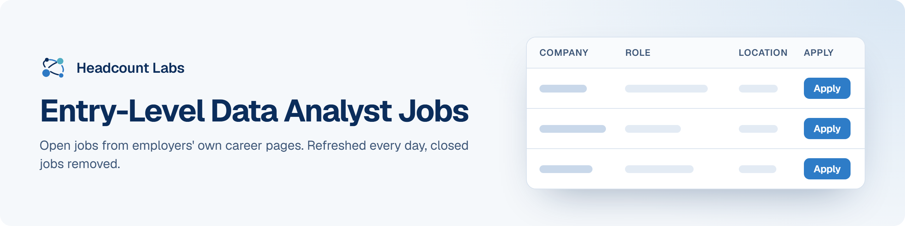

# Entry-Level Data Analyst Jobs

Junior, associate and entry-level data and business analyst jobs in the US.

**382 open jobs** · 96 new since the last update · 114 removed because they closed or left the employer's board · updated November 6, 2026 at 4:38 AM EST

This list is built and refreshed every day by [Headcount Labs](https://headcountlabs.com/?utm_source=github&utm_medium=job-list&utm_campaign=entry-level-data-analyst-jobs), which reads jobs straight from employers' own career pages and job boards. Every job here was still listed on its source board when we last read that board, within the past 3 days, and was posted in the past 30 days. Copies of the same job are merged into one row, and jobs that close are removed at the next update.

Want this data in your own app or agent? Use the [Headcount Labs jobs API](https://headcountlabs.com/docs/?utm_source=github&utm_medium=job-list&utm_campaign=entry-level-data-analyst-jobs) (free tier), the [MCP server](https://headcountlabs.com/mcp/?utm_source=github&utm_medium=job-list&utm_campaign=entry-level-data-analyst-jobs) for Claude, ChatGPT and other AI assistants, or the [public dataset subsets](https://huggingface.co/HeadcountLabs) on Hugging Face (the full dataset is coming soon).

**Jump to:** [Posted in the last 7 days (145)](#posted-in-the-last-7-days) · [Posted 8 to 30 days ago (237)](#posted-8-to-30-days-ago)

**Columns.** *Apply* opens the original posting on the employer's site. *Details* opens the job on Headcount Labs, with every posting we found for it. *Remote* shows what the employer states; a dash means the posting doesn't say. *Pay* is the range the employer published.

## Posted in the last 7 days

| Company | Role | Location | Remote | Pay | Posted | Apply | Details |
| --- | --- | --- | --- | --- | --- | :---: | :---: |
| **Valeris, Inc.** | Junior Product Analyst | 

2 locations
Morrisville, NC Louisville, KY
 | Remote | — | Nov 5 |  | <a href="https://headcountlabs.com/catalog/jobs/6b85eac2-20d8-4920-8e5d-ef5e92e2732f?utm_source=github&utm_medium=job-list&utm_campaign=entry-level-data-analyst-jobs">via Headcount Labs</a> |
| **State of Florida** | 68065058 - GOVERNMENT ANALYST I | TALLAHASSEE, FL | — | $2k–$2k/yr | Nov 5 |  | <a href="https://headcountlabs.com/catalog/jobs/28e741a1-dd49-4e74-a34a-ca7ff529664e?utm_source=github&utm_medium=job-list&utm_campaign=entry-level-data-analyst-jobs">via Headcount Labs</a> |
| **SSB002 SOUTHSTATE BANK, NATIONAL ASSOCIATION** | TM Sales Analyst I | United States | — | — | Nov 5 |  | <a href="https://headcountlabs.com/catalog/jobs/27567858-f06d-454e-8b0f-5f8860b2b178?utm_source=github&utm_medium=job-list&utm_campaign=entry-level-data-analyst-jobs">via Headcount Labs</a> |
| **Saco &amp; Biddeford Savings Institution** | Credit Analyst I | Saco, ME | — | — | Nov 5 |  | <a href="https://headcountlabs.com/catalog/jobs/a687323b-ce27-400a-b44f-0875220e73c8?utm_source=github&utm_medium=job-list&utm_campaign=entry-level-data-analyst-jobs">via Headcount Labs</a> |
| **LIGHTFEATHER IO LLC** | Junior Business Analyst | Arlington, VA | On-site | $50k–$60k/yr | Nov 5 |  | <a href="https://headcountlabs.com/catalog/jobs/d1caf0aa-697a-4fc5-a7d8-88a869c42095?utm_source=github&utm_medium=job-list&utm_campaign=entry-level-data-analyst-jobs">via Headcount Labs</a> |
| **Kimley-Horn** | Entry Level Land Development Engineering Analyst | Lakeland, FL | — | — | Nov 5 |  | <a href="https://headcountlabs.com/catalog/jobs/5920797a-5aa6-4fd5-9d72-74a04022c82c?utm_source=github&utm_medium=job-list&utm_campaign=entry-level-data-analyst-jobs">via Headcount Labs</a> |
| **Holland America** | Revenue Management Analyst I | Seattle, WA | Hybrid | $70k/yr | Nov 5 |  | <a href="https://headcountlabs.com/catalog/jobs/4ce0fd8f-2350-416b-b94f-8a7fe3916a47?utm_source=github&utm_medium=job-list&utm_campaign=entry-level-data-analyst-jobs">via Headcount Labs</a> |
| **General Atomics and Affiliated Companies** | Business Process Analyst I | Poway, CA | — | — | Nov 5 |  | <a href="https://headcountlabs.com/catalog/jobs/2a93012d-1d51-4a52-8741-eb73f374dd72?utm_source=github&utm_medium=job-list&utm_campaign=entry-level-data-analyst-jobs">via Headcount Labs</a> |
| **General Atomics and Affiliated Companies** | Project Control Analyst I | San Diego, CA | — | — | Nov 5 |  | <a href="https://headcountlabs.com/catalog/jobs/981a5117-7c25-49da-a7cc-5874ba20ade7?utm_source=github&utm_medium=job-list&utm_campaign=entry-level-data-analyst-jobs">via Headcount Labs</a> |
| **General Atomics** | Project Control Analyst I | San Diego, CA | On-site | — | Nov 5 |  | <a href="https://headcountlabs.com/catalog/jobs/39c0005e-1588-4ce0-89b0-5739f9fb8216?utm_source=github&utm_medium=job-list&utm_campaign=entry-level-data-analyst-jobs">via Headcount Labs</a> |
| **FlexSteel** | FlexSteel - Manufacturing Analyst I | Baytown, TX | On-site | — | Nov 5 |  | <a href="https://headcountlabs.com/catalog/jobs/b1baf5d3-5912-4c83-9ddb-6db85425f084?utm_source=github&utm_medium=job-list&utm_campaign=entry-level-data-analyst-jobs">via Headcount Labs</a> |
| **ECU Health Medical Center** | End User Support Analyst I | Kenansville, NC | On-site | $25.92–$37.78/hr | Nov 5 |  | <a href="https://headcountlabs.com/catalog/jobs/d5a6289b-1e85-423d-a5e6-70ea7ef81f71?utm_source=github&utm_medium=job-list&utm_campaign=entry-level-data-analyst-jobs">via Headcount Labs</a> |
| **CARNIVAL CRUISE LINE** | Revenue Management Analyst I | Seattle, WA | Hybrid | — | Nov 5 |  | <a href="https://headcountlabs.com/catalog/jobs/d2145977-429d-4255-9b5d-944d6a1b7020?utm_source=github&utm_medium=job-list&utm_campaign=entry-level-data-analyst-jobs">via Headcount Labs</a> |
| **Boeing** | Entry-level Production Control Analyst | Wichita, KS | — | — | Nov 5 |  | <a href="https://headcountlabs.com/catalog/jobs/acde1921-845c-4a25-820f-f6dcef4c56b2?utm_source=github&utm_medium=job-list&utm_campaign=entry-level-data-analyst-jobs">via Headcount Labs</a> |
| **Amentum** | Junior All Source Analyst | Tampa, FL | On-site | — | Nov 5 |  | <a href="https://headcountlabs.com/catalog/jobs/56e69dcf-730d-4164-845c-2613cf4c07d0?utm_source=github&utm_medium=job-list&utm_campaign=entry-level-data-analyst-jobs">via Headcount Labs</a> |
| **XCORP AvalonBay Communities Inc.** | Benefits Analyst I | United States | — | $59k–$89k/yr | Nov 4 |  | <a href="https://headcountlabs.com/catalog/jobs/0cb7a214-0cc0-4ab3-a777-2f8ecc10df3f?utm_source=github&utm_medium=job-list&utm_campaign=entry-level-data-analyst-jobs">via Headcount Labs</a> |
| **Vivmark Residential** | Benefits Analyst I | Arlington, VA | — | $59k–$89k/yr | Nov 4 |  | <a href="https://headcountlabs.com/catalog/jobs/4f727dd6-a5d0-4d4d-bf86-137a234d12ea?utm_source=github&utm_medium=job-list&utm_campaign=entry-level-data-analyst-jobs">via Headcount Labs</a> |
| **URM Stores Inc.** | Programmer Analyst I – Store Systems | Spokane, WA | On-site | $43–$48/hr | Nov 4 |  | <a href="https://headcountlabs.com/catalog/jobs/ec68e3ae-b29b-4a19-a010-b8627e9b0530?utm_source=github&utm_medium=job-list&utm_campaign=entry-level-data-analyst-jobs">via Headcount Labs</a> |
| **Town and Country Credit Union** | Consumer Underwriter &amp; Junior Analyst - Minot | Minot, ND | — | — | Nov 4 |  | <a href="https://headcountlabs.com/catalog/jobs/d3f08aba-7eda-4709-bf79-adfa73f63d4b?utm_source=github&utm_medium=job-list&utm_campaign=entry-level-data-analyst-jobs">via Headcount Labs</a> |
| **Town and Country Credit Union** | Consumer Underwriter &amp; Junior Analyst - Fargo | Fargo, ND | — | — | Nov 4 |  | <a href="https://headcountlabs.com/catalog/jobs/84835e5c-c0ed-48be-85bd-797a5c51c416?utm_source=github&utm_medium=job-list&utm_campaign=entry-level-data-analyst-jobs">via Headcount Labs</a> |
| **Temple University** | Grant Analyst I | United States | — | $50k–$53k/yr | Nov 4 |  | <a href="https://headcountlabs.com/catalog/jobs/c38a6cd7-4949-4932-847b-8507a32bf4cd?utm_source=github&utm_medium=job-list&utm_campaign=entry-level-data-analyst-jobs">via Headcount Labs</a> |
| **TD Bank, N.A.** | Business Mgmt Analyst I (US) | 

5 locations
Mount Laurel, NJ Charlotte, NC Greenville, SC Jacksonville, FL Portland, ME
 | Remote | $24–$36/hr | Nov 4 |  | <a href="https://headcountlabs.com/catalog/jobs/f0abb3f7-3c05-4c7a-9fb4-666b194d3c23?utm_source=github&utm_medium=job-list&utm_campaign=entry-level-data-analyst-jobs">via Headcount Labs</a> |
| **Summit Federal Services, LLC** | Entry Level Invoice Analyst (Temporary Contract) | Reston, VA | On-site | $25–$36/hr | Nov 4 |  | <a href="https://headcountlabs.com/catalog/jobs/eb64f0c9-3295-49fa-b5d2-b389112609fa?utm_source=github&utm_medium=job-list&utm_campaign=entry-level-data-analyst-jobs">via Headcount Labs</a> |
| **State of Illinois** | Web Developer / Information Systems Analyst I, Option W | Springfield, IL | — | $7k/mo | Nov 4 |  | <a href="https://headcountlabs.com/catalog/jobs/41c686b9-18ae-4a72-ab9f-7dc934a6ee6c?utm_source=github&utm_medium=job-list&utm_campaign=entry-level-data-analyst-jobs">via Headcount Labs</a> |
| **State of Florida** | OPERATIONS ANALYST I - 64043918 | TALLAHASSEE, FL | On-site | $35k–$40k/yr | Nov 4 |  | <a href="https://headcountlabs.com/catalog/jobs/d372ef69-58ae-4dad-aff2-9bf32ac332ef?utm_source=github&utm_medium=job-list&utm_campaign=entry-level-data-analyst-jobs">via Headcount Labs</a> |
| **Snap Inc.** | Ad Product Quality Analyst I | Los Angeles, CA | — | $35.09–$52.40/hr | Nov 4 |  | <a href="https://headcountlabs.com/catalog/jobs/cd9a3303-4d08-4cb9-8ce7-ec56ac8c9685?utm_source=github&utm_medium=job-list&utm_campaign=entry-level-data-analyst-jobs">via Headcount Labs</a> |
| **Setpoint Medical Corporation** | Operations Analyst I | Valencia, CA | — | $30–$38/hr | Nov 4 |  | <a href="https://headcountlabs.com/catalog/jobs/7c0c5a16-1f5d-4208-bdfc-59548f8a498b?utm_source=github&utm_medium=job-list&utm_campaign=entry-level-data-analyst-jobs">via Headcount Labs</a> |
| **SB Simmons Bank** | Card Fraud Analyst I | Little Rock, AR | — | — | Nov 4 |  | <a href="https://headcountlabs.com/catalog/jobs/2a200594-c733-47de-afd3-f3bb6eab6668?utm_source=github&utm_medium=job-list&utm_campaign=entry-level-data-analyst-jobs">via Headcount Labs</a> |
| **Sarasota Memorial Health Care System** | Charge Analyst I | Sarasota, FL | — | — | Nov 4 |  | <a href="https://headcountlabs.com/catalog/jobs/889b372e-8d10-4234-949a-4c4d0da20bcc?utm_source=github&utm_medium=job-list&utm_campaign=entry-level-data-analyst-jobs">via Headcount Labs</a> |
| **Ruchman** | Junior Program Analyst | Clarksburg, WV | — | — | Nov 4 |  | <a href="https://headcountlabs.com/catalog/jobs/90bba6f8-c64c-4899-82e5-68ea0e97a770?utm_source=github&utm_medium=job-list&utm_campaign=entry-level-data-analyst-jobs">via Headcount Labs</a> |
| **PUMA North America, Inc.** | Analyst I IT Service Desk | United States | — | $52k–$69k/yr | Nov 4 |  | <a href="https://headcountlabs.com/catalog/jobs/db4b4926-544b-487a-bfa1-7d7e79d8822e?utm_source=github&utm_medium=job-list&utm_campaign=entry-level-data-analyst-jobs">via Headcount Labs</a> |
| **Palmetto GBA** | Business Analyst I | Columbia, SC | On-site | — | Nov 4 |  | <a href="https://headcountlabs.com/catalog/jobs/490154fd-2a98-4fd3-a34a-950ee581b278?utm_source=github&utm_medium=job-list&utm_campaign=entry-level-data-analyst-jobs">via Headcount Labs</a> |
| **Osaic, Inc.** | Risk Analyst I | 

5 locations
Scottsdale, AZ Atlanta, GA La Vista Oakdale, MN Saint Petersburg
 | — | $50k–$59k/yr | Nov 4 |  | <a href="https://headcountlabs.com/catalog/jobs/0c889645-7d2c-461c-a24a-f1874301c98f?utm_source=github&utm_medium=job-list&utm_campaign=entry-level-data-analyst-jobs">via Headcount Labs</a> |
| **Mount Sinai Kravis Children's Hospital** | Financial Analyst I - Windreich Department for AI &amp; Human Health Research | 

2 locations
United States New York, NY
 | On-site | — | Nov 4 |  | <a href="https://headcountlabs.com/catalog/jobs/5fff4aa9-1567-4c73-9bbe-d92d9585242b?utm_source=github&utm_medium=job-list&utm_campaign=entry-level-data-analyst-jobs">via Headcount Labs</a> |
| **Mount Sinai Health Systems** | Financial Analyst I - Windreich Department for AI &amp; Human Health Research | New York, NY | — | $66k–$82k/yr | Nov 4 |  | <a href="https://headcountlabs.com/catalog/jobs/39f1bebb-5fa1-4ec5-980d-afa4b1a0d947?utm_source=github&utm_medium=job-list&utm_campaign=entry-level-data-analyst-jobs">via Headcount Labs</a> |
| **MasTec Inc** | Fleet Analyst I | Blue Bell, PA | — | — | Nov 4 |  | <a href="https://headcountlabs.com/catalog/jobs/6f809d12-b8a2-4bda-b961-b80780e4c170?utm_source=github&utm_medium=job-list&utm_campaign=entry-level-data-analyst-jobs">via Headcount Labs</a> |
| **LHC New Liberty Hospital Corporation** | Periop &amp; Procedural Business Informatics Analyst I | Lenexa, KS | — | — | Nov 4 |  | <a href="https://headcountlabs.com/catalog/jobs/709489b5-04ec-4118-8283-f90ff2d5b770?utm_source=github&utm_medium=job-list&utm_campaign=entry-level-data-analyst-jobs">via Headcount Labs</a> |
| **Lear Corporation** | Plant Finance Controller Analyst I | Wentzville, MO | — | — | Nov 4 |  | <a href="https://headcountlabs.com/catalog/jobs/0c967f58-0be8-40d5-b602-48e3dc004ea4?utm_source=github&utm_medium=job-list&utm_campaign=entry-level-data-analyst-jobs">via Headcount Labs</a> |
| **LE001 Dana-Farber Cancer Institute, Inc.** | Application Analyst I – Collaboration &amp; Productivity Tools Team | United States | — | $74k–$82k/yr | Nov 4 |  | <a href="https://headcountlabs.com/catalog/jobs/66145f4e-3fe3-407c-839d-023d4cee57bd?utm_source=github&utm_medium=job-list&utm_campaign=entry-level-data-analyst-jobs">via Headcount Labs</a> |
| **KAIROS Inc** | Management Analyst, Junior | St. Inigoes, MD | On-site | $50k–$58k/yr | Nov 4 |  | <a href="https://headcountlabs.com/catalog/jobs/9ddca42e-69e3-4d56-8105-bd8573d70be9?utm_source=github&utm_medium=job-list&utm_campaign=entry-level-data-analyst-jobs">via Headcount Labs</a> |
| **Integrity Technology** | Target Analyst Reporter Junior Level | Ft. Meade, MD | — | $90k–$110k/yr | Nov 4 |  | <a href="https://headcountlabs.com/catalog/jobs/f33c8832-a8a0-4dff-a30f-6c4173cfad2e?utm_source=github&utm_medium=job-list&utm_campaign=entry-level-data-analyst-jobs">via Headcount Labs</a> |
| **Health First Careers** | Epic Beacon Application Analyst I | Florida | — | — | Nov 4 |  | <a href="https://headcountlabs.com/catalog/jobs/30b543fa-abb1-4a94-83db-e71ac1b0f833?utm_source=github&utm_medium=job-list&utm_campaign=entry-level-data-analyst-jobs">via Headcount Labs</a> |
| **Glacier Bancorp, Inc.** | Credit Analyst I | Lewistown, MT | — | — | Nov 4 |  | <a href="https://headcountlabs.com/catalog/jobs/ad99502c-e112-4ea9-af85-d58fbd539623?utm_source=github&utm_medium=job-list&utm_campaign=entry-level-data-analyst-jobs">via Headcount Labs</a> |
| **Flagstar Bank** | Credit Products Analyst I | 

2 locations
New York, NY Charlotte, NC
 | On-site | $47k–$79k/yr | Nov 4 |  | <a href="https://headcountlabs.com/catalog/jobs/9a9f7930-2d30-4c22-ac32-77f04b2d7da7?utm_source=github&utm_medium=job-list&utm_campaign=entry-level-data-analyst-jobs">via Headcount Labs</a> |
| **Eurofins** | Analyst I - Environment Testing - M-F, 1st Shift -Kittanning, PA | Kittanning, PA | — | $19–$20/hr | Nov 4 |  | <a href="https://headcountlabs.com/catalog/jobs/46342ddb-f681-48b4-a43a-229e7aec5264?utm_source=github&utm_medium=job-list&utm_campaign=entry-level-data-analyst-jobs">via Headcount Labs</a> |
| **Eurofins** | Analyst I - Environment Testing -Wed-Sun, 1st Shift -Kittanning, PA | Kittanning, PA | — | $19–$20/hr | Nov 4 |  | <a href="https://headcountlabs.com/catalog/jobs/3dfa90c3-97fb-43a9-944e-ee0c86bce45d?utm_source=github&utm_medium=job-list&utm_campaign=entry-level-data-analyst-jobs">via Headcount Labs</a> |
| **Eurofins** | Analyst I - Microbiology - M-F, 1st Shift -Kittanning, PA | Kittanning, PA | — | $19–$20/hr | Nov 4 |  | <a href="https://headcountlabs.com/catalog/jobs/0a5587b2-6e71-4a0d-b9f4-a6aea1985f7a?utm_source=github&utm_medium=job-list&utm_campaign=entry-level-data-analyst-jobs">via Headcount Labs</a> |
| **ENGINEERING SERVICES NETWORK, Inc.** | Junior Data Analyst | Portsmouth, VA | On-site | $40k–$43k/yr | Nov 4 |  | <a href="https://headcountlabs.com/catalog/jobs/7accc695-3880-417e-80bc-a64bdee08227?utm_source=github&utm_medium=job-list&utm_campaign=entry-level-data-analyst-jobs">via Headcount Labs</a> |
| **Cardinal Technology Systems, Corp.** | Junior Talent Acquisition &amp; HR Analyst | Cullen, VA | Remote | — | Nov 4 |  | <a href="https://headcountlabs.com/catalog/jobs/605ab0a3-11c3-4248-908a-a276cdc0eeb7?utm_source=github&utm_medium=job-list&utm_campaign=entry-level-data-analyst-jobs">via Headcount Labs</a> |
| **Booz Allen Hamilton_United States** | Program Controls Organization Financial Analyst, Junior | McLean, VA | — | $44k–$90k/yr | Nov 4 |  | <a href="https://headcountlabs.com/catalog/jobs/cd50e134-b465-4a70-a849-02f2b9c82908?utm_source=github&utm_medium=job-list&utm_campaign=entry-level-data-analyst-jobs">via Headcount Labs</a> |
| **Baxter** | Quality Lab Analyst I | Marion, NC | — | $68k–$94k/yr | Nov 4 |  | <a href="https://headcountlabs.com/catalog/jobs/0d861a5e-4ec7-439f-93e5-27148952ed5a?utm_source=github&utm_medium=job-list&utm_campaign=entry-level-data-analyst-jobs">via Headcount Labs</a> |
| **Alexandria Insights** | Logistics Analyst-Junior Level | Stafford, VA | Remote | $55k–$75k/yr | Nov 4 |  | <a href="https://headcountlabs.com/catalog/jobs/9319c4e4-0c0b-4ed9-9a25-1aa13896e84a?utm_source=github&utm_medium=job-list&utm_campaign=entry-level-data-analyst-jobs">via Headcount Labs</a> |
| **Wausau Financial Systems Inc** | Technical Product Analyst I | Minnesota | Remote | $17.50–$19/hr | Nov 3 |  | <a href="https://headcountlabs.com/catalog/jobs/9d410bfe-d901-470b-b8b7-8197c06cfd7f?utm_source=github&utm_medium=job-list&utm_campaign=entry-level-data-analyst-jobs">via Headcount Labs</a> |
| **ThinkTek** | Junior Business Analyst, Data Visualization | Quantico, VA | — | $70k/yr | Nov 3 |  | <a href="https://headcountlabs.com/catalog/jobs/ec19a0d3-f9ba-4a85-ba22-ca5ae5d07e38?utm_source=github&utm_medium=job-list&utm_campaign=entry-level-data-analyst-jobs">via Headcount Labs</a> |
| **The Elevance Health Companies, Inc.** | Help Desk Analyst I (External Support) | United States | — | — | Nov 3 |  | <a href="https://headcountlabs.com/catalog/jobs/6dfcdc29-842a-4585-afef-c636d78cc0eb?utm_source=github&utm_medium=job-list&utm_campaign=entry-level-data-analyst-jobs">via Headcount Labs</a> |
| **State of Florida** | OPS Government Analyst I | TALLAHASSEE, FL | — | $20/hr | Nov 3 |  | <a href="https://headcountlabs.com/catalog/jobs/064ea38c-a0c9-4126-a374-b9985e5c4826?utm_source=github&utm_medium=job-list&utm_campaign=entry-level-data-analyst-jobs">via Headcount Labs</a> |
| **Shelby County** | Programmer Analyst I (Planning &amp; Development) | Memphis, TN | On-site | $49k–$67k/yr | Nov 3 |  | <a href="https://headcountlabs.com/catalog/jobs/d60356d1-3768-47d6-b8fa-675c02d69312?utm_source=github&utm_medium=job-list&utm_campaign=entry-level-data-analyst-jobs">via Headcount Labs</a> |
| **Palmetto GBA** | Operations Analyst I | Columbia, SC | On-site | — | Nov 3 |  | <a href="https://headcountlabs.com/catalog/jobs/efe525b6-e2e6-4198-b02d-b952e06f61ca?utm_source=github&utm_medium=job-list&utm_campaign=entry-level-data-analyst-jobs">via Headcount Labs</a> |
| **New York Botanical Garden** | Applications Analyst I | Bronx, NY | — | $69k–$75k/yr | Nov 3 |  | <a href="https://headcountlabs.com/catalog/jobs/cfe3e716-d679-400c-b5b3-24fb7771933d?utm_source=github&utm_medium=job-list&utm_campaign=entry-level-data-analyst-jobs">via Headcount Labs</a> |
| **Live Nation Worldwide, Inc.** | LN Venues, Financial Analyst I | United States | Remote | $56k–$70k/yr | Nov 3 |  | <a href="https://headcountlabs.com/catalog/jobs/ff8948ee-3a0f-4025-acb1-eb01be7cc5df?utm_source=github&utm_medium=job-list&utm_campaign=entry-level-data-analyst-jobs">via Headcount Labs</a> |
| **Lithia** | Business Analyst I | Tigard, OR | Hybrid | $60k–$70k/yr | Nov 3 |  | <a href="https://headcountlabs.com/catalog/jobs/6ced5f3a-8821-48ae-b9d9-5f09f6744560?utm_source=github&utm_medium=job-list&utm_campaign=entry-level-data-analyst-jobs">via Headcount Labs</a> |
| **LAM Lennar Associates Mgmt LLC** | Technical Analyst I, Legal &amp; Compliance Technology | 

3 locations
Miami, FL Irvine, CA Irving, TX
 | Remote | $73k–$98k/yr | Nov 3 |  | <a href="https://headcountlabs.com/catalog/jobs/84d42b32-5bfd-4074-9dcc-ad7d08c5bcd3?utm_source=github&utm_medium=job-list&utm_campaign=entry-level-data-analyst-jobs">via Headcount Labs</a> |
| **Katmai** | Systems Monitoring Analyst I | United States | Remote | — | Nov 3 |  | <a href="https://headcountlabs.com/catalog/jobs/907fa8af-2ccc-4409-83b4-c2ea7647d345?utm_source=github&utm_medium=job-list&utm_campaign=entry-level-data-analyst-jobs">via Headcount Labs</a> |
| **ICR United States USA** | Part-Time Lab Analyst I - Salt Lake City, UT - Onsite | Salt Lake City | On-site | — | Nov 3 |  | <a href="https://headcountlabs.com/catalog/jobs/09c14052-5f30-41eb-b0c6-c56e607f7654?utm_source=github&utm_medium=job-list&utm_campaign=entry-level-data-analyst-jobs">via Headcount Labs</a> |
| **Hyundai Autoever America** | 10629 - Business Process Analyst I | Irvine, CA | On-site | $73k–$104k/yr | Nov 3 |  | <a href="https://headcountlabs.com/catalog/jobs/96fa474d-97a1-4696-8095-d983c0939572?utm_source=github&utm_medium=job-list&utm_campaign=entry-level-data-analyst-jobs">via Headcount Labs</a> |
| **HNTB Corporation** | GIS Analyst I | 

2 locations
New Orleans, LA Baton Rouge, LA
 | — | — | Nov 3 |  | <a href="https://headcountlabs.com/catalog/jobs/fddecca2-cafa-481b-91f2-bf1c5785bd34?utm_source=github&utm_medium=job-list&utm_campaign=entry-level-data-analyst-jobs">via Headcount Labs</a> |
| **Helmerich &amp; Payne Management LLC** | Cybersecurity Analyst I | Tulsa-OK-USA | On-site | — | Nov 3 |  | <a href="https://headcountlabs.com/catalog/jobs/c760468d-2f7d-42cf-a048-ad4f2314d630?utm_source=github&utm_medium=job-list&utm_campaign=entry-level-data-analyst-jobs">via Headcount Labs</a> |
| **General Atomics** | Inventory Analyst I | Poway, CA | On-site | — | Nov 3 |  | <a href="https://headcountlabs.com/catalog/jobs/9a1fb6d9-b813-4585-a87c-4cfeb00dd3a7?utm_source=github&utm_medium=job-list&utm_campaign=entry-level-data-analyst-jobs">via Headcount Labs</a> |
| **Fujifilm** | Junior Sales Enablement Analyst | Santa Ana, CA | — | $56k–$73k/yr | Nov 3 |  | <a href="https://headcountlabs.com/catalog/jobs/cad000ad-228c-45d3-8a1b-9278dec6e9a3?utm_source=github&utm_medium=job-list&utm_campaign=entry-level-data-analyst-jobs">via Headcount Labs</a> |
| **FSG - Cybertek Corp.** | Analyst I Business Process Transactions | Charleston, SC | On-site | — | Nov 3 |  | <a href="https://headcountlabs.com/catalog/jobs/4f520599-e18f-4cfc-a166-bbea619f1266?utm_source=github&utm_medium=job-list&utm_campaign=entry-level-data-analyst-jobs">via Headcount Labs</a> |
| **Fiserv** | Product Analyst I | Omaha, NE | On-site | — | Nov 3 |  | <a href="https://headcountlabs.com/catalog/jobs/7e231d46-8957-4951-9314-030dbb23415c?utm_source=github&utm_medium=job-list&utm_campaign=entry-level-data-analyst-jobs">via Headcount Labs</a> |
| **Department of Rehabilitation** | Analyst I | California | On-site | $4k–$6k/mo | Nov 3 |  | <a href="https://headcountlabs.com/catalog/jobs/0920f95d-a929-4ec1-be56-e2a7299c6468?utm_source=github&utm_medium=job-list&utm_campaign=entry-level-data-analyst-jobs">via Headcount Labs</a> |
| **DEPARTMENT OF INDUSTRIAL RELATIONS** | Analyst I | California | Hybrid | $4k–$6k/mo | Nov 3 |  | <a href="https://headcountlabs.com/catalog/jobs/55ec5b08-92ae-4801-a565-3e78562235ba?utm_source=github&utm_medium=job-list&utm_campaign=entry-level-data-analyst-jobs">via Headcount Labs</a> |
| **Department of Corrections &amp; Rehabilitation** | Analyst I | California | On-site | $4k–$6k/mo | Nov 3 |  | <a href="https://headcountlabs.com/catalog/jobs/8428f040-f347-4432-a7f2-d824679a235c?utm_source=github&utm_medium=job-list&utm_campaign=entry-level-data-analyst-jobs">via Headcount Labs</a> |
| **County of Riverside** | Administrative Services Analyst I/ll-TTC | Riverside, CA | — | $75k–$99k/yr | Nov 3 |  | <a href="https://headcountlabs.com/catalog/jobs/d95b8dc3-6bd7-4a57-af1a-39d004650ff3?utm_source=github&utm_medium=job-list&utm_campaign=entry-level-data-analyst-jobs">via Headcount Labs</a> |
| **County of Riverside** | IT Business Systems Analyst I | Riverside, CA | — | $76k–$103k/yr | Nov 3 |  | <a href="https://headcountlabs.com/catalog/jobs/6a7466b0-fdbe-4db8-b0ab-d53e3537acf8?utm_source=github&utm_medium=job-list&utm_campaign=entry-level-data-analyst-jobs">via Headcount Labs</a> |
| **CO2000 H. Lee Moffitt Cancer Center and Research Institute, Inc.** | IT SERVICE DESK ANALYST I | United States | — | $21.65–$33.05/hr | Nov 3 |  | <a href="https://headcountlabs.com/catalog/jobs/a59b7c1b-758b-45be-bcf6-47b040e9f985?utm_source=github&utm_medium=job-list&utm_campaign=entry-level-data-analyst-jobs">via Headcount Labs</a> |
| **CITY OF COCOA BEACH** | Financial Analyst I (56199) | Cocoa Beach, FL | — | $56k/yr | Nov 3 |  | <a href="https://headcountlabs.com/catalog/jobs/62766b31-65a1-4c9d-92a9-8b69bb5ad98e?utm_source=github&utm_medium=job-list&utm_campaign=entry-level-data-analyst-jobs">via Headcount Labs</a> |
| **City of Anaheim** | Business Information Systems Analyst I - Public Utilities | Anaheim, CA | — | $86k–$129k/yr | Nov 3 |  | <a href="https://headcountlabs.com/catalog/jobs/4914c54d-ba7d-4811-8be3-6f638a2d8315?utm_source=github&utm_medium=job-list&utm_campaign=entry-level-data-analyst-jobs">via Headcount Labs</a> |
| **CGI Technologies and Solutions, Inc.** | Junior Momentum Accounts Receivable &amp; Revenue Analyst | 

3 locations
Fairfax, VA Lafayette, LA Knoxville, TN
 | — | — | Nov 3 |  | <a href="https://headcountlabs.com/catalog/jobs/c53867cd-ccc2-4d12-9d0b-6822332f82d7?utm_source=github&utm_medium=job-list&utm_campaign=entry-level-data-analyst-jobs">via Headcount Labs</a> |
| **CGI Technologies and Solutions, Inc.** | Management Analyst I - FBI/A | Quantico, VA | — | $25.72/hr | Nov 3 |  | <a href="https://headcountlabs.com/catalog/jobs/bdae3713-5f48-474a-828a-ff8f5d7ba1d9?utm_source=github&utm_medium=job-list&utm_campaign=entry-level-data-analyst-jobs">via Headcount Labs</a> |
| **CGI Technologies and Solutions, Inc.** | Business Analyst - Functional (Junior) | 

2 locations
Lafayette, LA Fairfax, VA
 | — | — | Nov 3 |  | <a href="https://headcountlabs.com/catalog/jobs/e658e20d-d809-4ed1-9fcc-a702a515518b?utm_source=github&utm_medium=job-list&utm_campaign=entry-level-data-analyst-jobs">via Headcount Labs</a> |
| **Booking.com** | Data Analyst I - Grand Rapids, MI | Grand Rapids, MI | — | $105k–$116k/yr | Nov 3 |  | <a href="https://headcountlabs.com/catalog/jobs/3657f955-6e2e-42e1-9a1e-6cc3802f2b01?utm_source=github&utm_medium=job-list&utm_campaign=entry-level-data-analyst-jobs">via Headcount Labs</a> |
| **bioMérieux** | QC Analyst I (EM) | Durham, NC | — | $23–$32.20/hr | Nov 3 |  | <a href="https://headcountlabs.com/catalog/jobs/30829239-afde-48a2-80c5-c1f1b77ced9d?utm_source=github&utm_medium=job-list&utm_campaign=entry-level-data-analyst-jobs">via Headcount Labs</a> |
| **Astreya Partners, LLC** | Incident Response Analyst I | Austin, TX | — | $60k–$94k/yr | Nov 3 |  | <a href="https://headcountlabs.com/catalog/jobs/0db9218b-7fe4-42c2-b763-1e5f4be6e705?utm_source=github&utm_medium=job-list&utm_campaign=entry-level-data-analyst-jobs">via Headcount Labs</a> |
| **ASRC Federal Holding Company** | Junior Process Improvement Analyst/ISO Auditor | Elizabeth City, NC | On-site | — | Nov 3 |  | <a href="https://headcountlabs.com/catalog/jobs/6d7dec97-87ba-4176-93e6-69aa342c2df0?utm_source=github&utm_medium=job-list&utm_campaign=entry-level-data-analyst-jobs">via Headcount Labs</a> |
| **Aspirion** | Entry Level Medical Claims Analyst - Billing (On-site) | Las Vegas, NV | On-site | $17.45–$25.60/hr | Nov 3 |  | <a href="https://headcountlabs.com/catalog/jobs/41c04575-3a64-4414-82b3-76343cb7e517?utm_source=github&utm_medium=job-list&utm_campaign=entry-level-data-analyst-jobs">via Headcount Labs</a> |
| **Arbor Realty Trust** | Analyst I, Insurance Compliance | Buffalo, NY | Hybrid | $60k–$65k/yr | Nov 3 |  | <a href="https://headcountlabs.com/catalog/jobs/109049e5-48cd-4267-bbd6-4551f7817ab1?utm_source=github&utm_medium=job-list&utm_campaign=entry-level-data-analyst-jobs">via Headcount Labs</a> |
| **Amerihealth Caritas** | UAT Testing Analyst I | United States | — | — | Nov 3 |  | <a href="https://headcountlabs.com/catalog/jobs/dae691fe-949b-4a49-84c5-a056a5b4669d?utm_source=github&utm_medium=job-list&utm_campaign=entry-level-data-analyst-jobs">via Headcount Labs</a> |
| **AECOM** | Junior Engineering - Operations &amp; Maintenance Analyst (Transit/Rail Projects) - 2 Years of Experience Required | Austin, TX | Hybrid | $70k–$120k/yr | Nov 3 |  | <a href="https://headcountlabs.com/catalog/jobs/081dfe9b-ea95-4a57-9e50-dc01e4b5196e?utm_source=github&utm_medium=job-list&utm_campaign=entry-level-data-analyst-jobs">via Headcount Labs</a> |
| **Yale New Haven Health** | Epic System Analyst I | Stratford, CT | — | — | Nov 2 |  | <a href="https://headcountlabs.com/catalog/jobs/07cab5b0-bd36-4fb4-833b-72e9c2c82cf8?utm_source=github&utm_medium=job-list&utm_campaign=entry-level-data-analyst-jobs">via Headcount Labs</a> |
| **Xtreme Solutions Inc** | Business Process Analyst I | Washington, DC | — | — | Nov 2 |  | <a href="https://headcountlabs.com/catalog/jobs/337e47c8-d0d2-4f45-82d3-e1a0faf7c547?utm_source=github&utm_medium=job-list&utm_campaign=entry-level-data-analyst-jobs">via Headcount Labs</a> |
| **Williams-Sonoma** | Financial Analyst I | San Francisco, CA | On-site | $65k–$76k/yr | Nov 2 |  | <a href="https://headcountlabs.com/catalog/jobs/54ed5646-9767-4f2e-845d-13db8cf7c908?utm_source=github&utm_medium=job-list&utm_campaign=entry-level-data-analyst-jobs">via Headcount Labs</a> |
| **WASHINGTON COUNTY MENTAL HEALTH SERVICES INC** | Data Analyst I | Barre, VT | — | $72k–$76k/yr | Nov 2 |  | <a href="https://headcountlabs.com/catalog/jobs/62b8c64d-3743-45c0-8b3a-cb72f56a3ea6?utm_source=github&utm_medium=job-list&utm_campaign=entry-level-data-analyst-jobs">via Headcount Labs</a> |
| **UCF Hotel Venture** | Help Desk Analyst I | Orlando, FL | — | — | Nov 2 |  | <a href="https://headcountlabs.com/catalog/jobs/a46ddf1c-ae6a-4835-a763-38f810addca9?utm_source=github&utm_medium=job-list&utm_campaign=entry-level-data-analyst-jobs">via Headcount Labs</a> |
| **The Concourse Group LLC** | Entry Level Project Support Analyst | Columbia, MD | Hybrid | — | Nov 2 |  | <a href="https://headcountlabs.com/catalog/jobs/97798775-faa9-443c-8c37-c90d20c541ad?utm_source=github&utm_medium=job-list&utm_campaign=entry-level-data-analyst-jobs">via Headcount Labs</a> |
| **State of Florida** | OPS GOVERNMENT ANALYST I - 37960032 | TALLAHASSEE, FL | — | $19.40/hr | Nov 2 |  | <a href="https://headcountlabs.com/catalog/jobs/43e8cfa9-81e4-4881-a1eb-14d01c6bb075?utm_source=github&utm_medium=job-list&utm_campaign=entry-level-data-analyst-jobs">via Headcount Labs</a> |
| **State of Florida** | OPS GOVERNMENT ANALYST I - 37960070 | TALLAHASSEE, FL | — | $24.20/hr | Nov 2 |  | <a href="https://headcountlabs.com/catalog/jobs/95c023a9-05e1-4a6a-8ba9-5423af6c66e4?utm_source=github&utm_medium=job-list&utm_campaign=entry-level-data-analyst-jobs">via Headcount Labs</a> |
| **State of California** | Analyst I | California | Hybrid | $4k–$6k/mo | Nov 2 |  | <a href="https://headcountlabs.com/catalog/jobs/7c108741-dddd-4451-8c91-d23b0228a8c0?utm_source=github&utm_medium=job-list&utm_campaign=entry-level-data-analyst-jobs">via Headcount Labs</a> |
| **Sperry Rail, Inc.** | Data Analyst I | Olathe, KS | On-site | — | Nov 2 |  | <a href="https://headcountlabs.com/catalog/jobs/fd82ef66-4db3-44cf-a887-9b7fdcd7e7fe?utm_source=github&utm_medium=job-list&utm_campaign=entry-level-data-analyst-jobs">via Headcount Labs</a> |
| **Snap-on Inc** | Business Intelligence Analyst I | Kenosha, WI | On-site | — | Nov 2 |  | <a href="https://headcountlabs.com/catalog/jobs/5729d3cc-c301-4979-b947-6424ed19767e?utm_source=github&utm_medium=job-list&utm_campaign=entry-level-data-analyst-jobs">via Headcount Labs</a> |
| **Sarasota Memorial Health Care System** | Managed Care Analyst I | Sarasota, FL | — | — | Nov 2 |  | <a href="https://headcountlabs.com/catalog/jobs/314e674a-6d25-4b61-8bf2-04c5ba6edb6c?utm_source=github&utm_medium=job-list&utm_campaign=entry-level-data-analyst-jobs">via Headcount Labs</a> |
| **Phillips 66** | Market Risk Analyst I | Houston, TX | — | $96k–$118k/yr | Nov 2 |  | <a href="https://headcountlabs.com/catalog/jobs/4b331c59-2da8-4230-8dba-05f36b5e89e5?utm_source=github&utm_medium=job-list&utm_campaign=entry-level-data-analyst-jobs">via Headcount Labs</a> |
| **Milliman** | Entry-Level Temporary Analyst – Minneapolis (On-Site) | Eden Prairie, MN | On-site | $26.10–$40.43/hr | Nov 2 |  | <a href="https://headcountlabs.com/catalog/jobs/1aa03d8b-aca6-46d2-8cf6-93c91342543f?utm_source=github&utm_medium=job-list&utm_campaign=entry-level-data-analyst-jobs">via Headcount Labs</a> |
| **Lone Star National Bank** | FID Analyst I | McAllen, TX | — | — | Nov 2 |  | <a href="https://headcountlabs.com/catalog/jobs/2297c5a6-e586-4baa-8bbb-f81382b751f8?utm_source=github&utm_medium=job-list&utm_campaign=entry-level-data-analyst-jobs">via Headcount Labs</a> |
| **Interactive Brokers Group** | Risk Assessment Analyst I | Chicago, IL | Hybrid | — | Nov 2 |  | <a href="https://headcountlabs.com/catalog/jobs/2c68dbad-3628-4886-a947-0d806a763c9e?utm_source=github&utm_medium=job-list&utm_campaign=entry-level-data-analyst-jobs">via Headcount Labs</a> |
| **Institute for Defense Analyses (IDA)** | Research Analyst – Air Warfare - Entry-Level PhD | Alexandria, VA | — | $113k–$277k/yr | Nov 2 |  | <a href="https://headcountlabs.com/catalog/jobs/89fb406a-0822-4bd5-9ed2-5dbe623359ae?utm_source=github&utm_medium=job-list&utm_campaign=entry-level-data-analyst-jobs">via Headcount Labs</a> |
| **Global Payment Holding Company** | Info Sec Engineering Analyst I | COLUMBUS, GA | Hybrid | — | Nov 2 |  | <a href="https://headcountlabs.com/catalog/jobs/c5053866-46e7-4ba7-89f1-16a224ce80f0?utm_source=github&utm_medium=job-list&utm_campaign=entry-level-data-analyst-jobs">via Headcount Labs</a> |
| **General Atomics and Affiliated Companies** | Inventory Analyst I | Poway, CA | — | — | Nov 2 |  | <a href="https://headcountlabs.com/catalog/jobs/a287f488-8316-408c-ac07-6fe0dc3651bb?utm_source=github&utm_medium=job-list&utm_campaign=entry-level-data-analyst-jobs">via Headcount Labs</a> |
| **Fay Servicing** | Special Loans Analyst I | 

2 locations
Tampa, FL Rosemont, IL
 | Hybrid | $18.51–$24/hr | Nov 2 |  | <a href="https://headcountlabs.com/catalog/jobs/83c6d001-aa4e-4a68-b872-5d475b6c17fb?utm_source=github&utm_medium=job-list&utm_campaign=entry-level-data-analyst-jobs">via Headcount Labs</a> |
| **eSentire** | Support Center Analyst I | United States | On-site | $70k–$80k/yr | Nov 2 |  | <a href="https://headcountlabs.com/catalog/jobs/292f134e-2a9a-4480-aa04-1614a32e664d?utm_source=github&utm_medium=job-list&utm_campaign=entry-level-data-analyst-jobs">via Headcount Labs</a> |
| **Eisenhower Medical Center** | Insurance Analyst I | United States | On-site | $19.28–$28.54/hr | Nov 2 |  | <a href="https://headcountlabs.com/catalog/jobs/d627e360-3f9d-457c-8b2b-012b2ca63ffa?utm_source=github&utm_medium=job-list&utm_campaign=entry-level-data-analyst-jobs">via Headcount Labs</a> |
| **EchoStar** | Supply Chain Analyst I (Early Career) | Englewood, CO | — | $75k/yr | Nov 2 |  | <a href="https://headcountlabs.com/catalog/jobs/6e1d04b5-7985-4d21-a596-add0be9e4914?utm_source=github&utm_medium=job-list&utm_campaign=entry-level-data-analyst-jobs">via Headcount Labs</a> |
| **EchoStar** | Financial Analyst I (Early Career) | Englewood, CO | — | $75k/yr | Nov 2 |  | <a href="https://headcountlabs.com/catalog/jobs/578b99ea-459f-46e3-bfb2-f3a3ac965b1d?utm_source=github&utm_medium=job-list&utm_campaign=entry-level-data-analyst-jobs">via Headcount Labs</a> |
| **EchoStar** | Tax Analyst I (Early Career) | Englewood, CO | — | $75k/yr | Nov 2 |  | <a href="https://headcountlabs.com/catalog/jobs/458c0a3d-d7c9-4fb0-9046-68440ba3789f?utm_source=github&utm_medium=job-list&utm_campaign=entry-level-data-analyst-jobs">via Headcount Labs</a> |
| **DYOPATH** | Desktop Support Analyst I | Athens, GA | On-site | $23/hr | Nov 2 |  | <a href="https://headcountlabs.com/catalog/jobs/3899a9dd-bad9-4656-bf67-288c94f30496?utm_source=github&utm_medium=job-list&utm_campaign=entry-level-data-analyst-jobs">via Headcount Labs</a> |
| **CorVel** | Provider Management Analyst I | Fort Worth, TX | Remote | $13.94–$20.27/hr | Nov 2 |  | <a href="https://headcountlabs.com/catalog/jobs/1e4a5f8e-8a8d-499c-be4f-3b88bf27bf8c?utm_source=github&utm_medium=job-list&utm_campaign=entry-level-data-analyst-jobs">via Headcount Labs</a> |
| **Coborn's, Inc.** | Financial Analyst - Entry Level | St. Cloud, MN | — | $55k–$99k/yr | Nov 2 |  | <a href="https://headcountlabs.com/catalog/jobs/9814d1da-abfd-410e-a9e7-ee8039b92d5d?utm_source=github&utm_medium=job-list&utm_campaign=entry-level-data-analyst-jobs">via Headcount Labs</a> |
| **City of San Bernardino** | Management Analyst I (Flex) | San Bernardino, CA | — | $68k–$83k/yr | Nov 2 |  | <a href="https://headcountlabs.com/catalog/jobs/2cbbfacc-c7ef-4c89-b71c-35bdb1540924?utm_source=github&utm_medium=job-list&utm_campaign=entry-level-data-analyst-jobs">via Headcount Labs</a> |
| **City of McAllen, TX** | Office of Management &amp; Budget-Budget Analyst I | McAllen, TX | — | $24.08/hr | Nov 2 |  | <a href="https://headcountlabs.com/catalog/jobs/2ec3eb3a-9920-4216-a639-e64cd55f6767?utm_source=github&utm_medium=job-list&utm_campaign=entry-level-data-analyst-jobs">via Headcount Labs</a> |
| **CERIS** | Provider Management Analyst I | Fort Worth, TX | Remote | $13.94–$20.27/hr | Nov 2 |  | <a href="https://headcountlabs.com/catalog/jobs/fa6cc492-ddcf-42fc-84e5-ae5d121fcbc9?utm_source=github&utm_medium=job-list&utm_campaign=entry-level-data-analyst-jobs">via Headcount Labs</a> |
| **Bend Bioscience** | Financial Analyst I | Gainesville, GA | Remote | — | Nov 2 |  | <a href="https://headcountlabs.com/catalog/jobs/dcf79a88-5da7-47fd-b873-b9f52d269408?utm_source=github&utm_medium=job-list&utm_campaign=entry-level-data-analyst-jobs">via Headcount Labs</a> |
| **Bank OZK** | Operational Risk Analyst I | Little Rock, AR | — | — | Nov 2 |  | <a href="https://headcountlabs.com/catalog/jobs/55725a44-cc63-457f-96d6-0e57462a52ac?utm_source=github&utm_medium=job-list&utm_campaign=entry-level-data-analyst-jobs">via Headcount Labs</a> |
| **Aston Carter** | Junior Master Data Analyst | Tampa, FL | Hybrid | $20–$22/hr | Nov 2 |  | <a href="https://headcountlabs.com/catalog/jobs/9c2080e7-79e9-4d1e-ac6a-57ad89cea09c?utm_source=github&utm_medium=job-list&utm_campaign=entry-level-data-analyst-jobs">via Headcount Labs</a> |
| **Amentum** | Financial Crimes Analyst (Junior) | Vienna, VA | On-site | — | Nov 2 |  | <a href="https://headcountlabs.com/catalog/jobs/047c9ee1-a005-4e06-977d-26ca79e38b0a?utm_source=github&utm_medium=job-list&utm_campaign=entry-level-data-analyst-jobs">via Headcount Labs</a> |
| **AAFES** | Financial Analyst I | AAFES Headquarters, TX | — | — | Nov 2 |  | <a href="https://headcountlabs.com/catalog/jobs/a145a267-36b9-4a22-be9b-7a035182dd95?utm_source=github&utm_medium=job-list&utm_campaign=entry-level-data-analyst-jobs">via Headcount Labs</a> |
| **(Do Not Use) Xtreme Solutions Inc** | Business Process Analyst I | Washington, DC | — | — | Nov 2 |  | <a href="https://headcountlabs.com/catalog/jobs/0d633711-783d-42ed-916e-54410372a653?utm_source=github&utm_medium=job-list&utm_campaign=entry-level-data-analyst-jobs">via Headcount Labs</a> |
| **UCHealth** | Summit Analyst I | Aurora, CO | On-site | $40.87/hr | Oct 31 |  | <a href="https://headcountlabs.com/catalog/jobs/f25c3ffe-da33-4293-9d28-75e021ec93c9?utm_source=github&utm_medium=job-list&utm_campaign=entry-level-data-analyst-jobs">via Headcount Labs</a> |
| **Raymond James Financial, Inc.** | 2027 Investment Banking Analyst I Health Care New York, NY | New York, NY | — | — | Oct 31 |  | <a href="https://headcountlabs.com/catalog/jobs/de3907eb-65d0-409e-b0ba-f5d0d9060785?utm_source=github&utm_medium=job-list&utm_campaign=entry-level-data-analyst-jobs">via Headcount Labs</a> |
| **Charles River Laboratories** | Research Analyst I - Lab Sciences | Reno, NV | — | $24/hr | Oct 31 |  | <a href="https://headcountlabs.com/catalog/jobs/34e5e02c-28e1-44cc-81a0-598f957d5435?utm_source=github&utm_medium=job-list&utm_campaign=entry-level-data-analyst-jobs">via Headcount Labs</a> |
| **Charles River Laboratories** | Research Analyst I, Bioanalysis LBA | Mattawan, MI | — | $23.50/hr | Oct 31 |  | <a href="https://headcountlabs.com/catalog/jobs/d2fa7612-5758-4544-a549-dec8f47b764f?utm_source=github&utm_medium=job-list&utm_campaign=entry-level-data-analyst-jobs">via Headcount Labs</a> |
| **US02 Lonza Biologics Inc.** | Quality Control Analyst I – Microbial Control | Portsmouth, NH | On-site | — | Oct 30 |  | <a href="https://headcountlabs.com/catalog/jobs/acff137f-6bab-418b-8c13-151286031774?utm_source=github&utm_medium=job-list&utm_campaign=entry-level-data-analyst-jobs">via Headcount Labs</a> |
| **The Huntington National Bank** | CRE Credit Analyst I | Cleveland Bo Cl | On-site | — | Oct 30 |  | <a href="https://headcountlabs.com/catalog/jobs/ab3a2c86-8094-479a-bc9e-2310e51b1993?utm_source=github&utm_medium=job-list&utm_campaign=entry-level-data-analyst-jobs">via Headcount Labs</a> |
| **StepStone Group** | Junior Analyst - Marketing | 

2 locations
New York, NY La Jolla, CA
 | — | $30/hr | Oct 30 |  | <a href="https://headcountlabs.com/catalog/jobs/e20d4af9-6064-4fc4-89af-fe592c4648dc?utm_source=github&utm_medium=job-list&utm_campaign=entry-level-data-analyst-jobs">via Headcount Labs</a> |
| **Stanford Health Care** | Clinical Applications Analyst I, Enterprise Imaging | 

3 locations
Palo Alto, CA United States PALO ALTO, CA
 | Hybrid | $54.27–$71.91/hr | Oct 30 |  | <a href="https://headcountlabs.com/catalog/jobs/fdd4c874-f305-4307-839f-57b885d732b9?utm_source=github&utm_medium=job-list&utm_campaign=entry-level-data-analyst-jobs">via Headcount Labs</a> |
| **Self Regional** | Client Analyst I | Greenwood, SC | — | — | Oct 30 |  | <a href="https://headcountlabs.com/catalog/jobs/5aa30d06-e535-4e6d-9ffd-f39e89abcbe0?utm_source=github&utm_medium=job-list&utm_campaign=entry-level-data-analyst-jobs">via Headcount Labs</a> |
| **San Diego State University** | Business Systems Analyst I | San Diego | — | $6k–$8k/mo | Oct 30 |  | <a href="https://headcountlabs.com/catalog/jobs/b0025b15-d359-4cf9-b722-2ee0b403e0ca?utm_source=github&utm_medium=job-list&utm_campaign=entry-level-data-analyst-jobs">via Headcount Labs</a> |
| **Pima County** | Business Systems Analyst I - Information Technology | Tucson, AZ | — | $59k–$71k/yr | Oct 30 |  | <a href="https://headcountlabs.com/catalog/jobs/f674882d-d05b-4f1d-a180-2878099a58f5?utm_source=github&utm_medium=job-list&utm_campaign=entry-level-data-analyst-jobs">via Headcount Labs</a> |
| **Military Spouse Jobs &amp; VetJobs** | Network Implementation Analyst Entry Level - Scott AFB IL | Scott AFB, IL | — | — | Oct 30 |  | <a href="https://headcountlabs.com/catalog/jobs/027c7117-a74c-4b56-b0fa-34377852850a?utm_source=github&utm_medium=job-list&utm_campaign=entry-level-data-analyst-jobs">via Headcount Labs</a> |
| **First Citizens Bank** | Analyst I, Foreign Exchange Middle Office | New York, NY | Hybrid | $29.50–$39/hr | Oct 30 |  | <a href="https://headcountlabs.com/catalog/jobs/ff6b0851-c20a-448e-8364-fa4bbe1f2d4f?utm_source=github&utm_medium=job-list&utm_campaign=entry-level-data-analyst-jobs">via Headcount Labs</a> |
| **CSU** | Business Systems Analyst I | San Diego | — | $6k–$8k/mo | Oct 30 |  | <a href="https://headcountlabs.com/catalog/jobs/4b5e61eb-3a31-4222-beaf-cee0902963c8?utm_source=github&utm_medium=job-list&utm_campaign=entry-level-data-analyst-jobs">via Headcount Labs</a> |
| **CITY OF PHILADELPHIA** | Analyst I | California | Hybrid | $22.27–$36.20/hr | Oct 30 |  | <a href="https://headcountlabs.com/catalog/jobs/e73f0209-1461-448c-98d5-71141805496d?utm_source=github&utm_medium=job-list&utm_campaign=entry-level-data-analyst-jobs">via Headcount Labs</a> |
| **City of Austin** | Financial Analyst I - Austin Financial Services | Austin Financial Services | — | $63k–$78k/yr | Oct 30 |  | <a href="https://headcountlabs.com/catalog/jobs/03132fa4-9640-4dcb-947f-108e8386cfe0?utm_source=github&utm_medium=job-list&utm_campaign=entry-level-data-analyst-jobs">via Headcount Labs</a> |
| **Businessolver** | Business Analyst I (Remote) | United States | Remote | — | Oct 30 |  | <a href="https://headcountlabs.com/catalog/jobs/57e2d4fd-7206-412a-bcf5-62ef993a626c?utm_source=github&utm_medium=job-list&utm_campaign=entry-level-data-analyst-jobs">via Headcount Labs</a> |
| **Aston Carter** | Collections Analyst (Entry Level) | St. Louis, MO | On-site | $24–$25/hr | Oct 30 |  | <a href="https://headcountlabs.com/catalog/jobs/dca190cb-f447-4321-9544-7cd9e2ccf326?utm_source=github&utm_medium=job-list&utm_campaign=entry-level-data-analyst-jobs">via Headcount Labs</a> |

## Posted 8 to 30 days ago

| Company | Role | Location | Remote | Pay | Posted | Apply | Details |
| --- | --- | --- | --- | --- | --- | :---: | :---: |
| **Xtreme Solutions Inc** | Program Support Analyst I | Washington, DC | — | — | Oct 29 |  | <a href="https://headcountlabs.com/catalog/jobs/41d29507-5461-4bbe-a0fb-329f03a976c8?utm_source=github&utm_medium=job-list&utm_campaign=entry-level-data-analyst-jobs">via Headcount Labs</a> |
| **The Policy &amp; Research Group** | Junior Research Analyst | New Orleans, LA | Hybrid | $50k/yr | Oct 29 |  | <a href="https://headcountlabs.com/catalog/jobs/6db13c90-2a73-40d9-af38-a4cb2c16147d?utm_source=github&utm_medium=job-list&utm_campaign=entry-level-data-analyst-jobs">via Headcount Labs</a> |
| **State of Vermont** | AOT Data Analyst I | Barre, VT | — | — | Oct 29 |  | <a href="https://headcountlabs.com/catalog/jobs/8b82da71-4d5d-40e2-a81a-fcc15810c68e?utm_source=github&utm_medium=job-list&utm_campaign=entry-level-data-analyst-jobs">via Headcount Labs</a> |
| **State Controller's Office** | Analyst I | California | Hybrid | $4k–$6k/mo | Oct 29 |  | <a href="https://headcountlabs.com/catalog/jobs/f0b95737-de64-40b5-ba37-96af560e1396?utm_source=github&utm_medium=job-list&utm_campaign=entry-level-data-analyst-jobs">via Headcount Labs</a> |
| **SMX** | Cleared On Site Junior Financial Business Analyst/Functional Systems Analyst (5800) | Arlington, VA | — | $88k–$125k/yr | Oct 29 |  | <a href="https://headcountlabs.com/catalog/jobs/faaec37a-72d3-47a2-89a1-b5dd61770d50?utm_source=github&utm_medium=job-list&utm_campaign=entry-level-data-analyst-jobs">via Headcount Labs</a> |
| **LERETA** | Agency Systems Mgt Quality Assurance Analyst I | Pomona, CA | Remote | $20–$21.93/hr | Oct 29 |  | <a href="https://headcountlabs.com/catalog/jobs/b8416ac6-06d2-4a11-9e92-cffeb5f09464?utm_source=github&utm_medium=job-list&utm_campaign=entry-level-data-analyst-jobs">via Headcount Labs</a> |
| **Goldbelt, Inc.** | Administrative Assistant (Program Analyst I) | Atlanta, GA | — | — | Oct 29 |  | <a href="https://headcountlabs.com/catalog/jobs/088bad3b-ca34-4c89-99f3-9497a7db33e9?utm_source=github&utm_medium=job-list&utm_campaign=entry-level-data-analyst-jobs">via Headcount Labs</a> |
| **GM Financial** | Enterprise Technology Financial Analyst I | Arlington, TX | Hybrid | — | Oct 29 |  | <a href="https://headcountlabs.com/catalog/jobs/5adc8eee-6407-40f2-9fa8-42f7df2d111a?utm_source=github&utm_medium=job-list&utm_campaign=entry-level-data-analyst-jobs">via Headcount Labs</a> |
| **CorVel** | Bill Review Analyst I | 

2 locations
Syracuse, NY Charlotte, NC
 | — | $16–$23.42/hr | Oct 29 |  | <a href="https://headcountlabs.com/catalog/jobs/0ba1020d-9a0a-41f5-ba12-871dcf1cc4c6?utm_source=github&utm_medium=job-list&utm_campaign=entry-level-data-analyst-jobs">via Headcount Labs</a> |
| **California Highway Patrol** | ANALYST I | California | On-site | $4k–$6k/mo | Oct 29 |  | <a href="https://headcountlabs.com/catalog/jobs/873b1fd0-0ba2-4778-bd38-29fc00b7d011?utm_source=github&utm_medium=job-list&utm_campaign=entry-level-data-analyst-jobs">via Headcount Labs</a> |
| **Alluvionic** | Program Analyst I | Arlington, VA | On-site | — | Oct 29 |  | <a href="https://headcountlabs.com/catalog/jobs/cf2fad50-3338-431e-af92-3961917f4339?utm_source=github&utm_medium=job-list&utm_campaign=entry-level-data-analyst-jobs">via Headcount Labs</a> |
| **Allied National, Inc** | Claims Analyst I | United States | — | — | Oct 29 |  | <a href="https://headcountlabs.com/catalog/jobs/61d7968c-ae02-432e-931d-64d4ea743fd3?utm_source=github&utm_medium=job-list&utm_campaign=entry-level-data-analyst-jobs">via Headcount Labs</a> |
| **AFA American Fidelity Assurance Company** | Actuarial Analytics Support Analyst I | Oklahoma City, OK | — | — | Oct 29 |  | <a href="https://headcountlabs.com/catalog/jobs/9ac6ac89-1dbd-4050-b14d-53f33ef5a219?utm_source=github&utm_medium=job-list&utm_campaign=entry-level-data-analyst-jobs">via Headcount Labs</a> |
| **AAFES** | Business Systems Analyst I | AAFES Headquarters, TX | — | — | Oct 29 |  | <a href="https://headcountlabs.com/catalog/jobs/f7ca6d21-27ea-4526-8dfa-e4247e2cb660?utm_source=github&utm_medium=job-list&utm_campaign=entry-level-data-analyst-jobs">via Headcount Labs</a> |
| **95050 CVC MGMT** | Junior Financial Analyst, Real Estate Funds (Entry Level) | Las Vegas, NV | On-site | $60k–$70k/yr | Oct 29 |  | <a href="https://headcountlabs.com/catalog/jobs/81b4bab0-6107-4b2f-80a2-06bc7d351741?utm_source=github&utm_medium=job-list&utm_campaign=entry-level-data-analyst-jobs">via Headcount Labs</a> |
| **Texas A&amp;M University** | FBS Analyst I | College Station, TX | — | — | Oct 28 |  | <a href="https://headcountlabs.com/catalog/jobs/66b59992-0127-4f6a-93e7-23689af87a0a?utm_source=github&utm_medium=job-list&utm_campaign=entry-level-data-analyst-jobs">via Headcount Labs</a> |
| **StepStone Group** | Junior Analyst - Data Monitoring | La Jolla, CA | Hybrid | $27.50/hr | Oct 28 |  | <a href="https://headcountlabs.com/catalog/jobs/7514ace1-8a67-4839-aa8a-23d4ee7682b6?utm_source=github&utm_medium=job-list&utm_campaign=entry-level-data-analyst-jobs">via Headcount Labs</a> |
| **State Water Resources Control Board** | Analyst I | California | Hybrid | $4k–$6k/mo | Oct 28 |  | <a href="https://headcountlabs.com/catalog/jobs/c7d880d2-5a63-42bf-80af-bdf4ef34cdf6?utm_source=github&utm_medium=job-list&utm_campaign=entry-level-data-analyst-jobs">via Headcount Labs</a> |
| **Oahu Transit Services, Inc** | Technology and Planning Analyst I (JO 61-26) | Honolulu, HI | On-site | — | Oct 28 |  | <a href="https://headcountlabs.com/catalog/jobs/eb1f0b64-1071-4e4b-bed6-357f57f70f40?utm_source=github&utm_medium=job-list&utm_campaign=entry-level-data-analyst-jobs">via Headcount Labs</a> |
| **Ntiva is Now Hiring!** | Security Analyst I (F-M, 12am-11am CST) | Mc Lean, VA | Remote | $49k–$70k/yr | Oct 28 |  | <a href="https://headcountlabs.com/catalog/jobs/fdb69137-a1d6-43b0-b198-6beee2c98c89?utm_source=github&utm_medium=job-list&utm_campaign=entry-level-data-analyst-jobs">via Headcount Labs</a> |
| **Ntiva is Now Hiring!** | Security Analyst I (F-M, 7am-6pm CST) | Mc Lean, VA | Remote | $49k–$70k/yr | Oct 28 |  | <a href="https://headcountlabs.com/catalog/jobs/f51e13ec-533c-4f43-9c9f-ac0e8c05d5d7?utm_source=github&utm_medium=job-list&utm_campaign=entry-level-data-analyst-jobs">via Headcount Labs</a> |
| **Ntiva is Now Hiring!** | Security Analyst I (F-M, 3pm-2am CST) | Mc Lean, VA | Remote | $49k–$70k/yr | Oct 28 |  | <a href="https://headcountlabs.com/catalog/jobs/18b5b8f5-eef6-44e9-8510-46efe8bfd21d?utm_source=github&utm_medium=job-list&utm_campaign=entry-level-data-analyst-jobs">via Headcount Labs</a> |
| **Nightwing Intelligence Solutions, LLC** | Junior Geospatial / Full-Motion Video (FMV) Analyst | Lumber Bridge, NC | On-site | — | Oct 28 |  | <a href="https://headcountlabs.com/catalog/jobs/ef2211a6-66b0-4e32-ae86-cb48b938e7f2?utm_source=github&utm_medium=job-list&utm_campaign=entry-level-data-analyst-jobs">via Headcount Labs</a> |
| **Moffitt Cancer Center** | IT Service Desk Analyst I | Tampa, FL | — | — | Oct 28 |  | <a href="https://headcountlabs.com/catalog/jobs/df684583-0d15-4e32-8d70-9ff536568006?utm_source=github&utm_medium=job-list&utm_campaign=entry-level-data-analyst-jobs">via Headcount Labs</a> |
| **LGC Group** | Analyst I, QC - Swing Shift | Petaluma, CA | — | $52k–$73k/yr | Oct 28 |  | <a href="https://headcountlabs.com/catalog/jobs/5a013ab1-4d2d-4591-bdba-6d2c8192af15?utm_source=github&utm_medium=job-list&utm_campaign=entry-level-data-analyst-jobs">via Headcount Labs</a> |
| **LANXESS Corporation** | Junior Accounts Payable Analyst | Pittsburgh, PA | Hybrid | — | Oct 28 |  | <a href="https://headcountlabs.com/catalog/jobs/d04a5f52-a734-4d6e-a44f-e9a74156e9f5?utm_source=github&utm_medium=job-list&utm_campaign=entry-level-data-analyst-jobs">via Headcount Labs</a> |
| **Koniag Government Services** | Policy Analyst I | Washington, DC | On-site | — | Oct 28 |  | <a href="https://headcountlabs.com/catalog/jobs/28d82d62-b121-4610-9f7a-ad24860d021d?utm_source=github&utm_medium=job-list&utm_campaign=entry-level-data-analyst-jobs">via Headcount Labs</a> |
| **Graham Healthcare Group** | Billing Analyst I - HCHB Required | 

2 locations
Nationwide Michigan
 | Remote | $21–$24/hr | Oct 28 |  | <a href="https://headcountlabs.com/catalog/jobs/d18ce937-beed-4b95-8c30-15f0cb633cba?utm_source=github&utm_medium=job-list&utm_campaign=entry-level-data-analyst-jobs">via Headcount Labs</a> |
| **DISA Global Solutions, Inc.** | Analyst I, Client Onboarding | United States | Remote | $50k–$62k/yr | Oct 28 |  | <a href="https://headcountlabs.com/catalog/jobs/669beb91-379c-445b-86bb-af4b37175ed8?utm_source=github&utm_medium=job-list&utm_campaign=entry-level-data-analyst-jobs">via Headcount Labs</a> |
| **Department of Justice** | Crime Analyst I | California | Hybrid | $4k–$6k/mo | Oct 28 |  | <a href="https://headcountlabs.com/catalog/jobs/f9084314-b915-4666-bf42-6a422e0f77a1?utm_source=github&utm_medium=job-list&utm_campaign=entry-level-data-analyst-jobs">via Headcount Labs</a> |
| **Department of Forestry &amp; Fire Protection** | Analyst I | California | Hybrid | $4k–$6k/mo | Oct 28 |  | <a href="https://headcountlabs.com/catalog/jobs/6ed2f512-c58d-4b07-9887-61053f067e2d?utm_source=github&utm_medium=job-list&utm_campaign=entry-level-data-analyst-jobs">via Headcount Labs</a> |
| **Commission on Teacher Credentialing** | Analyst I | California | Hybrid | $4k–$6k/mo | Oct 28 |  | <a href="https://headcountlabs.com/catalog/jobs/d472ea8a-c42b-4f15-ac61-45fbba51a7b1?utm_source=github&utm_medium=job-list&utm_campaign=entry-level-data-analyst-jobs">via Headcount Labs</a> |
| **Caterpillar** | 2027 IT Analyst - Entry Level | 

2 locations
Irving, TX East Peoria, IL
 | — | $81k–$122k/yr | Oct 28 |  | <a href="https://headcountlabs.com/catalog/jobs/5b7bf7fb-f8cb-4e14-9d9f-444a13037d53?utm_source=github&utm_medium=job-list&utm_campaign=entry-level-data-analyst-jobs">via Headcount Labs</a> |
| **Bass Pro Outdoor World LLC** | CLUB Data Analyst I | Lincoln, NE | On-site | — | Oct 28 |  | <a href="https://headcountlabs.com/catalog/jobs/916d31e3-9333-4b51-8d72-39c878202bfb?utm_source=github&utm_medium=job-list&utm_campaign=entry-level-data-analyst-jobs">via Headcount Labs</a> |
| **Aston Carter** | Entry Level Data QA Analyst (HYBRID) | Irving, TX | On-site | $21–$25/hr | Oct 28 |  | <a href="https://headcountlabs.com/catalog/jobs/fe5f0b2a-485e-4a27-8930-fea69a631172?utm_source=github&utm_medium=job-list&utm_campaign=entry-level-data-analyst-jobs">via Headcount Labs</a> |
| **ASM Research** | SOC Analyst Junior | United States | Remote | — | Oct 28 |  | <a href="https://headcountlabs.com/catalog/jobs/18407c6e-a097-4103-a8e6-e11a5b674fd1?utm_source=github&utm_medium=job-list&utm_campaign=entry-level-data-analyst-jobs">via Headcount Labs</a> |
| **ArcBest** | Organic Growth Analyst I | Fort Smith, AR | — | — | Oct 28 |  | <a href="https://headcountlabs.com/catalog/jobs/8860a73b-1ded-49b9-9c03-ec25f6b627fc?utm_source=github&utm_medium=job-list&utm_campaign=entry-level-data-analyst-jobs">via Headcount Labs</a> |
| **1st Source** | Risk Management Analyst I, South Bend, IN | South Bend, IN | On-site | — | Oct 28 |  | <a href="https://headcountlabs.com/catalog/jobs/089a7320-2768-4940-94fb-17c872c4caea?utm_source=github&utm_medium=job-list&utm_campaign=entry-level-data-analyst-jobs">via Headcount Labs</a> |
| **TSG Resources, Inc.** | Data &amp; Performance Analyst I | Lafayette, LA | — | $43k–$59k/yr | Oct 27 |  | <a href="https://headcountlabs.com/catalog/jobs/ecbd9074-4682-4b49-a5f0-381e41a7df29?utm_source=github&utm_medium=job-list&utm_campaign=entry-level-data-analyst-jobs">via Headcount Labs</a> |
| **The Mental Health Association of NYC, Inc. dba Vibrant Emotional Health** | IAM Analyst I | United States | Remote | $77k–$102k/yr | Oct 27 |  | <a href="https://headcountlabs.com/catalog/jobs/0311ef2c-b5cf-47dc-9471-f427b5ccc83c?utm_source=github&utm_medium=job-list&utm_campaign=entry-level-data-analyst-jobs">via Headcount Labs</a> |
| **SOLUTION ONE INDUSTRIES** | Logistics Forward Center Analyst I (2297) | Ft. Campbell, KY | — | — | Oct 27 |  | <a href="https://headcountlabs.com/catalog/jobs/2cfd397e-9c0f-4cc5-94b9-2c119a773443?utm_source=github&utm_medium=job-list&utm_campaign=entry-level-data-analyst-jobs">via Headcount Labs</a> |
| **SCCU** | Vendor Management Analyst I | Melbourne, FL | Hybrid | $24.74–$26.20/hr | Oct 27 |  | <a href="https://headcountlabs.com/catalog/jobs/071dfd40-403b-4fdf-bb90-936f09352b93?utm_source=github&utm_medium=job-list&utm_campaign=entry-level-data-analyst-jobs">via Headcount Labs</a> |
| **Publicis Groupe Holdings B.V** | New Grad Program: Associate, Business Systems Analyst | Boston, MA | Hybrid | $70k/yr | Oct 27 |  | <a href="https://headcountlabs.com/catalog/jobs/d57f05ae-36de-4379-81e1-4a09afb42ff8?utm_source=github&utm_medium=job-list&utm_campaign=entry-level-data-analyst-jobs">via Headcount Labs</a> |
| **Pleasant Valley State Prison** | ANALYST I-OFFICE OF GRIEVANCES | California | On-site | $4k–$6k/mo | Oct 27 |  | <a href="https://headcountlabs.com/catalog/jobs/a6ea0140-c0b0-401b-b3d1-13bf30615cab?utm_source=github&utm_medium=job-list&utm_campaign=entry-level-data-analyst-jobs">via Headcount Labs</a> |
| **Peace Officer Standards and Training** | Analyst I | California | Hybrid | $4k–$6k/mo | Oct 27 |  | <a href="https://headcountlabs.com/catalog/jobs/9b5442af-861e-414e-ad00-f8661cea070c?utm_source=github&utm_medium=job-list&utm_campaign=entry-level-data-analyst-jobs">via Headcount Labs</a> |
| **Lippert** | Accounts Receivable Analyst I | Elkhart, IN | — | — | Oct 27 |  | <a href="https://headcountlabs.com/catalog/jobs/940e6f96-aea8-402f-b1d1-c6f3a9f32feb?utm_source=github&utm_medium=job-list&utm_campaign=entry-level-data-analyst-jobs">via Headcount Labs</a> |
| **Internet Brands** | Associate Data Analyst | El Segundo, CA | — | $65k–$70k/yr | Oct 27 |  | <a href="https://headcountlabs.com/catalog/jobs/6897fa1d-89e1-4ad7-a6c8-fe175ec21551?utm_source=github&utm_medium=job-list&utm_campaign=entry-level-data-analyst-jobs">via Headcount Labs</a> |
| **HERITAGE FINANCIAL CREDIT UNION** | Operational Strategy Analyst I - Middletown, NY | Middletown, NY | — | $29.91–$38/hr | Oct 27 |  | <a href="https://headcountlabs.com/catalog/jobs/fa55752f-7854-4717-92e9-5a396e409828?utm_source=github&utm_medium=job-list&utm_campaign=entry-level-data-analyst-jobs">via Headcount Labs</a> |
| **Hackensack Meridian Health** | Process Improvement Analyst I - Patient Safety and Quality | Hackensack, NJ | — | — | Oct 27 |  | <a href="https://headcountlabs.com/catalog/jobs/6ed7ac1e-607b-4f4f-ae3e-0608a914a562?utm_source=github&utm_medium=job-list&utm_campaign=entry-level-data-analyst-jobs">via Headcount Labs</a> |
| **First Citizens Bank** | Portfolio Management Analyst I- Global Fund Banking | Phoenix, AZ | Hybrid | — | Oct 27 |  | <a href="https://headcountlabs.com/catalog/jobs/8970cf23-b391-4e8a-a77a-4212b545a528?utm_source=github&utm_medium=job-list&utm_campaign=entry-level-data-analyst-jobs">via Headcount Labs</a> |
| **Department of Developmental Services - Headquarters** | Analyst I | California | Hybrid | $4k–$6k/mo | Oct 27 |  | <a href="https://headcountlabs.com/catalog/jobs/38c4a2a3-2772-408b-bbd2-35d66a952b18?utm_source=github&utm_medium=job-list&utm_campaign=entry-level-data-analyst-jobs">via Headcount Labs</a> |
| **Cambrex** | Microbiology Analyst I | Agawam, MA | — | $24–$28/hr | Oct 27 |  | <a href="https://headcountlabs.com/catalog/jobs/b207f4b0-c36b-491f-b246-5cc90babd5f3?utm_source=github&utm_medium=job-list&utm_campaign=entry-level-data-analyst-jobs">via Headcount Labs</a> |
| **C&amp;F Bank** | Commercial Credit Analyst I- Bank | 

2 locations
Richmond, VA Toano, VA
 | — | $59k–$82k/yr | Oct 27 |  | <a href="https://headcountlabs.com/catalog/jobs/53e26024-457d-4976-b555-53723a9f2d9f?utm_source=github&utm_medium=job-list&utm_campaign=entry-level-data-analyst-jobs">via Headcount Labs</a> |
| **Bowman Consulting Group, Ltd.** | Project Analyst I | Charlotte, NC | — | — | Oct 27 |  | <a href="https://headcountlabs.com/catalog/jobs/dcd770de-e36e-4979-93de-1be68e6f2a9e?utm_source=github&utm_medium=job-list&utm_campaign=entry-level-data-analyst-jobs">via Headcount Labs</a> |
| **Blackhawk Network** | Fraud Risk Analyst I | South Portland, ME | — | $40k–$51k/yr | Oct 27 |  | <a href="https://headcountlabs.com/catalog/jobs/55abda75-37d1-415d-b8af-2f1977cff599?utm_source=github&utm_medium=job-list&utm_campaign=entry-level-data-analyst-jobs">via Headcount Labs</a> |
| **Axos Bank** | Special Assets Analyst I | San Diego, CA | On-site | — | Oct 27 |  | <a href="https://headcountlabs.com/catalog/jobs/4c9d06ce-c555-4e5c-8982-0a439d0c2b49?utm_source=github&utm_medium=job-list&utm_campaign=entry-level-data-analyst-jobs">via Headcount Labs</a> |
| **Virtual Service Operations** | NOC Network Analyst I * | Lorton, VA | — | $100k–$130k/yr | Oct 26 |  | <a href="https://headcountlabs.com/catalog/jobs/414dfff4-3ed6-40d6-9b72-a70c7f62eb60?utm_source=github&utm_medium=job-list&utm_campaign=entry-level-data-analyst-jobs">via Headcount Labs</a> |
| **Twenty-Six Defense** | Material Analyst I | Fort Worth, TX | On-site | — | Oct 26 |  | <a href="https://headcountlabs.com/catalog/jobs/45ee4fd5-3e7c-42c3-96ce-68bef4b3498b?utm_source=github&utm_medium=job-list&utm_campaign=entry-level-data-analyst-jobs">via Headcount Labs</a> |
| **TURNING POINT COMMUNITY PROGRAMS** | Data Analyst I (On-Site) | Rancho Cordova, CA | On-site | $23–$24.90/hr | Oct 26 |  | <a href="https://headcountlabs.com/catalog/jobs/c0806aee-1acf-4099-b095-e54211a8838e?utm_source=github&utm_medium=job-list&utm_campaign=entry-level-data-analyst-jobs">via Headcount Labs</a> |
| **The Cheesecake Factory** | Junior HRSS Time Off and Benefits Analyst | Calabasas Hills, CA | — | $72k–$80k/yr | Oct 26 |  | <a href="https://headcountlabs.com/catalog/jobs/4046598e-d2f1-4fe8-8475-5f533fda48df?utm_source=github&utm_medium=job-list&utm_campaign=entry-level-data-analyst-jobs">via Headcount Labs</a> |
| **Spirit AeroSystems** | Entry-level Production Control Analyst | Wichita, KS | — | — | Oct 26 |  | <a href="https://headcountlabs.com/catalog/jobs/c6a0aa3f-37a4-438b-acad-6a52b6a45d3d?utm_source=github&utm_medium=job-list&utm_campaign=entry-level-data-analyst-jobs">via Headcount Labs</a> |
| **RELX Inc. Company** | Software Management Analyst I | 

2 locations
Raleigh, NC Dayton, OH
 | — | $54k–$90k/yr | Oct 26 |  | <a href="https://headcountlabs.com/catalog/jobs/0eddb49f-a6df-4a3a-8830-d1373485c0e7?utm_source=github&utm_medium=job-list&utm_campaign=entry-level-data-analyst-jobs">via Headcount Labs</a> |
| **Proven IT** | Connectivity Services Analyst I | Tinley Park, IL | — | $40k–$50k/yr | Oct 26 |  | <a href="https://headcountlabs.com/catalog/jobs/e76155e6-4c30-4ae4-b8fa-84bf9d010018?utm_source=github&utm_medium=job-list&utm_campaign=entry-level-data-analyst-jobs">via Headcount Labs</a> |
| **MyMichigan Health** | Application Analyst I | Midland, MI | — | — | Oct 26 |  | <a href="https://headcountlabs.com/catalog/jobs/025ae6f1-ffec-4b43-a51d-2a43dfd61e91?utm_source=github&utm_medium=job-list&utm_campaign=entry-level-data-analyst-jobs">via Headcount Labs</a> |
| **MCCNO** | Financial Planning &amp; Analysis Analyst I | New Orleans, LA | On-site | — | Oct 26 |  | <a href="https://headcountlabs.com/catalog/jobs/3ec24408-98a5-4b5e-8148-02a9cd90cb39?utm_source=github&utm_medium=job-list&utm_campaign=entry-level-data-analyst-jobs">via Headcount Labs</a> |
| **Johns Hopkins Medicine** | CONTRACT ANALYST I | Baltimore, MD | — | $28.90–$47.71/hr | Oct 26 |  | <a href="https://headcountlabs.com/catalog/jobs/3585d851-0d8e-41ea-a025-2feb9b3dbaab?utm_source=github&utm_medium=job-list&utm_campaign=entry-level-data-analyst-jobs">via Headcount Labs</a> |
| **HarperCollins Publishers** | Junior Analyst, Business Process Reengineering (NYC Hybrid) | New York, NY | Hybrid | $65k–$75k/yr | Oct 26 |  | <a href="https://headcountlabs.com/catalog/jobs/5f1a934a-19aa-4cc2-93ae-4915bfe12bf7?utm_source=github&utm_medium=job-list&utm_campaign=entry-level-data-analyst-jobs">via Headcount Labs</a> |
| **First Citizens Bank** | Default Analyst I - Foreclosure | Raleigh, NC | Hybrid | — | Oct 26 |  | <a href="https://headcountlabs.com/catalog/jobs/00a3d7ad-38b2-47fd-91f5-b30398c3be1f?utm_source=github&utm_medium=job-list&utm_campaign=entry-level-data-analyst-jobs">via Headcount Labs</a> |
| **ENFRA LLC** | Utility Analyst I | 

2 locations
Little Rock, AR Fayetteville, AR
 | — | — | Oct 26 |  | <a href="https://headcountlabs.com/catalog/jobs/7d97facc-e275-4dc8-803d-c3575a94b64c?utm_source=github&utm_medium=job-list&utm_campaign=entry-level-data-analyst-jobs">via Headcount Labs</a> |
| **CorVel** | Business Analyst I | Fort Worth, TX | — | $61k–$91k/yr | Oct 26 |  | <a href="https://headcountlabs.com/catalog/jobs/4ec2cfef-df29-4166-b3a6-9745fc39554d?utm_source=github&utm_medium=job-list&utm_campaign=entry-level-data-analyst-jobs">via Headcount Labs</a> |
| **Brazoria County** | Crime Analyst I | Texas | — | $31.76–$33.70/hr | Oct 26 |  | <a href="https://headcountlabs.com/catalog/jobs/76f14e4a-36f6-439f-a1ab-aa8dd2506f4b?utm_source=github&utm_medium=job-list&utm_campaign=entry-level-data-analyst-jobs">via Headcount Labs</a> |
| **52-2185192 Banc of America Leasing &amp; Capital, LLC** | Credit Analyst I - Global Infrastructure Credit | 

3 locations
Charlotte Boston North Carolina
 | On-site | $75k–$95k/yr | Oct 26 |  | <a href="https://headcountlabs.com/catalog/jobs/7936b7a2-9d23-4d55-8cb5-dfc84d68b6d9?utm_source=github&utm_medium=job-list&utm_campaign=entry-level-data-analyst-jobs">via Headcount Labs</a> |
| **Cayuse Holdings** | Religious Freedom Analyst, Junior | Washington, DC | — | $47.59–$52.40/hr | Oct 24 |  | <a href="https://headcountlabs.com/catalog/jobs/9f74d8ea-aaea-4fbc-a54b-3be1c1c49860?utm_source=github&utm_medium=job-list&utm_campaign=entry-level-data-analyst-jobs">via Headcount Labs</a> |
| **ABF Freight** | Shipment Research Validation Analyst I | Dallas, TX | — | — | Oct 24 |  | <a href="https://headcountlabs.com/catalog/jobs/f141618d-ee30-4e0b-bfd1-5aa2d7231559?utm_source=github&utm_medium=job-list&utm_campaign=entry-level-data-analyst-jobs">via Headcount Labs</a> |
| **Stanford Health Care** | Clinical Systems Imaging Analyst I - Radiation Oncology | PALO ALTO, CA | Hybrid | $54.27–$71.91/hr | Oct 23 |  | <a href="https://headcountlabs.com/catalog/jobs/131b388f-c77d-4728-9543-ddc1572dbe22?utm_source=github&utm_medium=job-list&utm_campaign=entry-level-data-analyst-jobs">via Headcount Labs</a> |
| **San Ysidro Health** | Vista PACE Quality Analyst I | Vista, CA | On-site | — | Oct 23 |  | <a href="https://headcountlabs.com/catalog/jobs/efa97075-6925-4a1a-9bc2-63e43af9967a?utm_source=github&utm_medium=job-list&utm_campaign=entry-level-data-analyst-jobs">via Headcount Labs</a> |
| **Rheem Manufacturing Company** | Credit and Collections Analyst I | Houston, TX | Hybrid | — | Oct 23 |  | <a href="https://headcountlabs.com/catalog/jobs/f5678343-6a7c-496f-a21b-473dc66f74b7?utm_source=github&utm_medium=job-list&utm_campaign=entry-level-data-analyst-jobs">via Headcount Labs</a> |
| **NICO National Indemnity Company** | Client Services Analyst I | Omaha, NE | — | — | Oct 23 |  | <a href="https://headcountlabs.com/catalog/jobs/c1a564a4-04e5-4a9c-8042-5c41dab111eb?utm_source=github&utm_medium=job-list&utm_campaign=entry-level-data-analyst-jobs">via Headcount Labs</a> |
| **Kimley-Horn** | Entry-Level Electrical Engineering Analyst- Power Delivery | Frisco, TX | — | — | Oct 23 |  | <a href="https://headcountlabs.com/catalog/jobs/54d70402-5749-45da-8d00-831fc25c5d5b?utm_source=github&utm_medium=job-list&utm_campaign=entry-level-data-analyst-jobs">via Headcount Labs</a> |
| **Golden 1 Talent Acquisition Team** | Consumer Direct Lending Ops - Consumer Credit Analyst I | Sacramento, CA | Hybrid | $25.40–$32/hr | Oct 23 |  | <a href="https://headcountlabs.com/catalog/jobs/71faf553-4dde-4759-bbc7-83868f9f0d62?utm_source=github&utm_medium=job-list&utm_campaign=entry-level-data-analyst-jobs">via Headcount Labs</a> |
| **Eurofins** | Laboratory Analyst I (Wet Chemistry) - Eurofins Drinking Water &amp; Wastewater Southeast - Orlando (Altamonte Springs) FL | Altamonte Springs, FL | — | $19/hr | Oct 23 |  | <a href="https://headcountlabs.com/catalog/jobs/47920958-0b87-42a1-a51f-09e4cc16167f?utm_source=github&utm_medium=job-list&utm_campaign=entry-level-data-analyst-jobs">via Headcount Labs</a> |
| **ePlus Technology, inc.** | Service Desk Analyst I - On Site at Chesapeake Regional Healthcare (Req #1483) | Chesapeake, VA | On-site | $16.83–$24.04/hr | Oct 23 |  | <a href="https://headcountlabs.com/catalog/jobs/018024ca-24bc-4235-ae3e-e38286093d77?utm_source=github&utm_medium=job-list&utm_campaign=entry-level-data-analyst-jobs">via Headcount Labs</a> |
| **Dudek** | Business Operations Analyst I | United States | Remote | $32.64–$37/hr | Oct 23 |  | <a href="https://headcountlabs.com/catalog/jobs/dbf290d6-8100-41c3-a9e2-d62fdc78386c?utm_source=github&utm_medium=job-list&utm_campaign=entry-level-data-analyst-jobs">via Headcount Labs</a> |
| **Detroit Diesel Corporation** | Business Process Quality Analyst I | Detroit, MI | Hybrid | $58k/yr | Oct 23 |  | <a href="https://headcountlabs.com/catalog/jobs/aca37951-51d4-4b7a-9458-22c1cab7492e?utm_source=github&utm_medium=job-list&utm_campaign=entry-level-data-analyst-jobs">via Headcount Labs</a> |
| **Charles River Laboratories** | Research Analyst I, Formulations - Weekend Shift | Mattawan, MI | — | $23.50/hr | Oct 23 |  | <a href="https://headcountlabs.com/catalog/jobs/77cdb758-64e0-4414-87e0-2a3710c033dc?utm_source=github&utm_medium=job-list&utm_campaign=entry-level-data-analyst-jobs">via Headcount Labs</a> |
| **Cedar House Life Change Center** | Compliance Analyst I | Bloomington, CA | — | $28.37–$34.84/hr | Oct 23 |  | <a href="https://headcountlabs.com/catalog/jobs/9ebb21f0-a8f5-4f41-b73c-0627bdf5bffa?utm_source=github&utm_medium=job-list&utm_campaign=entry-level-data-analyst-jobs">via Headcount Labs</a> |
| **BAKERRIPLEY** | Data Analyst I (FAS) (2835) | Houston, TX | — | — | Oct 23 |  | <a href="https://headcountlabs.com/catalog/jobs/a0388a5f-8bca-4757-8584-c583c49b7063?utm_source=github&utm_medium=job-list&utm_campaign=entry-level-data-analyst-jobs">via Headcount Labs</a> |
| **Aspirion** | Entry Level Claims Analyst - Workers' Comp (Fully Remote) | Columbus, GA | Remote | $17–$25.60/hr | Oct 23 |  | <a href="https://headcountlabs.com/catalog/jobs/aae659e9-2d5d-4b38-9843-e534714529db?utm_source=github&utm_medium=job-list&utm_campaign=entry-level-data-analyst-jobs">via Headcount Labs</a> |
| **Adena Health** | Service Desk Analyst I-ARMC (Variable) FT | Chillicothe, OH | On-site | — | Oct 23 |  | <a href="https://headcountlabs.com/catalog/jobs/caab426a-f176-4a77-8548-730db868f298?utm_source=github&utm_medium=job-list&utm_campaign=entry-level-data-analyst-jobs">via Headcount Labs</a> |
| **70 Health Research Inc.** | Research Subject Protection Analyst I | Carlton House | — | $66k–$83k/yr | Oct 23 |  | <a href="https://headcountlabs.com/catalog/jobs/a753a225-7253-4d8a-b95a-edbabe975859?utm_source=github&utm_medium=job-list&utm_campaign=entry-level-data-analyst-jobs">via Headcount Labs</a> |
| **Woodforest National Bank** | Credit Analyst I | The Woodlands, TX | — | — | Oct 22 |  | <a href="https://headcountlabs.com/catalog/jobs/756fa1ad-346a-4f07-8e1b-f20cb9dd5afa?utm_source=github&utm_medium=job-list&utm_campaign=entry-level-data-analyst-jobs">via Headcount Labs</a> |
| **The Policy &amp; Research Group** | Junior Research Analyst: Data Management | New Orleans, LA | Hybrid | $50k/yr | Oct 22 |  | <a href="https://headcountlabs.com/catalog/jobs/6a34ed8b-af5f-4976-ad27-96e222e6ea0f?utm_source=github&utm_medium=job-list&utm_campaign=entry-level-data-analyst-jobs">via Headcount Labs</a> |
| **Sterling Labs** | Entry-Level Laboratory GC Analyst Mon - Fri 9:00 AM - 5:30 PM | Des Plaines, IL | — | — | Oct 22 |  | <a href="https://headcountlabs.com/catalog/jobs/690eafed-6a5d-47c5-ae98-49e38d1c8783?utm_source=github&utm_medium=job-list&utm_campaign=entry-level-data-analyst-jobs">via Headcount Labs</a> |
| **State Treasurer's Office** | Analyst I | California | Hybrid | $4k–$6k/mo | Oct 22 |  | <a href="https://headcountlabs.com/catalog/jobs/85246e2a-fe1a-4ead-bd50-2447ca43dbac?utm_source=github&utm_medium=job-list&utm_campaign=entry-level-data-analyst-jobs">via Headcount Labs</a> |
| **Rivian** | Early Career - Associate Carrier Operations Analyst | Normal, IL | — | $63k–$72k/yr | Oct 22 |  | <a href="https://headcountlabs.com/catalog/jobs/898954a6-f83f-4d6c-bfee-618f1e9078fc?utm_source=github&utm_medium=job-list&utm_campaign=entry-level-data-analyst-jobs">via Headcount Labs</a> |
| **PDS Health** | Analyst I, Legal Systems | Irvine, CA | On-site | $30.40–$41.20/hr | Oct 22 |  | <a href="https://headcountlabs.com/catalog/jobs/5ee0e005-06ea-435f-a56c-e64fd8165e01?utm_source=github&utm_medium=job-list&utm_campaign=entry-level-data-analyst-jobs">via Headcount Labs</a> |
| **National Reconnaissance Office (NRO)** | Budget Analyst-Entry Level | Chantilly, VA | On-site | $58k–$75k/yr | Oct 22 |  | <a href="https://headcountlabs.com/catalog/jobs/87b7eb92-abcc-41ed-bfa6-d40c83945428?utm_source=github&utm_medium=job-list&utm_campaign=entry-level-data-analyst-jobs">via Headcount Labs</a> |
| **Geisinger** | Application Analyst I - Eastern Time (ET) | Danville, PA | Remote | — | Oct 22 |  | <a href="https://headcountlabs.com/catalog/jobs/3097e80c-cd1f-46e7-b523-ad37e0c57815?utm_source=github&utm_medium=job-list&utm_campaign=entry-level-data-analyst-jobs">via Headcount Labs</a> |
| **Department of Veterans Affairs** | ANALYST I | California | Hybrid | $4k–$6k/mo | Oct 22 |  | <a href="https://headcountlabs.com/catalog/jobs/d0b92ee8-41b9-4cb1-a7d0-8c6fe3f10211?utm_source=github&utm_medium=job-list&utm_campaign=entry-level-data-analyst-jobs">via Headcount Labs</a> |
| **Department of Justice** | Analyst I | California | On-site | $4k–$6k/mo | Oct 22 |  | <a href="https://headcountlabs.com/catalog/jobs/424b3d8e-360a-42e3-a453-26addda294ea?utm_source=github&utm_medium=job-list&utm_campaign=entry-level-data-analyst-jobs">via Headcount Labs</a> |
| **Celestar** | All-Source (CT) Analyst- Junior | United States | — | $90k–$91k/yr | Oct 22 |  | <a href="https://headcountlabs.com/catalog/jobs/41bb7084-886f-40cf-bf6e-78b375b1468c?utm_source=github&utm_medium=job-list&utm_campaign=entry-level-data-analyst-jobs">via Headcount Labs</a> |
| **California Governor's Office of Emergency Services** | Analyst I | California | Hybrid | $4k–$6k/mo | Oct 22 |  | <a href="https://headcountlabs.com/catalog/jobs/1bb3fdc3-9d44-4b28-9aa0-38f76912ff0b?utm_source=github&utm_medium=job-list&utm_campaign=entry-level-data-analyst-jobs">via Headcount Labs</a> |
| **CACI, INC.-FEDERAL** | Junior Data Analyst | 

2 locations
Florham Park, NJ United States
 | On-site | $53k–$106k/yr | Oct 22 |  | <a href="https://headcountlabs.com/catalog/jobs/ed40e925-543d-4231-8f2a-dcf7161d44ae?utm_source=github&utm_medium=job-list&utm_campaign=entry-level-data-analyst-jobs">via Headcount Labs</a> |
| **Bart &amp; Associates** | All-Source (CT) Analyst- Junior | 

2 locations
Crystal City, VA United States
 | — | $90k–$91k/yr | Oct 22 |  | <a href="https://headcountlabs.com/catalog/jobs/c80ede1d-2892-461b-b482-5c9f4a1ac682?utm_source=github&utm_medium=job-list&utm_campaign=entry-level-data-analyst-jobs">via Headcount Labs</a> |
| **Astronautics Corp of America** | Cost Analyst I | Pine Brook, NJ | On-site | $60k–$90k/yr | Oct 22 |  | <a href="https://headcountlabs.com/catalog/jobs/f1f0a616-e7ac-44bb-babf-287607380757?utm_source=github&utm_medium=job-list&utm_campaign=entry-level-data-analyst-jobs">via Headcount Labs</a> |
| **Associa** | Service Desk Analyst I | Richardson, TX | — | — | Oct 22 |  | <a href="https://headcountlabs.com/catalog/jobs/8ca86ec4-6d43-4089-85f9-dd4a3387339b?utm_source=github&utm_medium=job-list&utm_campaign=entry-level-data-analyst-jobs">via Headcount Labs</a> |
| **ASM Research** | Seasonal Customer Service Quality Policy Analyst I | United States | Remote | — | Oct 22 |  | <a href="https://headcountlabs.com/catalog/jobs/8bc65be1-7183-411d-b905-9e183014e81a?utm_source=github&utm_medium=job-list&utm_campaign=entry-level-data-analyst-jobs">via Headcount Labs</a> |
| **Amerant Bancorp Inc.** | Bank Secrecy Act Analyst I | Miramar, FL | — | — | Oct 22 |  | <a href="https://headcountlabs.com/catalog/jobs/9d9371c1-02e7-4c4e-bb17-e298f33dec11?utm_source=github&utm_medium=job-list&utm_campaign=entry-level-data-analyst-jobs">via Headcount Labs</a> |
| **USC** | Programmer Analyst I | Los Angeles, CA | Hybrid | $36.55–$41.07/hr | Oct 21 |  | <a href="https://headcountlabs.com/catalog/jobs/85fe5fa2-182c-4c69-b500-a9cbb0af6e8a?utm_source=github&utm_medium=job-list&utm_campaign=entry-level-data-analyst-jobs">via Headcount Labs</a> |
| **US003 Marsh Management Services Inc.** | Analyst I - Account Management - Captives | United States | Remote | $54k–$114k/yr | Oct 21 |  | <a href="https://headcountlabs.com/catalog/jobs/bdf4a5e5-f4cb-4dd0-a2e6-4ae9c155a330?utm_source=github&utm_medium=job-list&utm_campaign=entry-level-data-analyst-jobs">via Headcount Labs</a> |
| **State of Florida** | GOVERNMENT ANALYST I - 43003273 | TALLAHASSEE, FL | — | $43k–$89k/yr | Oct 21 |  | <a href="https://headcountlabs.com/catalog/jobs/87e176ca-648c-4bc9-8da7-ea6269224f56?utm_source=github&utm_medium=job-list&utm_campaign=entry-level-data-analyst-jobs">via Headcount Labs</a> |
| **RELX INC** | Software Management Analyst I | 

2 locations
Raleigh, NC Dayton, OH
 | — | $54k–$90k/yr | Oct 21 |  | <a href="https://headcountlabs.com/catalog/jobs/1d0a4632-de27-4762-b2af-95e09d86684b?utm_source=github&utm_medium=job-list&utm_campaign=entry-level-data-analyst-jobs">via Headcount Labs</a> |
| **PAA/CABS** | Business Intelligence Analyst I | Charlotte, NC | Hybrid | — | Oct 21 |  | <a href="https://headcountlabs.com/catalog/jobs/6cc60284-2a16-49d3-bf0c-ef4bae56d8b2?utm_source=github&utm_medium=job-list&utm_campaign=entry-level-data-analyst-jobs">via Headcount Labs</a> |
| **Mount Sinai Kravis Children's Hospital** | Capacity Management Analyst I - HSO AMB CAPACITY MGMT &amp; ACCESS - Mount Sinai Hospital - Full-Time M-F 9AM-5PM (Hybrid) | 

2 locations
United States New York, NY
 | Hybrid | $66k–$99k/yr | Oct 21 |  | <a href="https://headcountlabs.com/catalog/jobs/c7596b55-bed7-4e86-a20e-cb47918ee976?utm_source=github&utm_medium=job-list&utm_campaign=entry-level-data-analyst-jobs">via Headcount Labs</a> |
| **Mount Sinai Health Systems** | Capacity Management Analyst I - HSO AMB CAPACITY MGMT &amp; ACCESS - Mount Sinai Hospital - Full-Time M-F 9AM-5PM (Hybrid) | New York, NY | Hybrid | $66k–$99k/yr | Oct 21 |  | <a href="https://headcountlabs.com/catalog/jobs/f8e72b15-89c2-4fe1-a96b-51cdfa0f8ae0?utm_source=github&utm_medium=job-list&utm_campaign=entry-level-data-analyst-jobs">via Headcount Labs</a> |
| **Liberty University, Inc.** | Business Analyst I | United States | Hybrid | $50k–$60k/yr | Oct 21 |  | <a href="https://headcountlabs.com/catalog/jobs/533ffa45-74c0-4cd0-bfba-05827bc215d1?utm_source=github&utm_medium=job-list&utm_campaign=entry-level-data-analyst-jobs">via Headcount Labs</a> |
| **Liberty University, Inc.** | Quality Analyst Engineer I | United States | Remote | $55k–$65k/yr | Oct 21 |  | <a href="https://headcountlabs.com/catalog/jobs/b16763d7-4b92-4a91-94d5-2bf351eaeb1b?utm_source=github&utm_medium=job-list&utm_campaign=entry-level-data-analyst-jobs">via Headcount Labs</a> |
| **Liberty University, Inc.** | Strategy &amp; Operations Analyst I | Lynchburg, VA | On-site | $50k–$60k/yr | Oct 21 |  | <a href="https://headcountlabs.com/catalog/jobs/39a5e21e-5a18-4a2e-8b10-e34940b18f6e?utm_source=github&utm_medium=job-list&utm_campaign=entry-level-data-analyst-jobs">via Headcount Labs</a> |
| **Jackson-Madison County General Hospital District** | Information System Analyst I - Patient Financial | United States | — | — | Oct 21 |  | <a href="https://headcountlabs.com/catalog/jobs/802898c2-e8e1-433c-ba83-536e9eab83bf?utm_source=github&utm_medium=job-list&utm_campaign=entry-level-data-analyst-jobs">via Headcount Labs</a> |
| **J Choo USA Inc** | Junior Financial Analyst | United States | — | $75k–$77k/yr | Oct 21 |  | <a href="https://headcountlabs.com/catalog/jobs/e7d57427-0098-4ccd-ae51-b18303da37c5?utm_source=github&utm_medium=job-list&utm_campaign=entry-level-data-analyst-jobs">via Headcount Labs</a> |
| **Infinite Management Solutions, LLC** | Junior Contract Analyst | Ft Belvoir, VA | On-site | $83k–$92k/yr | Oct 21 |  | <a href="https://headcountlabs.com/catalog/jobs/0e2af765-a8b2-4be9-8d18-c7dff0208419?utm_source=github&utm_medium=job-list&utm_campaign=entry-level-data-analyst-jobs">via Headcount Labs</a> |
| **Google** | Associate Finance Analyst, University Graduate | 

2 locations
Chicago, IL Sunnyvale, CA
 | — | $78k–$109k/yr | Oct 21 |  | <a href="https://headcountlabs.com/catalog/jobs/fe607415-96bd-4952-a8c2-9aec330e9221?utm_source=github&utm_medium=job-list&utm_campaign=entry-level-data-analyst-jobs">via Headcount Labs</a> |
| **Google** | Treasury Analyst I | Sunnyvale, CA | — | $95k–$135k/yr | Oct 21 |  | <a href="https://headcountlabs.com/catalog/jobs/893c5962-5a7f-4172-a459-8a360135b7aa?utm_source=github&utm_medium=job-list&utm_campaign=entry-level-data-analyst-jobs">via Headcount Labs</a> |
| **Department of State Hospitals** | Analyst I - Procurement Analyst | California | On-site | $4k–$6k/mo | Oct 21 |  | <a href="https://headcountlabs.com/catalog/jobs/0157a78f-6e8e-4daa-8122-fc453a622bea?utm_source=github&utm_medium=job-list&utm_campaign=entry-level-data-analyst-jobs">via Headcount Labs</a> |
| **City of Columbus** | Management Analyst I (Part-Time Temporary) (Vacancies) | Varies by position, OH | — | $26.33–$39.51/hr | Oct 21 |  | <a href="https://headcountlabs.com/catalog/jobs/8d4a885d-6192-4b90-9278-eb16076af086?utm_source=github&utm_medium=job-list&utm_campaign=entry-level-data-analyst-jobs">via Headcount Labs</a> |
| **Citi** | Market Operations Junior Analyst Program Hybrid | 

2 locations
Getzville, NY United States
 | Hybrid | $55k–$68k/yr | Oct 21 |  | <a href="https://headcountlabs.com/catalog/jobs/9e205ece-baa3-48cc-bb80-fc5abbf72a92?utm_source=github&utm_medium=job-list&utm_campaign=entry-level-data-analyst-jobs">via Headcount Labs</a> |
| **Bowman Consulting Group, Ltd.** | GIS Analyst I (Surdex) | Chesterfield, MO | — | — | Oct 21 |  | <a href="https://headcountlabs.com/catalog/jobs/56b54ce2-3743-475a-8be3-792f770ef259?utm_source=github&utm_medium=job-list&utm_campaign=entry-level-data-analyst-jobs">via Headcount Labs</a> |
| **Sierra Space** | Configuration Management Analyst I (Software Systems) | 

2 locations
Louisville, CO Centennial, CO
 | — | $61k–$84k/yr | Oct 20 |  | <a href="https://headcountlabs.com/catalog/jobs/f4fc998b-32c1-45df-84b5-2b4632458aa5?utm_source=github&utm_medium=job-list&utm_campaign=entry-level-data-analyst-jobs">via Headcount Labs</a> |
| **Sierra Space** | Configuration Management Analyst I (Analyst &amp; Data Librarian) | 

2 locations
Louisville, CO Centennial, CO
 | — | $61k–$84k/yr | Oct 20 |  | <a href="https://headcountlabs.com/catalog/jobs/bbb99b05-d26f-41a4-abd7-e532c55a7760?utm_source=github&utm_medium=job-list&utm_campaign=entry-level-data-analyst-jobs">via Headcount Labs</a> |
| **Saalex** | Junior Computer Systems Analyst | Ridgecrest, CA | On-site | — | Oct 20 |  | <a href="https://headcountlabs.com/catalog/jobs/54b5ecd7-eb2b-4730-ab98-a1a0f3a741d8?utm_source=github&utm_medium=job-list&utm_campaign=entry-level-data-analyst-jobs">via Headcount Labs</a> |
| **S&amp;P Global** | CREDit Graduate Program Analyst | Boulder, CO | Hybrid | $75k–$81k/yr | Oct 20 |  | <a href="https://headcountlabs.com/catalog/jobs/0a0fe7a8-e016-4208-acf2-e156e89501e4?utm_source=github&utm_medium=job-list&utm_campaign=entry-level-data-analyst-jobs">via Headcount Labs</a> |
| **Lippert** | Credit &amp; Collection Analyst I | Elkhart, IN | — | — | Oct 20 |  | <a href="https://headcountlabs.com/catalog/jobs/da86adf3-ee22-421f-85ef-17a3833e698d?utm_source=github&utm_medium=job-list&utm_campaign=entry-level-data-analyst-jobs">via Headcount Labs</a> |
| **Lippert** | Accounts Payable Analyst I | Elkhart, IN | — | — | Oct 20 |  | <a href="https://headcountlabs.com/catalog/jobs/da77d76a-9d40-425c-beb8-8f99b6ebce68?utm_source=github&utm_medium=job-list&utm_campaign=entry-level-data-analyst-jobs">via Headcount Labs</a> |
| **ICR United States USA** | Lab Analyst I | 

2 locations
Lenexa KCIB Lenexa KCI
 | On-site | — | Oct 20 |  | <a href="https://headcountlabs.com/catalog/jobs/0c4d8cc1-a953-44b8-8dad-c4071a35ecac?utm_source=github&utm_medium=job-list&utm_campaign=entry-level-data-analyst-jobs">via Headcount Labs</a> |
| **Golden 1 Talent Acquisition Team** | IT - Enterprise Platforms Servicing Applications - Business Systems Analyst I | Sacramento, CA | Remote | $77k–$82k/yr | Oct 20 |  | <a href="https://headcountlabs.com/catalog/jobs/cd4f3424-d587-40b9-a574-1215be0d28d0?utm_source=github&utm_medium=job-list&utm_campaign=entry-level-data-analyst-jobs">via Headcount Labs</a> |
| **Gemini Legal Support Inc** | Data Business Analyst I | United States | Remote | $75k–$99k/yr | Oct 20 |  | <a href="https://headcountlabs.com/catalog/jobs/7a3a4ad1-f695-46e4-9c31-d63cc43567fe?utm_source=github&utm_medium=job-list&utm_campaign=entry-level-data-analyst-jobs">via Headcount Labs</a> |
| **Firelands Health** | Service Desk Analyst I: Hrly FT | Sandusky, OH | On-site | — | Oct 20 |  | <a href="https://headcountlabs.com/catalog/jobs/38b88869-8e1a-47cc-9cb3-93a70f3c73cc?utm_source=github&utm_medium=job-list&utm_campaign=entry-level-data-analyst-jobs">via Headcount Labs</a> |
| **eSimplicity** | Data Analyst I | Columbia, MD | — | $52k–$65k/yr | Oct 20 |  | <a href="https://headcountlabs.com/catalog/jobs/c75ee097-8267-4c38-a08c-41b0fc322f66?utm_source=github&utm_medium=job-list&utm_campaign=entry-level-data-analyst-jobs">via Headcount Labs</a> |
| **Divcon** | Entry Level Project Financial Analyst | Irving, TX | On-site | — | Oct 20 |  | <a href="https://headcountlabs.com/catalog/jobs/908856c9-0e32-4268-bf09-3a7d5ac92aa3?utm_source=github&utm_medium=job-list&utm_campaign=entry-level-data-analyst-jobs">via Headcount Labs</a> |
| **Crisis24** | Intelligence Analyst I | Colorado Springs, CO | On-site | — | Oct 20 |  | <a href="https://headcountlabs.com/catalog/jobs/00b8fe72-2008-4360-8167-d0ea1d4230ab?utm_source=github&utm_medium=job-list&utm_campaign=entry-level-data-analyst-jobs">via Headcount Labs</a> |
| **CO00 Children's Hospital Medical Center** | EMR Analyst I - Epic Billing | United States | Remote | $69k–$89k/yr | Oct 20 |  | <a href="https://headcountlabs.com/catalog/jobs/67564159-37d2-458d-a990-6c6e40be1008?utm_source=github&utm_medium=job-list&utm_campaign=entry-level-data-analyst-jobs">via Headcount Labs</a> |
| **Clearwater Analytics, LLC** | Client Servicing Analyst - New Graduate | 

2 locations
Office - Boise Boise
 | — | — | Oct 20 |  | <a href="https://headcountlabs.com/catalog/jobs/804a2801-9e96-4f47-a13c-31f4d977c866?utm_source=github&utm_medium=job-list&utm_campaign=entry-level-data-analyst-jobs">via Headcount Labs</a> |
| **CGI Technologies and Solutions, Inc.** | Technical Business Analyst (Junior) | 

3 locations
Fairfax, VA Lafayette, LA Knoxville, TN
 | — | — | Oct 20 |  | <a href="https://headcountlabs.com/catalog/jobs/ead56137-1f78-4d44-badd-a95b8e12e6a3?utm_source=github&utm_medium=job-list&utm_campaign=entry-level-data-analyst-jobs">via Headcount Labs</a> |
| **Stamford Health** | Clinical Systems Analyst I | Stamford, CT | On-site | $44.59–$71.34/hr | Oct 19 |  | <a href="https://headcountlabs.com/catalog/jobs/d2b57b2e-b667-46c7-b243-f4ff0c88ce51?utm_source=github&utm_medium=job-list&utm_campaign=entry-level-data-analyst-jobs">via Headcount Labs</a> |
| **Peraton** | Junior Business Analyst–Fish &amp; Wildlife Ecological Services | Home, MD | Remote | $51k–$82k/yr | Oct 19 |  | <a href="https://headcountlabs.com/catalog/jobs/fc21f871-9d50-4ca7-b5f9-7059bd3ae976?utm_source=github&utm_medium=job-list&utm_campaign=entry-level-data-analyst-jobs">via Headcount Labs</a> |
| **Medpace, Inc.** | Entry-Level Financial Analyst - Revenue | Cincinnati, OH | — | — | Oct 19 |  | <a href="https://headcountlabs.com/catalog/jobs/da94d0f0-8a91-4e75-aa7d-5a9ebea0537a?utm_source=github&utm_medium=job-list&utm_campaign=entry-level-data-analyst-jobs">via Headcount Labs</a> |
| **American Honda Motor Co., Inc.** | Systems Analyst I - Plant Floor Systems | 

2 locations
Timmonsville, SC United States
 | — | $65k–$81k/yr | Oct 19 |  | <a href="https://headcountlabs.com/catalog/jobs/b2a3bb5f-7a1f-4ec3-bae8-5ff62b3128d9?utm_source=github&utm_medium=job-list&utm_campaign=entry-level-data-analyst-jobs">via Headcount Labs</a> |
| **Altamira Technologies Corp.** | Entry Level Intelligence Analyst – TS/SCI CI Poly | Aurora, CO | — | $75k–$90k/yr | Oct 19 |  | <a href="https://headcountlabs.com/catalog/jobs/5c05a04c-d542-439a-886a-d6b7c59e239f?utm_source=github&utm_medium=job-list&utm_campaign=entry-level-data-analyst-jobs">via Headcount Labs</a> |
| **Aether Aerospace** | Junior SharePoint Power BI Analyst | Patuxent River, MD | On-site | $80k–$85k/yr | Oct 19 |  | <a href="https://headcountlabs.com/catalog/jobs/ee2cb789-5c8a-44ad-8839-21ae86372e86?utm_source=github&utm_medium=job-list&utm_campaign=entry-level-data-analyst-jobs">via Headcount Labs</a> |
| **84 Lumber Company** | Junior Financial Analyst-Store Finance | Eighty Four, PA | — | — | Oct 19 |  | <a href="https://headcountlabs.com/catalog/jobs/b33087f9-cd73-401c-9410-b295184f094c?utm_source=github&utm_medium=job-list&utm_campaign=entry-level-data-analyst-jobs">via Headcount Labs</a> |
| **HPE** | Sales Support Analyst I, SLED Programs | Spring, TX | Hybrid | — | Oct 18 |  | <a href="https://headcountlabs.com/catalog/jobs/9a20ef46-1dab-4c87-8ba2-42151dcf8bda?utm_source=github&utm_medium=job-list&utm_campaign=entry-level-data-analyst-jobs">via Headcount Labs</a> |
| **HPE** | Financial Analyst I | Spring, TX | Hybrid | — | Oct 18 |  | <a href="https://headcountlabs.com/catalog/jobs/4ff9ef53-6794-4f36-a510-fe97dbcfd1a3?utm_source=github&utm_medium=job-list&utm_campaign=entry-level-data-analyst-jobs">via Headcount Labs</a> |
| **WTW** | Early Careers: Corporate Risk and Broking (CRB) Graduate Development Program Analyst – Alternative Risk Transfer (ART)– NY - 2027 | New York, NY | Hybrid | $36–$39/hr | Oct 17 |  | <a href="https://headcountlabs.com/catalog/jobs/fd6e33ce-95f4-4534-adb8-5c814c4640da?utm_source=github&utm_medium=job-list&utm_campaign=entry-level-data-analyst-jobs">via Headcount Labs</a> |
| **Raymond James Financial, Inc.** | 2027 Investment Banking Analyst I Diversified Industrials McLean, VA | Mc Lean, VA | — | — | Oct 17 |  | <a href="https://headcountlabs.com/catalog/jobs/57b3f3a0-27d9-4c3f-b451-8e68c21db1db?utm_source=github&utm_medium=job-list&utm_campaign=entry-level-data-analyst-jobs">via Headcount Labs</a> |
| **SGS** | Lab Analyst I - PFAS | Orlando, FL | — | $20–$24/hr | Oct 16 |  | <a href="https://headcountlabs.com/catalog/jobs/70caff8f-396f-4117-96a6-d105f4d2086d?utm_source=github&utm_medium=job-list&utm_campaign=entry-level-data-analyst-jobs">via Headcount Labs</a> |
| **Segra** | Financial Analyst I | 

4 locations
Kansas City, MO Dallas, TX Plano, TX Atlanta, GA
 | Hybrid | $55k–$69k/yr | Oct 16 |  | <a href="https://headcountlabs.com/catalog/jobs/b8a2d078-4a7a-46d3-9d57-dd1c52d2e783?utm_source=github&utm_medium=job-list&utm_campaign=entry-level-data-analyst-jobs">via Headcount Labs</a> |
| **Niagara Bottling, LLC** | IT Systems Functional Analyst I - Oracle MFG Module | Diamond Bar, CA | — | $84k–$122k/yr | Oct 16 |  | <a href="https://headcountlabs.com/catalog/jobs/4750b314-e980-459a-91f7-9261fdc22cc6?utm_source=github&utm_medium=job-list&utm_campaign=entry-level-data-analyst-jobs">via Headcount Labs</a> |
| **MedImpact Healthcare Systems Inc.** | Configuration Analyst I | Tempe, AZ | Remote | $22.24–$35.57/hr | Oct 16 |  | <a href="https://headcountlabs.com/catalog/jobs/4fc84cfb-4fa0-425b-b465-9f0238713054?utm_source=github&utm_medium=job-list&utm_campaign=entry-level-data-analyst-jobs">via Headcount Labs</a> |
| **GM Financial** | Credit Review Analyst I - Auto Finance Fraud | Fort Worth, TX | Hybrid | — | Oct 16 |  | <a href="https://headcountlabs.com/catalog/jobs/e7eb55cd-fba9-4026-990a-3f45a3ed2fe4?utm_source=github&utm_medium=job-list&utm_campaign=entry-level-data-analyst-jobs">via Headcount Labs</a> |
| **ePlus Technology, inc.** | Service Desk Analyst I (Shift Sat-Wed 4pm-1am EST), Req #1470 | Virginia Beach, VA | Remote | $16.83–$24.04/hr | Oct 16 |  | <a href="https://headcountlabs.com/catalog/jobs/ed5792c3-8e67-427f-9aeb-811984a0ce29?utm_source=github&utm_medium=job-list&utm_campaign=entry-level-data-analyst-jobs">via Headcount Labs</a> |
| **CUC Corporate Brand** | Energy Analyst I | 

3 locations
United States Maryland Salisbury, MD
 | — | — | Oct 16 |  | <a href="https://headcountlabs.com/catalog/jobs/dbf330f3-45be-4929-8337-ffb865553d62?utm_source=github&utm_medium=job-list&utm_campaign=entry-level-data-analyst-jobs">via Headcount Labs</a> |
| **Commonwealth Rolled Products** | Financial Analyst (Entry-Level) | Lewisport, KY | — | — | Oct 16 |  | <a href="https://headcountlabs.com/catalog/jobs/bac400e9-230f-49df-91fa-7f27b3112db0?utm_source=github&utm_medium=job-list&utm_campaign=entry-level-data-analyst-jobs">via Headcount Labs</a> |
| **Alliance** | External Clinical Quality Analyst I (Full-time Remote, North Carolina Based) | 

5 locations
North Carolina Morrisville, NC Charlotte, NC Smithfield, NC Fayetteville, NC
 | Remote | $29.54–$37.66/hr | Oct 16 |  | <a href="https://headcountlabs.com/catalog/jobs/a59979bc-27a5-4166-b07d-9626b377a19e?utm_source=github&utm_medium=job-list&utm_campaign=entry-level-data-analyst-jobs">via Headcount Labs</a> |
| **Williams Companies** | Accounting Analyst I | Salt Lake City, UT | — | — | Oct 15 |  | <a href="https://headcountlabs.com/catalog/jobs/54d45b8a-3996-4a13-9754-fbfaa74c8ab5?utm_source=github&utm_medium=job-list&utm_campaign=entry-level-data-analyst-jobs">via Headcount Labs</a> |
| **TD SYNNEX Corporation** | Vendor Accounting Analyst I | Greenville, SC | Hybrid | — | Oct 15 |  | <a href="https://headcountlabs.com/catalog/jobs/f5a89d95-86ac-4d93-af1d-dafd7b7adce5?utm_source=github&utm_medium=job-list&utm_campaign=entry-level-data-analyst-jobs">via Headcount Labs</a> |
| **Systems Planning and Analysis** | Operations Research Analyst - Junior/Journeyman | Chantilly, VA | — | $105k/yr | Oct 15 |  | <a href="https://headcountlabs.com/catalog/jobs/ddd9fadd-96ba-4205-8a3e-74515de1e6da?utm_source=github&utm_medium=job-list&utm_campaign=entry-level-data-analyst-jobs">via Headcount Labs</a> |
| **Denver Health and Hospital Authority** | Pharmacy IT Analyst I ***Must Live In or Relocate to Colorado*** | Warehouse | — | $67k–$101k/yr | Oct 15 |  | <a href="https://headcountlabs.com/catalog/jobs/d65aa163-afbf-45c8-b0a0-db7abf9f9197?utm_source=github&utm_medium=job-list&utm_campaign=entry-level-data-analyst-jobs">via Headcount Labs</a> |
| **C_001 Transaction Network Services, Inc.** | Application Security Analyst I | 

22 locations
USA - Virtual - Virginia USA - Virtual - Arizona USA - Virtual - California USA - Virtual - Connecticut USA - Virtual - Florida USA - Virtual - Georgia USA - Virtual - Illinois USA - Virtual - Kansas USA - Virtual - Maryland USA - Virtual - Massachusetts USA - Virtual - Michigan USA - Virtual - Missouri +10 more
 | Remote | $75k–$83k/yr | Oct 15 |  | <a href="https://headcountlabs.com/catalog/jobs/7c709a44-8d8b-48f2-a77d-298aca8b4a47?utm_source=github&utm_medium=job-list&utm_campaign=entry-level-data-analyst-jobs">via Headcount Labs</a> |
| **Bora Biologics USA LLC** | QC Analyst I - Sample Handler | Rockville | — | $60k–$75k/yr | Oct 15 |  | <a href="https://headcountlabs.com/catalog/jobs/20b210c5-53b4-4d80-bff6-692cbdcf06ae?utm_source=github&utm_medium=job-list&utm_campaign=entry-level-data-analyst-jobs">via Headcount Labs</a> |
| **WTW** | Early Careers: Corporate Risk and Broking (CRB) Graduate Development Program Analyst – Risk &amp; Analytics - Enterprise Risk Consulting – NY - 2027 | New York, NY | Hybrid | $36–$39/hr | Oct 14 |  | <a href="https://headcountlabs.com/catalog/jobs/a27d6a09-1bf4-48dd-a68e-ec4c8fda9e2b?utm_source=github&utm_medium=job-list&utm_campaign=entry-level-data-analyst-jobs">via Headcount Labs</a> |
| **WTW** | Early Careers: Corporate Risk and Broking (CRB) Graduate Development Program Analyst – Client Advocacy, Personal Lines Placement – NY - 2027 | New York, NY | Hybrid | $36–$39/hr | Oct 14 |  | <a href="https://headcountlabs.com/catalog/jobs/62c38b2e-11aa-48a3-84c6-129b4abe9328?utm_source=github&utm_medium=job-list&utm_campaign=entry-level-data-analyst-jobs">via Headcount Labs</a> |
| **Williams WPC-I, LLC.** | Accounting Analyst I | United States | — | — | Oct 14 |  | <a href="https://headcountlabs.com/catalog/jobs/199a9f56-0875-43d7-94b7-91dea4ec6649?utm_source=github&utm_medium=job-list&utm_campaign=entry-level-data-analyst-jobs">via Headcount Labs</a> |
| **The Cadmus Group, Inc.** | Water Policy Junior Analyst – Entry Level | 

3 locations
Arlington, VA Boston, MA Waltham, MA
 | — | $60k–$70k/yr | Oct 14 |  | <a href="https://headcountlabs.com/catalog/jobs/80f7d249-dab3-4d92-a46c-e5880a629149?utm_source=github&utm_medium=job-list&utm_campaign=entry-level-data-analyst-jobs">via Headcount Labs</a> |
| **Takeda Pharmaceutical** | Fees &amp; Incentives Analyst I | Exton, PA | Hybrid | $58k–$92k/yr | Oct 14 |  | <a href="https://headcountlabs.com/catalog/jobs/218d01d1-5462-4e57-a48d-9b8a81b4b3d4?utm_source=github&utm_medium=job-list&utm_campaign=entry-level-data-analyst-jobs">via Headcount Labs</a> |
| **Support Center - Shared Services** | Epic Clinical Information System Analyst I, Day Shift, Outpatient | Gaithersburg, MD | — | $72k–$108k/yr | Oct 14 |  | <a href="https://headcountlabs.com/catalog/jobs/c74e54de-1e11-4f07-8220-b134ab5e874d?utm_source=github&utm_medium=job-list&utm_campaign=entry-level-data-analyst-jobs">via Headcount Labs</a> |
| **Support Center - Shared Services** | Epic Clinical Information System Analyst I, Day Shift, Lumens | Gaithersburg, MD | — | $72k–$108k/yr | Oct 14 |  | <a href="https://headcountlabs.com/catalog/jobs/12fa2ca3-7c12-49cb-8cf9-e843c5e44c24?utm_source=github&utm_medium=job-list&utm_campaign=entry-level-data-analyst-jobs">via Headcount Labs</a> |
| **Support Center - Shared Services** | Epic Clinical Information System Analyst I, Day Shift, Cupid Cardiology | Gaithersburg, MD | — | $72k–$108k/yr | Oct 14 |  | <a href="https://headcountlabs.com/catalog/jobs/e1bf2294-ea28-4d6c-8d20-d2f23e454379?utm_source=github&utm_medium=job-list&utm_campaign=entry-level-data-analyst-jobs">via Headcount Labs</a> |
| **Support Center - Shared Services** | Epic Clinical Information System Analyst I, Day Shift, Beaker Lab | Gaithersburg, MD | — | $72k–$108k/yr | Oct 14 |  | <a href="https://headcountlabs.com/catalog/jobs/dac4a80e-466a-4b31-a1f3-82a7a29ff50e?utm_source=github&utm_medium=job-list&utm_campaign=entry-level-data-analyst-jobs">via Headcount Labs</a> |
| **Support Center - Shared Services** | Epic Clinical Information System Analyst I, Day Shift, Inpatient | Gaithersburg, MD | — | $72k–$108k/yr | Oct 14 |  | <a href="https://headcountlabs.com/catalog/jobs/71c65696-a8fd-457d-9509-f53561745ac5?utm_source=github&utm_medium=job-list&utm_campaign=entry-level-data-analyst-jobs">via Headcount Labs</a> |
| **ScionHealth** | IT Analyst I (Onsite) | Andalusia, AL | On-site | — | Oct 14 |  | <a href="https://headcountlabs.com/catalog/jobs/35b785e5-4482-42fd-8b4f-b59ab154130e?utm_source=github&utm_medium=job-list&utm_campaign=entry-level-data-analyst-jobs">via Headcount Labs</a> |
| **HUMAN TOUCH LLC** | Business Analyst - Junior | Washington, DC | Hybrid | $80k–$100k/yr | Oct 14 |  | <a href="https://headcountlabs.com/catalog/jobs/d1919099-3033-45e7-b5be-01faed8d37d6?utm_source=github&utm_medium=job-list&utm_campaign=entry-level-data-analyst-jobs">via Headcount Labs</a> |
| **Global Outsourcing Svcs** | Analyst I Software Engineering | Any City, CT | On-site | $50k–$94k/yr | Oct 14 |  | <a href="https://headcountlabs.com/catalog/jobs/92ace0c0-382b-44b8-99c8-66b990691c0d?utm_source=github&utm_medium=job-list&utm_campaign=entry-level-data-analyst-jobs">via Headcount Labs</a> |
| **FRANKLIN PRIMARY HEALTH CENTER INC** | HIT ANALYST I | MOBILE, AL | — | — | Oct 14 |  | <a href="https://headcountlabs.com/catalog/jobs/10c97721-1466-4a7c-9710-bf29d0ae5c1b?utm_source=github&utm_medium=job-list&utm_campaign=entry-level-data-analyst-jobs">via Headcount Labs</a> |
| **ENFRA LLC** | Energy Systems Analyst I | 

2 locations
Newark, NJ Little Rock, AR
 | — | $64k–$85k/yr | Oct 14 |  | <a href="https://headcountlabs.com/catalog/jobs/4d0a3b10-e8b7-4fae-8751-90db4feacb4f?utm_source=github&utm_medium=job-list&utm_campaign=entry-level-data-analyst-jobs">via Headcount Labs</a> |
| **Edward Elmhurst Healthcare** | Business Analyst I - IT Asset Management | United States | — | $31.91–$49.45/hr | Oct 14 |  | <a href="https://headcountlabs.com/catalog/jobs/f04d59e3-6921-44c0-8437-15a8b61f77da?utm_source=github&utm_medium=job-list&utm_campaign=entry-level-data-analyst-jobs">via Headcount Labs</a> |
| **DSV** | Junior Business Analyst, Warehouse &amp; Logistics | Bensenville, IL | — | $22.55–$28.19/hr | Oct 14 |  | <a href="https://headcountlabs.com/catalog/jobs/5dd091e3-a2ca-422e-8e31-e3e0094fed4d?utm_source=github&utm_medium=job-list&utm_campaign=entry-level-data-analyst-jobs">via Headcount Labs</a> |
| **Community Financial System, Inc.** | Junior Analyst: Treasury Management &amp; Government Banking (Part Time - 20 hrs. per week) | Latham, NY | — | — | Oct 14 |  | <a href="https://headcountlabs.com/catalog/jobs/f3e837fc-06d5-4f67-bdfc-fe93c18e4375?utm_source=github&utm_medium=job-list&utm_campaign=entry-level-data-analyst-jobs">via Headcount Labs</a> |
| **City of Dallas** | Police Dispatch Analyst I - Dallas Police (Civil Service) | United States | — | $25.12–$28.85/hr | Oct 14 |  | <a href="https://headcountlabs.com/catalog/jobs/bbe4cd69-d1fa-4a6c-9eb4-f8f0ac499c29?utm_source=github&utm_medium=job-list&utm_campaign=entry-level-data-analyst-jobs">via Headcount Labs</a> |
| **City of Dallas** | 911 Call Analyst I - Dallas Police (Civil Service) | United States | — | $24.39–$27.71/hr | Oct 14 |  | <a href="https://headcountlabs.com/catalog/jobs/5475c01f-4254-4cab-a2ed-c7aaf2501cfd?utm_source=github&utm_medium=job-list&utm_campaign=entry-level-data-analyst-jobs">via Headcount Labs</a> |
| **Alliant** | Pharmacy Analyst I - Employee Benefits | United States | Remote | — | Oct 14 |  | <a href="https://headcountlabs.com/catalog/jobs/c6f25648-a2d6-4616-af7f-1859db9e754a?utm_source=github&utm_medium=job-list&utm_campaign=entry-level-data-analyst-jobs">via Headcount Labs</a> |
| **WTW** | Early Careers: Corporate Risk and Broking (CRB) Graduate Development Program Analyst – Mahoney Placement – Dallas - 2027 | Dallas, TX | Hybrid | — | Oct 13 |  | <a href="https://headcountlabs.com/catalog/jobs/de86c05b-bc4c-4e9f-b72c-491cd1e7a177?utm_source=github&utm_medium=job-list&utm_campaign=entry-level-data-analyst-jobs">via Headcount Labs</a> |
| **System One** | Drug Safety Surveillance Analyst I | 

3 locations
Johns Creek, GA St Joeseph, MO Ames, IA
 | On-site | $67–$70/hr | Oct 13 |  | <a href="https://headcountlabs.com/catalog/jobs/22f9c4e6-bee5-491e-bd0f-370895fe618c?utm_source=github&utm_medium=job-list&utm_campaign=entry-level-data-analyst-jobs">via Headcount Labs</a> |
| **Medpace, Inc.** | Junior Business Intelligence Analyst | Cincinnati, OH | — | — | Oct 13 |  | <a href="https://headcountlabs.com/catalog/jobs/bd7a713d-977f-4a37-b074-fc301f5aba22?utm_source=github&utm_medium=job-list&utm_campaign=entry-level-data-analyst-jobs">via Headcount Labs</a> |
| **JRC Careers** | Junior Public Affairs Support Analyst | Crane, IN | — | — | Oct 13 |  | <a href="https://headcountlabs.com/catalog/jobs/04e3c663-c668-4058-8dae-565be3a523ac?utm_source=github&utm_medium=job-list&utm_campaign=entry-level-data-analyst-jobs">via Headcount Labs</a> |
| **Endeavor Health Clinical Operations** | Applications Analyst I - Ambulatory/Beacon | United States | — | $35.10–$54.41/hr | Oct 13 |  | <a href="https://headcountlabs.com/catalog/jobs/16648332-a119-4ed6-b932-bc100dbc13f2?utm_source=github&utm_medium=job-list&utm_campaign=entry-level-data-analyst-jobs">via Headcount Labs</a> |
| **DAP Health** | Temporary Part-Time Junior Data Analyst | Fully, CA | Remote | $28.92–$32.53/hr | Oct 13 |  | <a href="https://headcountlabs.com/catalog/jobs/ccc5e0ab-09e1-4e9e-855f-45ecafd444a2?utm_source=github&utm_medium=job-list&utm_campaign=entry-level-data-analyst-jobs">via Headcount Labs</a> |
| **Charles River** | Research Analyst I - Lab Sciences | Nevada | — | $24/hr | Oct 13 |  | <a href="https://headcountlabs.com/catalog/jobs/c2e73a86-e34c-4efa-9fe2-04c5ddd4df14?utm_source=github&utm_medium=job-list&utm_campaign=entry-level-data-analyst-jobs">via Headcount Labs</a> |
| **MyMichigan Health** | EpicCare Ambulatory Analyst I | Midland, MI | — | — | Oct 12 |  | <a href="https://headcountlabs.com/catalog/jobs/9cf56829-9927-43e8-bf90-739e04f06353?utm_source=github&utm_medium=job-list&utm_campaign=entry-level-data-analyst-jobs">via Headcount Labs</a> |
| **Labcorp** | Flow Cytometry Analyst I | Indianapolis, IN | On-site | — | Oct 12 |  | <a href="https://headcountlabs.com/catalog/jobs/d08a76c2-3f9a-4614-a193-b1bae7fffeef?utm_source=github&utm_medium=job-list&utm_campaign=entry-level-data-analyst-jobs">via Headcount Labs</a> |
| **Horizon Healthcare Services, Inc** | GP Appeals Analyst I | Hopewell, NJ | Remote | $63k–$84k/yr | Oct 12 |  | <a href="https://headcountlabs.com/catalog/jobs/d134d3de-44cc-4a29-8fe5-0ec71957b9a1?utm_source=github&utm_medium=job-list&utm_campaign=entry-level-data-analyst-jobs">via Headcount Labs</a> |
| **Everest Global Services, Inc.** | Accounting Analyst I | Warren, NJ | Hybrid | $51k–$65k/yr | Oct 12 |  | <a href="https://headcountlabs.com/catalog/jobs/767379cf-9c89-491f-9017-adeaeca23e7e?utm_source=github&utm_medium=job-list&utm_campaign=entry-level-data-analyst-jobs">via Headcount Labs</a> |
| **10 Nationwide Children's Hospital** | Bioinformatics Analyst I - Lung Regeneration Research | Columbus, OH | — | — | Oct 12 |  | <a href="https://headcountlabs.com/catalog/jobs/25df2c1d-0db7-4784-bfb1-405e21447536?utm_source=github&utm_medium=job-list&utm_campaign=entry-level-data-analyst-jobs">via Headcount Labs</a> |
| **Hartford HealthCare Corp.** | ITS Application Analyst I / IS Special Projects | Farmington, CT | — | — | Oct 11 |  | <a href="https://headcountlabs.com/catalog/jobs/957403fb-d989-4fb9-b912-53c38fed745a?utm_source=github&utm_medium=job-list&utm_campaign=entry-level-data-analyst-jobs">via Headcount Labs</a> |
| **Hartford HealthCare Corp.** | ITS Application Analyst I / IS Clinical Care Systems | Farmington, CT | — | — | Oct 11 |  | <a href="https://headcountlabs.com/catalog/jobs/ff0b0886-bde0-47c8-80c1-800a8cbf9a33?utm_source=github&utm_medium=job-list&utm_campaign=entry-level-data-analyst-jobs">via Headcount Labs</a> |
| **Charles River Laboratories** | Research Analyst I - Formulations | Ashland, OH | — | $21/hr | Oct 10 |  | <a href="https://headcountlabs.com/catalog/jobs/cf1db9ad-a9b0-4ae8-9894-18e6cc97bee9?utm_source=github&utm_medium=job-list&utm_campaign=entry-level-data-analyst-jobs">via Headcount Labs</a> |
| **AMERICAN BANK NATIONAL ASSOCIATION** | Credit Analyst I (Full Time) - Bryan, S Texas | Bryan, TX | — | — | Oct 10 |  | <a href="https://headcountlabs.com/catalog/jobs/2641f379-bda8-4a43-9495-ef7a4a58ef76?utm_source=github&utm_medium=job-list&utm_campaign=entry-level-data-analyst-jobs">via Headcount Labs</a> |
| **Shift Digital** | Digital Analyst I | Birmingham, MI | Hybrid | — | Oct 9 |  | <a href="https://headcountlabs.com/catalog/jobs/21806126-6bbe-4219-8d4f-e413f3ac7a16?utm_source=github&utm_medium=job-list&utm_campaign=entry-level-data-analyst-jobs">via Headcount Labs</a> |
| **Flexential Corp.** | Incident Response Analyst I | 

8 locations
Atlanta, GA Denver - Corporate Headquarters - Tampa North (HUB), FL Las Vegas, NV - Cincinnati, OH - Richardson (HUB), TX - SLC S Valley (HUB), UT Oregon
 | Hybrid | $26–$29/hr | Oct 9 |  | <a href="https://headcountlabs.com/catalog/jobs/0113c75e-58e5-4497-b1c0-6c72e19a89ef?utm_source=github&utm_medium=job-list&utm_campaign=entry-level-data-analyst-jobs">via Headcount Labs</a> |
| **Charles River** | Research Analyst I - Formulations | Ohio | — | $21/hr | Oct 9 |  | <a href="https://headcountlabs.com/catalog/jobs/47cc3f62-9f29-4b64-b450-d232598bc810?utm_source=github&utm_medium=job-list&utm_campaign=entry-level-data-analyst-jobs">via Headcount Labs</a> |
| **Businessolver** | Product Quality Analyst I (Remote) | United States | Remote | — | Oct 9 |  | <a href="https://headcountlabs.com/catalog/jobs/1497e7ce-d0db-4b79-be11-774495e6d34b?utm_source=github&utm_medium=job-list&utm_campaign=entry-level-data-analyst-jobs">via Headcount Labs</a> |
| **United Therapeutics** | Analyst I, Materials Planning | 

2 locations
Research Triangle Park, NC North Carolina
 | On-site | — | Oct 8 |  | <a href="https://headcountlabs.com/catalog/jobs/9521e948-f600-4d9c-a80c-68b4d15fb0fb?utm_source=github&utm_medium=job-list&utm_campaign=entry-level-data-analyst-jobs">via Headcount Labs</a> |
| **UNAVAILABLE** | Financial Analyst I - Finance | Dayton, OH | — | — | Oct 8 |  | <a href="https://headcountlabs.com/catalog/jobs/97d0a97c-cdce-4566-b0ea-7170ab7210fe?utm_source=github&utm_medium=job-list&utm_campaign=entry-level-data-analyst-jobs">via Headcount Labs</a> |
| **Tekla Research** | FMS Program Analyst, Junior | Lexington Park, MD | — | $50k–$60k/yr | Oct 8 |  | <a href="https://headcountlabs.com/catalog/jobs/3728c046-e17c-43bf-a0af-87e0024bac45?utm_source=github&utm_medium=job-list&utm_campaign=entry-level-data-analyst-jobs">via Headcount Labs</a> |
| **StepStone Group** | Junior Analyst - Venture Capital | Baltimore, MD | — | $25/hr | Oct 8 |  | <a href="https://headcountlabs.com/catalog/jobs/3be425de-dd18-48f4-ae2b-d581fa7688d5?utm_source=github&utm_medium=job-list&utm_campaign=entry-level-data-analyst-jobs">via Headcount Labs</a> |
| **Sparksoft Corporation** | Junior Systems Analyst | Columbia, MD | Hybrid | — | Oct 8 |  | <a href="https://headcountlabs.com/catalog/jobs/0eb18f63-b55a-47fb-9114-f5f64b816e70?utm_source=github&utm_medium=job-list&utm_campaign=entry-level-data-analyst-jobs">via Headcount Labs</a> |
| **Peraton** | Junior Business Analyst – Data Mapping | United States | Remote | $51k–$82k/yr | Oct 8 |  | <a href="https://headcountlabs.com/catalog/jobs/2b4b5ab3-7ab4-44a4-898d-acf019f9cb44?utm_source=github&utm_medium=job-list&utm_campaign=entry-level-data-analyst-jobs">via Headcount Labs</a> |
| **Peoples Security Bank &amp; Trust Company** | Credit Analyst I | Moosic, PA | — | — | Oct 8 |  | <a href="https://headcountlabs.com/catalog/jobs/8a619b6c-3ce3-4902-bb9b-47ff3be6c65e?utm_source=github&utm_medium=job-list&utm_campaign=entry-level-data-analyst-jobs">via Headcount Labs</a> |
| **Nuvance Health** | Revenue Cycle Analyst I - Full Time | Danbury, CT | — | $29.65–$40/hr | Oct 8 |  | <a href="https://headcountlabs.com/catalog/jobs/3455fc94-9008-47fc-8873-f8bb7fda2ef3?utm_source=github&utm_medium=job-list&utm_campaign=entry-level-data-analyst-jobs">via Headcount Labs</a> |
| **Horwitz** | Junior Project Analyst | New Hope, MN | On-site | $60k–$70k/yr | Oct 8 |  | <a href="https://headcountlabs.com/catalog/jobs/e42c257d-edbd-4302-9574-fdf2d4ff5226?utm_source=github&utm_medium=job-list&utm_campaign=entry-level-data-analyst-jobs">via Headcount Labs</a> |
| **Holland &amp; Knight LLP** | Human Resources Systems Junior Analyst | Tampa, FL | — | — | Oct 8 |  | <a href="https://headcountlabs.com/catalog/jobs/698ea74e-127c-445e-ab84-e686f0ccb9d9?utm_source=github&utm_medium=job-list&utm_campaign=entry-level-data-analyst-jobs">via Headcount Labs</a> |
| **Headquarters** | Junior Allocation Analyst | Stamford, CT | On-site | — | Oct 8 |  | <a href="https://headcountlabs.com/catalog/jobs/0b227b13-b6c9-4c26-a07c-3ffc7bd2284f?utm_source=github&utm_medium=job-list&utm_campaign=entry-level-data-analyst-jobs">via Headcount Labs</a> |
| **Dealer Tire LLC** | Sales Operations Analyst I | Cleveland, OH | Remote | $72k–$78k/yr | Oct 8 |  | <a href="https://headcountlabs.com/catalog/jobs/5b8f8bed-ed17-4099-bb2c-a34f8845af26?utm_source=github&utm_medium=job-list&utm_campaign=entry-level-data-analyst-jobs">via Headcount Labs</a> |
| **CCM CrossCountry Mortgage, LLC** | Junior Product Analyst | Cleveland, OH | On-site | — | Oct 8 |  | <a href="https://headcountlabs.com/catalog/jobs/184fb357-93a6-4ba8-9d81-07b8135cb8a8?utm_source=github&utm_medium=job-list&utm_campaign=entry-level-data-analyst-jobs">via Headcount Labs</a> |
| **Camden National Bank** | Information Security Analyst I | 

3 locations
United States Posting - Maine Posting - New Hampshire
 | Hybrid | $52k–$76k/yr | Oct 8 |  | <a href="https://headcountlabs.com/catalog/jobs/80b0b004-f4b2-456f-b5de-6d58cbc83469?utm_source=github&utm_medium=job-list&utm_campaign=entry-level-data-analyst-jobs">via Headcount Labs</a> |
| **Wounded Warrior Project, Inc** | QA Testing Systems Analyst I | Jacksonville, FL | Hybrid | — | Oct 7 |  | <a href="https://headcountlabs.com/catalog/jobs/275434a8-dd9d-4087-9e95-1df3e5d5195a?utm_source=github&utm_medium=job-list&utm_campaign=entry-level-data-analyst-jobs">via Headcount Labs</a> |
| **UMB Bank** | Capital Markets Risk &amp; Operations Analyst I | Kansas City, MO | — | $59k–$87k/yr | Oct 7 |  | <a href="https://headcountlabs.com/catalog/jobs/73486a7d-2e61-467d-8d6a-57501919cd8b?utm_source=github&utm_medium=job-list&utm_campaign=entry-level-data-analyst-jobs">via Headcount Labs</a> |
| **The Marzetti Company** | QA Analyst I | Altoona, IA | — | — | Oct 7 |  | <a href="https://headcountlabs.com/catalog/jobs/7fa37e54-75a0-4294-a603-e19cc1e51ec1?utm_source=github&utm_medium=job-list&utm_campaign=entry-level-data-analyst-jobs">via Headcount Labs</a> |
| **SAIC** | Junior Facilities and Project analyst | Arlington, VA | On-site | — | Oct 7 |  | <a href="https://headcountlabs.com/catalog/jobs/2f64d9f1-3156-4d67-b8d0-6ccc3f2df3c5?utm_source=github&utm_medium=job-list&utm_campaign=entry-level-data-analyst-jobs">via Headcount Labs</a> |
| **Innovative Reasoning** | C2 C4I Junior Systems Planner &amp; Analyst | Quantico, VA | On-site | — | Oct 7 |  | <a href="https://headcountlabs.com/catalog/jobs/1402037b-b3b7-4857-b8cb-a30dd2188675?utm_source=github&utm_medium=job-list&utm_campaign=entry-level-data-analyst-jobs">via Headcount Labs</a> |
| **Hawaii Medical Service Association** | Compliance Operations Analyst I | Honolulu, HI | — | — | Oct 7 |  | <a href="https://headcountlabs.com/catalog/jobs/8ae310c7-c622-40e0-9e28-fc253e9d5e80?utm_source=github&utm_medium=job-list&utm_campaign=entry-level-data-analyst-jobs">via Headcount Labs</a> |
| **Goldbelt, Inc.** | Data Analyst I (ERIB) | Hire | Remote | $80k–$90k/yr | Oct 7 |  | <a href="https://headcountlabs.com/catalog/jobs/84b4e63f-c05e-4274-ab9b-efcf33c46874?utm_source=github&utm_medium=job-list&utm_campaign=entry-level-data-analyst-jobs">via Headcount Labs</a> |
| **Croda** | QC Analyst I | Mill Hall, PA | — | — | Oct 7 |  | <a href="https://headcountlabs.com/catalog/jobs/79bdf715-6923-40ab-b417-396c419140d3?utm_source=github&utm_medium=job-list&utm_campaign=entry-level-data-analyst-jobs">via Headcount Labs</a> |
| **Cayuse Holdings** | Operations Analyst-Junior | Washington, DC | — | $88k–$95k/yr | Oct 7 |  | <a href="https://headcountlabs.com/catalog/jobs/f729422f-7596-4da2-b563-6f624b37542e?utm_source=github&utm_medium=job-list&utm_campaign=entry-level-data-analyst-jobs">via Headcount Labs</a> |
| **Analytic Services Inc** | Management Analyst (Acquisition, Supply), Junior | St. Inigoes, MD | — | — | Oct 7 |  | <a href="https://headcountlabs.com/catalog/jobs/dad0facb-0d24-45b7-98d9-25af3ba3e40e?utm_source=github&utm_medium=job-list&utm_campaign=entry-level-data-analyst-jobs">via Headcount Labs</a> |
| **Analytic Services Inc** | Management Analyst (Acquisition, Services), Junior | St. Inigoes, MD | — | — | Oct 7 |  | <a href="https://headcountlabs.com/catalog/jobs/cd2347e0-ec06-4982-a7e0-b81f185032d3?utm_source=github&utm_medium=job-list&utm_campaign=entry-level-data-analyst-jobs">via Headcount Labs</a> |
| **Adventist Health** | Epic Certified EHR Systems Analyst I (Grand Central) | Roseville, CA | Remote | $90k–$134k/yr | Oct 7 |  | <a href="https://headcountlabs.com/catalog/jobs/0a74ad40-2d37-42e2-a291-5e24130e83ab?utm_source=github&utm_medium=job-list&utm_campaign=entry-level-data-analyst-jobs">via Headcount Labs</a> |
| **10 Nationwide Children's Hospital** | IGM Bioinformatics Analyst I | Columbus, OH | — | — | Oct 7 |  | <a href="https://headcountlabs.com/catalog/jobs/14f525dc-6d8a-4b18-9a68-9016b21b5832?utm_source=github&utm_medium=job-list&utm_campaign=entry-level-data-analyst-jobs">via Headcount Labs</a> |

## Related data on Headcount Labs

- [Data analyst salary data from posted pay](https://headcountlabs.com/salary-data/data-analyst/)
- [Data analyst job postings dataset](https://headcountlabs.com/data/data-analyst-job-postings/)
- [US job market report: open jobs by state, top employers, pay and remote share](https://headcountlabs.com/reports/us-job-market/)

## More lists from Headcount Labs

[Software Engineering Internships](https://github.com/HeadcountLabs/software-engineering-internships) · [Data Science, AI and Machine Learning Internships](https://github.com/HeadcountLabs/data-science-ai-internships) · [Engineering Internships](https://github.com/HeadcountLabs/engineering-internships) · [Business, Finance and Marketing Internships](https://github.com/HeadcountLabs/business-finance-internships) · [Internships in the US](https://github.com/HeadcountLabs/internships) · [New Grad Software Engineer Jobs](https://github.com/HeadcountLabs/new-grad-software-engineer-jobs) · [Entry-Level and New Grad Jobs](https://github.com/HeadcountLabs/entry-level-jobs) · [Remote Software Engineer Jobs](https://github.com/HeadcountLabs/remote-software-engineer-jobs) · [Remote Data, AI and Machine Learning Jobs](https://github.com/HeadcountLabs/remote-data-jobs) · [Remote Product Manager Jobs](https://github.com/HeadcountLabs/remote-product-manager-jobs) · [Remote Marketing Jobs](https://github.com/HeadcountLabs/remote-marketing-jobs) · [Remote Sales Jobs](https://github.com/HeadcountLabs/remote-sales-jobs) · [Remote Customer Support and Success Jobs](https://github.com/HeadcountLabs/remote-customer-support-jobs) · [Remote Healthcare Jobs](https://github.com/HeadcountLabs/remote-healthcare-jobs) · [Remote Finance and Accounting Jobs](https://github.com/HeadcountLabs/remote-finance-accounting-jobs) · [Remote Jobs in the US](https://github.com/HeadcountLabs/remote-jobs) · [AI and Machine Learning Engineer Jobs](https://github.com/HeadcountLabs/ai-ml-engineer-jobs) · [Data Engineer Jobs](https://github.com/HeadcountLabs/data-engineer-jobs) · [Cybersecurity Jobs](https://github.com/HeadcountLabs/cybersecurity-jobs) · [Product Manager Jobs](https://github.com/HeadcountLabs/product-manager-jobs) · [Registered Nurse Jobs](https://github.com/HeadcountLabs/registered-nurse-jobs) · [Software Jobs Paying $200k+](https://github.com/HeadcountLabs/high-paying-software-jobs) · [Tech and Software Jobs in the US](https://github.com/HeadcountLabs/tech-jobs) · [Jobs with Salary Listed in the US](https://github.com/HeadcountLabs/pay-transparency-jobs) · [San Francisco Bay Area Tech Jobs](https://github.com/HeadcountLabs/bay-area-tech-jobs) · [New York City Tech Jobs](https://github.com/HeadcountLabs/new-york-tech-jobs) · [Seattle Tech Jobs](https://github.com/HeadcountLabs/seattle-tech-jobs) · [Austin Tech Jobs](https://github.com/HeadcountLabs/austin-tech-jobs) · [Boston Tech Jobs](https://github.com/HeadcountLabs/boston-tech-jobs) · [Los Angeles Tech Jobs](https://github.com/HeadcountLabs/los-angeles-tech-jobs) · [Washington, DC Tech Jobs](https://github.com/HeadcountLabs/washington-dc-tech-jobs)

## Contributing

This README is generated, so edits to it are overwritten at the next update. If a job is closed, a link is broken or a detail is wrong, [open an issue](../../issues/new) with the link and we'll fix it in the data, which fixes it everywhere. Requests for new lists are welcome too.

## License

The list data is under the [Open Database License (ODbL) 1.0](LICENSE). Our own values in it are under the [Database Contents License (DbCL) 1.0](https://opendatacommons.org/licenses/dbcl/1-0/). Credit "Headcount Labs (https://headcountlabs.com)" when you reuse it. Job description text is the employer's own text and is not licensed by us. Takedown requests: [https://headcountlabs.com/remove/](https://headcountlabs.com/remove/). Location data includes data from OpenStreetMap contributors (ODbL) and Overture Maps. The same rows are in [`data/jobs.csv`](data/jobs.csv).

Generated by Headcount Labs from the jobs API on November 6, 2026 at 4:38 AM EST. At most 8 jobs per employer are shown in each list.
