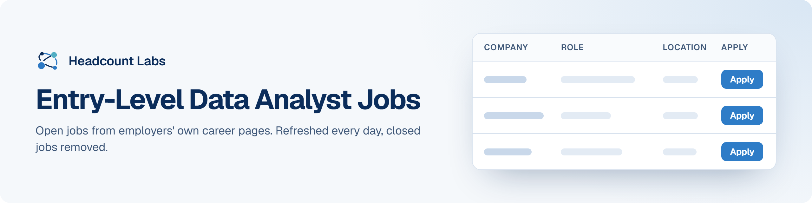

# Entry-Level Data Analyst Jobs

Junior, associate and entry-level data and business analyst jobs in the US.

**287 open jobs** · 47 new since the last update · 160 removed because they closed or left the employer's board · updated November 15, 2026 at 4:41 AM EST

This list is built and refreshed every day by [Headcount Labs](https://headcountlabs.com/?utm_source=github&utm_medium=job-list&utm_campaign=entry-level-data-analyst-jobs), which reads jobs straight from employers' own career pages and job boards. Every job here was still listed on its source board when we last read that board, within the past 3 days, and was posted in the past 30 days. Copies of the same job are merged into one row, and jobs that close are removed at the next update.

Want this data in your own app or agent? Use the [Headcount Labs jobs API](https://headcountlabs.com/docs/?utm_source=github&utm_medium=job-list&utm_campaign=entry-level-data-analyst-jobs) (free tier), the [MCP server](https://headcountlabs.com/mcp/?utm_source=github&utm_medium=job-list&utm_campaign=entry-level-data-analyst-jobs) for Claude, ChatGPT and other AI assistants, or the [public dataset subsets](https://huggingface.co/HeadcountLabs) on Hugging Face (the full dataset is coming soon).

**Jump to:** [Posted in the last 7 days (164)](#posted-in-the-last-7-days) · [Posted 8 to 30 days ago (123)](#posted-8-to-30-days-ago)

**Columns.** *Apply* opens the original posting on the employer's site. *Details* opens the job on Headcount Labs, with every posting we found for it. *Remote* shows what the employer states; a dash means the posting doesn't say. *Pay* is the range the employer published.

## Posted in the last 7 days

| Company | Role | Location | Remote | Pay | Posted | Apply | Details |
| --- | --- | --- | --- | --- | --- | :---: | :---: |
| **The Walt Disney Company** | Associate Data Analyst | Burbank, CA | — | $66k–$89k/yr | Nov 14 |  | <a href="https://headcountlabs.com/catalog/jobs/48c0285f-7358-4bee-a6b0-f35a1da4345b?utm_source=github&utm_medium=job-list&utm_campaign=entry-level-data-analyst-jobs">via Headcount Labs</a> |
| **Nooksack Everson Site** | Junior Cyber Security Analyst | Deming, WA | — | $31.55–$33.48/hr | Nov 14 |  | <a href="https://headcountlabs.com/catalog/jobs/8bf972f1-8152-43a6-848b-47166b8ac34b?utm_source=github&utm_medium=job-list&utm_campaign=entry-level-data-analyst-jobs">via Headcount Labs</a> |
| **Freeport McMoRan** | Control Systems Analyst I | 

2 locations
Bayard, NM Claypool, AZ
 | — | $75k–$104k/yr | Nov 14 |  | <a href="https://headcountlabs.com/catalog/jobs/0797f6d5-a312-452d-9a67-31e7f285eb21?utm_source=github&utm_medium=job-list&utm_campaign=entry-level-data-analyst-jobs">via Headcount Labs</a> |
| **WATSON CLINIC** | PRACTICE MANAGEMENT SYSTEMS ANALYST I | Lakeland, FL | — | — | Nov 13 |  | <a href="https://headcountlabs.com/catalog/jobs/a444688e-7be6-45d4-85d2-75e03c64351b?utm_source=github&utm_medium=job-list&utm_campaign=entry-level-data-analyst-jobs">via Headcount Labs</a> |
| **Ventus Solutions** | Junior Program Analyst/Technical Support | Arlington, VA | On-site | $50k–$65k/yr | Nov 13 |  | <a href="https://headcountlabs.com/catalog/jobs/75f11c03-5a34-482f-9000-579e950da649?utm_source=github&utm_medium=job-list&utm_campaign=entry-level-data-analyst-jobs">via Headcount Labs</a> |
| **Vast** | Compensation Analyst I | Long Beach, CA | — | $32–$45/hr | Nov 13 |  | <a href="https://headcountlabs.com/catalog/jobs/728bcf92-a3e1-4b47-ba9c-b837dbcf1fed?utm_source=github&utm_medium=job-list&utm_campaign=entry-level-data-analyst-jobs">via Headcount Labs</a> |
| **URM Stores Inc.** | Programmer Analyst I – Store Systems | Spokane, WA | On-site | $43–$48/hr | Nov 13 |  | <a href="https://headcountlabs.com/catalog/jobs/ec68e3ae-b29b-4a19-a010-b8627e9b0530?utm_source=github&utm_medium=job-list&utm_campaign=entry-level-data-analyst-jobs">via Headcount Labs</a> |
| **UFP Industries, Inc.** | Technical Analyst I | Grand Rapids, MI | — | — | Nov 13 |  | <a href="https://headcountlabs.com/catalog/jobs/dec34552-5d28-4cdb-ac04-0e7f567c1a15?utm_source=github&utm_medium=job-list&utm_campaign=entry-level-data-analyst-jobs">via Headcount Labs</a> |
| **Tulane University** | Data Analyst I | New Orleans, LA | On-site | — | Nov 13 |  | <a href="https://headcountlabs.com/catalog/jobs/4bea089f-4968-4f8b-a617-7806529f73e9?utm_source=github&utm_medium=job-list&utm_campaign=entry-level-data-analyst-jobs">via Headcount Labs</a> |
| **Trend Health Partners** | Claims Analyst I | United States | Remote | $50k–$60k/yr | Nov 13 |  | <a href="https://headcountlabs.com/catalog/jobs/32765b22-20bc-434b-a1cd-85868a456465?utm_source=github&utm_medium=job-list&utm_campaign=entry-level-data-analyst-jobs">via Headcount Labs</a> |
| **TLN Worldwide Enterprises Inc** | Financial Systems Analyst I - Naval Surface Warfare Center | Port Hueneme, CA | — | — | Nov 13 |  | <a href="https://headcountlabs.com/catalog/jobs/74e7d187-de7d-45ae-a375-653cdaa90dcd?utm_source=github&utm_medium=job-list&utm_campaign=entry-level-data-analyst-jobs">via Headcount Labs</a> |
| **TLN Worldwide Enterprises Inc** | Management Analyst I - Naval Surface Warfare Center | Port Hueneme, CA | — | — | Nov 13 |  | <a href="https://headcountlabs.com/catalog/jobs/4bdcf548-f550-4dae-9480-4ca55bf48934?utm_source=github&utm_medium=job-list&utm_campaign=entry-level-data-analyst-jobs">via Headcount Labs</a> |
| **The Vanguard Group, Inc.** | Junior Investment Data Analyst | Scottsdale, AZ | On-site | — | Nov 13 |  | <a href="https://headcountlabs.com/catalog/jobs/6334a11e-465d-4441-afbe-17fd0c3a330a?utm_source=github&utm_medium=job-list&utm_campaign=entry-level-data-analyst-jobs">via Headcount Labs</a> |
| **The Boeing Company** | Entry Level Methods Process Analyst | North Charleston, SC | On-site | $60k–$82k/yr | Nov 13 |  | <a href="https://headcountlabs.com/catalog/jobs/8c18e4fe-f41d-4b78-9b78-818ddd11e5c1?utm_source=github&utm_medium=job-list&utm_campaign=entry-level-data-analyst-jobs">via Headcount Labs</a> |
| **Sutter Health** | Digital Academy Analyst I, Greater Sacramento Division | 

2 locations
Sacramento Sacramento, CA
 | Hybrid | $38.55–$57.83/hr | Nov 13 |  | <a href="https://headcountlabs.com/catalog/jobs/a1031eb7-268b-41e5-b0ea-09e3a80cb9b6?utm_source=github&utm_medium=job-list&utm_campaign=entry-level-data-analyst-jobs">via Headcount Labs</a> |
| **State of Florida** | GOVERNMENT ANALYST I - 43003274 | TALLAHASSEE, FL | — | $43k–$50k/yr | Nov 13 |  | <a href="https://headcountlabs.com/catalog/jobs/a2d4f639-9b8e-48e1-9433-886d133f9b88?utm_source=github&utm_medium=job-list&utm_campaign=entry-level-data-analyst-jobs">via Headcount Labs</a> |
| **SGS** | Lab Analyst I - Semi-volatiles | Orlando, FL | — | $19–$22/hr | Nov 13 |  | <a href="https://headcountlabs.com/catalog/jobs/c9c1171f-7df4-4047-8330-edd13b11fc01?utm_source=github&utm_medium=job-list&utm_campaign=entry-level-data-analyst-jobs">via Headcount Labs</a> |
| **Ruchman** | Junior Program Analyst | Clarksburg, WV | — | — | Nov 13 |  | <a href="https://headcountlabs.com/catalog/jobs/ecc61ad7-02ee-4035-8539-5cc91697fc47?utm_source=github&utm_medium=job-list&utm_campaign=entry-level-data-analyst-jobs">via Headcount Labs</a> |
| **Raymond James &amp; Associates, Inc.** | Financial Planning Software Support Analyst I | Saint Petersburg, FL | Hybrid | — | Nov 13 |  | <a href="https://headcountlabs.com/catalog/jobs/fae9d29d-e2b1-4d65-85b8-1db2ff5c101a?utm_source=github&utm_medium=job-list&utm_campaign=entry-level-data-analyst-jobs">via Headcount Labs</a> |
| **Raymond James &amp; Associates, Inc.** | 2027 Investment Banking Analyst I Private Capital Advisory New York, NY | New York, NY | — | $70k–$105k/yr | Nov 13 |  | <a href="https://headcountlabs.com/catalog/jobs/66c75d7b-9252-44ef-bddd-3028f037bc02?utm_source=github&utm_medium=job-list&utm_campaign=entry-level-data-analyst-jobs">via Headcount Labs</a> |
| **Prosperity Bank** | Credit Analyst I (Full Time) - Houston, River Oaks | Houston, TX | — | — | Nov 13 |  | <a href="https://headcountlabs.com/catalog/jobs/004e12df-25fe-4ad8-8ac9-9b05c2e6c291?utm_source=github&utm_medium=job-list&utm_campaign=entry-level-data-analyst-jobs">via Headcount Labs</a> |
| **PenBay Technology Group LLC** | Legal Analyst I | Alexandria, VA | — | — | Nov 13 |  | <a href="https://headcountlabs.com/catalog/jobs/061f63ac-bddd-4ac2-a112-25fa0e0f7a71?utm_source=github&utm_medium=job-list&utm_campaign=entry-level-data-analyst-jobs">via Headcount Labs</a> |
| **Outcomes by HOPCo** | SOC Analyst I (Remote) | Phoenix, AZ | Remote | — | Nov 13 |  | <a href="https://headcountlabs.com/catalog/jobs/781f81f1-e4b6-4a32-92c7-606fd940fa90?utm_source=github&utm_medium=job-list&utm_campaign=entry-level-data-analyst-jobs">via Headcount Labs</a> |
| **Northwest Bank** | Junior Credit Analyst | Seattle, WA | — | $28–$38/hr | Nov 13 |  | <a href="https://headcountlabs.com/catalog/jobs/b8a343a7-ceda-4936-826c-04ff945dbe62?utm_source=github&utm_medium=job-list&utm_campaign=entry-level-data-analyst-jobs">via Headcount Labs</a> |
| **Mount Sinai Kravis Children's Hospital** | Data Analyst I - Population Health Science &amp; Policy Research (On Site) | 

2 locations
United States New York, NY
 | Remote | — | Nov 13 |  | <a href="https://headcountlabs.com/catalog/jobs/ca4fda48-d4f2-44a0-a84d-0a5c68d9ba1e?utm_source=github&utm_medium=job-list&utm_campaign=entry-level-data-analyst-jobs">via Headcount Labs</a> |
| **Mount Sinai Health Systems** | Data Analyst I - Population Health Science &amp; Policy Research (On Site) | New York, NY | On-site | $66k–$74k/yr | Nov 13 |  | <a href="https://headcountlabs.com/catalog/jobs/922f717a-dba0-434d-95ee-793c53d81dc6?utm_source=github&utm_medium=job-list&utm_campaign=entry-level-data-analyst-jobs">via Headcount Labs</a> |
| **Mass** | Data and Risk Management Analyst I | Boston, MA | Hybrid | $84k–$123k/yr | Nov 13 |  | <a href="https://headcountlabs.com/catalog/jobs/c4b26111-ec56-4f57-9307-2f50ca56bd41?utm_source=github&utm_medium=job-list&utm_campaign=entry-level-data-analyst-jobs">via Headcount Labs</a> |
| **LHH** | Trade Analyst I | Houston, TX | — | $41–$45/hr | Nov 13 |  | <a href="https://headcountlabs.com/catalog/jobs/1056a217-526c-4c16-b3c7-678294612f59?utm_source=github&utm_medium=job-list&utm_campaign=entry-level-data-analyst-jobs">via Headcount Labs</a> |
| **Landstar System, Inc.** | A/R Analyst I | Jacksonville, FL | Remote | $18–$22.15/hr | Nov 13 |  | <a href="https://headcountlabs.com/catalog/jobs/2717dcf9-8d1a-4b18-b48d-6b7d30c6b53c?utm_source=github&utm_medium=job-list&utm_campaign=entry-level-data-analyst-jobs">via Headcount Labs</a> |
| **INDUS Technology, Inc.** | Management Analyst I – AEGIS Program Support | Port Hueneme, CA | — | $33.65–$38.46/hr | Nov 13 |  | <a href="https://headcountlabs.com/catalog/jobs/80e36fe8-e101-4839-b5ed-84f4c29db0fb?utm_source=github&utm_medium=job-list&utm_campaign=entry-level-data-analyst-jobs">via Headcount Labs</a> |
| **HYDAC** | Financial Business Analyst (junior Controller) | Schaumburg, IL | — | $90k–$115k/yr | Nov 13 |  | <a href="https://headcountlabs.com/catalog/jobs/221bf2d8-bdb4-4e6b-b76c-7a06772cb4cb?utm_source=github&utm_medium=job-list&utm_campaign=entry-level-data-analyst-jobs">via Headcount Labs</a> |
| **Franchise Tax Board** | Analyst I | California | Hybrid | $4k–$6k/mo | Nov 13 |  | <a href="https://headcountlabs.com/catalog/jobs/bf05e0b4-5815-47b9-8e15-eff6998506c7?utm_source=github&utm_medium=job-list&utm_campaign=entry-level-data-analyst-jobs">via Headcount Labs</a> |
| **Duke University Health System** | Research Analyst I | North Carolina | — | — | Nov 13 |  | <a href="https://headcountlabs.com/catalog/jobs/1c3aa4fd-d3d1-42d4-ad4f-37fd93040fda?utm_source=github&utm_medium=job-list&utm_campaign=entry-level-data-analyst-jobs">via Headcount Labs</a> |
| **Duke** | Research Analyst I | Durham, NC | — | — | Nov 13 |  | <a href="https://headcountlabs.com/catalog/jobs/7b94593b-aea5-4b2d-b03d-01ea7c521e57?utm_source=github&utm_medium=job-list&utm_campaign=entry-level-data-analyst-jobs">via Headcount Labs</a> |
| **DTSV, Inc.** | Analyst I | Indianapolis, IN | On-site | $73k–$78k/yr | Nov 13 |  | <a href="https://headcountlabs.com/catalog/jobs/5d5311c2-8d77-41d6-9bab-2087cc10c5bb?utm_source=github&utm_medium=job-list&utm_campaign=entry-level-data-analyst-jobs">via Headcount Labs</a> |
| **Department of Veterans Affairs** | Analyst I | California | On-site | $4k–$6k/mo | Nov 13 |  | <a href="https://headcountlabs.com/catalog/jobs/c2442204-3dbc-4d25-b213-00135d5d2ece?utm_source=github&utm_medium=job-list&utm_campaign=entry-level-data-analyst-jobs">via Headcount Labs</a> |
| **COR Andersen Corporation** | Procurement/Scheduling Analyst I | Bayport, MN | On-site | $70k–$105k/yr | Nov 13 |  | <a href="https://headcountlabs.com/catalog/jobs/05efe771-c034-48e0-8e42-ea7d1f25ab9c?utm_source=github&utm_medium=job-list&utm_campaign=entry-level-data-analyst-jobs">via Headcount Labs</a> |
| **Commonwealth of Massachusetts** | Data and Risk Management Analyst I | Boston, MA | Hybrid | $84k–$123k/yr | Nov 13 |  | <a href="https://headcountlabs.com/catalog/jobs/8cf38d54-ab82-4e58-8261-f2fd9717f395?utm_source=github&utm_medium=job-list&utm_campaign=entry-level-data-analyst-jobs">via Headcount Labs</a> |
| **Command Alkon Inc** | Security Analyst I | 

25 locations
Dallas, TX Concord, NH Hartford, CT Harleysville, PA Oklahoma City, OK Jacksonville, FL Jackson, MS New Orleans, LA Indianapolis, IN Madison, WI Boise, ID Detroit, MI +13 more
 | Remote | — | Nov 13 |  | <a href="https://headcountlabs.com/catalog/jobs/6105087f-f3fe-4d12-914e-1bd0263cb56f?utm_source=github&utm_medium=job-list&utm_campaign=entry-level-data-analyst-jobs">via Headcount Labs</a> |
| **City of New York** | Junior Project Analyst | New York City, NY | — | $66k–$91k/yr | Nov 13 |  | <a href="https://headcountlabs.com/catalog/jobs/830ae92b-96e0-4aba-be42-fe028a9de32a?utm_source=github&utm_medium=job-list&utm_campaign=entry-level-data-analyst-jobs">via Headcount Labs</a> |
| **Buckland** | Customs Account Analyst, Junior | 

2 locations
Port Huron, MI Michigan
 | Hybrid | — | Nov 13 |  | <a href="https://headcountlabs.com/catalog/jobs/0fd3c48e-e4da-4a0c-995e-bc1f2a290fa4?utm_source=github&utm_medium=job-list&utm_campaign=entry-level-data-analyst-jobs">via Headcount Labs</a> |
| **Bostonscientific** | Product Complaint Analyst I | Arden Hills, MN | Hybrid | $51k/yr | Nov 13 |  | <a href="https://headcountlabs.com/catalog/jobs/bd1fe9e5-2d48-4094-ad29-98267809b34d?utm_source=github&utm_medium=job-list&utm_campaign=entry-level-data-analyst-jobs">via Headcount Labs</a> |
| **Boeing** | Entry Level Methods Process Analyst | North Charleston, SC | — | $60k–$82k/yr | Nov 13 |  | <a href="https://headcountlabs.com/catalog/jobs/c32f958a-516b-4a8b-b6b8-8ae66457165a?utm_source=github&utm_medium=job-list&utm_campaign=entry-level-data-analyst-jobs">via Headcount Labs</a> |
| **Blackhawk Network** | Financial Analyst I | Coppell, TX | — | $49k–$64k/yr | Nov 13 |  | <a href="https://headcountlabs.com/catalog/jobs/a614cc0a-9cfa-41f6-8e12-bba95593fcab?utm_source=github&utm_medium=job-list&utm_campaign=entry-level-data-analyst-jobs">via Headcount Labs</a> |
| **Aretum** | Business Systems Analyst I | Vienna, VA | On-site | — | Nov 13 |  | <a href="https://headcountlabs.com/catalog/jobs/50ce6cf8-c73e-49ba-8187-8b903a4e711a?utm_source=github&utm_medium=job-list&utm_campaign=entry-level-data-analyst-jobs">via Headcount Labs</a> |
| **Aretum** | Junior Financial Business Analyst | Vienna, VA | On-site | — | Nov 13 |  | <a href="https://headcountlabs.com/catalog/jobs/24bee060-c426-4ee9-bdb2-6bc704b3c6ef?utm_source=github&utm_medium=job-list&utm_campaign=entry-level-data-analyst-jobs">via Headcount Labs</a> |
| **Alliance Technical Group** | Lab Analyst I | 

2 locations
Wilmington, NC United States
 | — | $21–$25/hr | Nov 13 |  | <a href="https://headcountlabs.com/catalog/jobs/d44ceb0c-4421-4d36-8626-7b382393c5f7?utm_source=github&utm_medium=job-list&utm_campaign=entry-level-data-analyst-jobs">via Headcount Labs</a> |
| **Alliance** | Lab Analyst I | Wilmington, NC | — | $21–$25/hr | Nov 13 |  | <a href="https://headcountlabs.com/catalog/jobs/1a6df18b-1754-42be-bc97-ed839d790214?utm_source=github&utm_medium=job-list&utm_campaign=entry-level-data-analyst-jobs">via Headcount Labs</a> |
| **10 Nationwide Children's Hospital** | IS Business Intelligence Analyst I | Columbus, OH | — | — | Nov 13 |  | <a href="https://headcountlabs.com/catalog/jobs/04f2d338-4967-46a5-9f80-fe2e2ed08a65?utm_source=github&utm_medium=job-list&utm_campaign=entry-level-data-analyst-jobs">via Headcount Labs</a> |
| **ZenPoint Solutions LLC** | Business Analyst I - U.S. Citizenship Required | Springfield, VA | On-site | $65k–$80k/yr | Nov 12 |  | <a href="https://headcountlabs.com/catalog/jobs/56df3429-3e81-42ee-9f6b-27446d949d26?utm_source=github&utm_medium=job-list&utm_campaign=entry-level-data-analyst-jobs">via Headcount Labs</a> |
| **Yale New Haven Health** | Clinical Imaging Analyst I | New London, CT | — | — | Nov 12 |  | <a href="https://headcountlabs.com/catalog/jobs/9edfb2b0-18df-4b9c-b2b2-1640957d1cfa?utm_source=github&utm_medium=job-list&utm_campaign=entry-level-data-analyst-jobs">via Headcount Labs</a> |
| **WTW** | Early Careers: Corporate Risk and Broking (CRB) Graduate Development Program Analyst – Broking Placement – Multiple Locations - 2027 | 

8 locations
San Francisco, CA Houston, TX Atlanta, GA Boston, MA Dallas, TX Chicago, IL Los Angeles, CA New York, NY
 | Hybrid | $36/hr | Nov 12 |  | <a href="https://headcountlabs.com/catalog/jobs/d1043ae0-8ff0-443a-90fa-d3dae6ceeb64?utm_source=github&utm_medium=job-list&utm_campaign=entry-level-data-analyst-jobs">via Headcount Labs</a> |
| **Wilmington Chamber of Commerce** | Provider Network Data Analyst I | 

2 locations
North Carolina United States
 | Remote | $43k–$62k/yr | Nov 12 |  | <a href="https://headcountlabs.com/catalog/jobs/482ead6e-084b-4866-84cc-8fb18954c922?utm_source=github&utm_medium=job-list&utm_campaign=entry-level-data-analyst-jobs">via Headcount Labs</a> |
| **United Airlines** | Associate Analyst - Pricing &amp; Revenue Management (Campus 2027 Hires/New Grads) | Chicago, IL | — | $54k–$70k/yr | Nov 12 |  | <a href="https://headcountlabs.com/catalog/jobs/50d75863-63f5-4f8c-848f-54966fb97ee7?utm_source=github&utm_medium=job-list&utm_campaign=entry-level-data-analyst-jobs">via Headcount Labs</a> |
| **UNAVAILABLE** | iSupport Analyst I - IS SUPPORT CENTER | Miamisburg, OH | — | — | Nov 12 |  | <a href="https://headcountlabs.com/catalog/jobs/caa0a457-8788-45e9-aceb-426282a6d462?utm_source=github&utm_medium=job-list&utm_campaign=entry-level-data-analyst-jobs">via Headcount Labs</a> |
| **The Boeing Company** | Associate Data and Cost Modeling Analyst - Government Estimating | Hazelwood, MO | — | $98k–$132k/yr | Nov 12 |  | <a href="https://headcountlabs.com/catalog/jobs/3e7109e8-217c-4162-aae8-f5b848918b03?utm_source=github&utm_medium=job-list&utm_campaign=entry-level-data-analyst-jobs">via Headcount Labs</a> |
| **Sysmex** | Analyst I, Service Contracts | Lincolnshire, IL | — | $58k–$63k/yr | Nov 12 |  | <a href="https://headcountlabs.com/catalog/jobs/9f6d0e49-1198-444f-a1c0-4e952da81ac4?utm_source=github&utm_medium=job-list&utm_campaign=entry-level-data-analyst-jobs">via Headcount Labs</a> |
| **STV Incorporated** | Data Analyst I | New York, NY | — | $96k–$110k/yr | Nov 12 |  | <a href="https://headcountlabs.com/catalog/jobs/b4aff5d1-f85e-4c3f-8762-81fb382b2e53?utm_source=github&utm_medium=job-list&utm_campaign=entry-level-data-analyst-jobs">via Headcount Labs</a> |
| **State of Florida** | GOVERNMENT ANALYST I - 48004086 | TALLAHASSEE, FL | — | $4k–$7k/yr | Nov 12 |  | <a href="https://headcountlabs.com/catalog/jobs/b7f2421e-d123-479a-9712-e9d951c73b49?utm_source=github&utm_medium=job-list&utm_campaign=entry-level-data-analyst-jobs">via Headcount Labs</a> |
| **State of Florida** | GOVERNMENT ANALYST I - 41000466 1 | TALLAHASSEE, FL | — | $45k/yr | Nov 12 |  | <a href="https://headcountlabs.com/catalog/jobs/fef29e86-c49d-46aa-b1ca-64c8b165679d?utm_source=github&utm_medium=job-list&utm_campaign=entry-level-data-analyst-jobs">via Headcount Labs</a> |
| **State of Florida** | OPERATIONS ANALYST I - 73001318 | TAMPA, FL | — | $40k/yr | Nov 12 |  | <a href="https://headcountlabs.com/catalog/jobs/7c229159-cf4a-404e-a015-46d79889c79c?utm_source=github&utm_medium=job-list&utm_campaign=entry-level-data-analyst-jobs">via Headcount Labs</a> |
| **State of Florida** | GOVERNMENT ANALYST I - 79001149 | TALLAHASSEE, FL | — | $2k–$2k/yr | Nov 12 |  | <a href="https://headcountlabs.com/catalog/jobs/60ef2d35-ca6d-47fb-8f4a-4af0615f6e91?utm_source=github&utm_medium=job-list&utm_campaign=entry-level-data-analyst-jobs">via Headcount Labs</a> |
| **Sierra Conservation Center** | Analyst I, Accounting | California | On-site | $4k–$6k/mo | Nov 12 |  | <a href="https://headcountlabs.com/catalog/jobs/2553008b-2953-4b67-b627-2a3f9c934abd?utm_source=github&utm_medium=job-list&utm_campaign=entry-level-data-analyst-jobs">via Headcount Labs</a> |
| **R1 RCM Holdco Inc.** | US-Data &amp; Information Privacy Analyst I | New Jersey | Remote | $54k–$79k/yr | Nov 12 |  | <a href="https://headcountlabs.com/catalog/jobs/bde95b2d-31ca-482a-b354-9b33d9a6736c?utm_source=github&utm_medium=job-list&utm_campaign=entry-level-data-analyst-jobs">via Headcount Labs</a> |
| **Newtown Savings Bank** | BSA Analyst I (onsite) | Newtown, CT | On-site | $23.33–$32.87/hr | Nov 12 |  | <a href="https://headcountlabs.com/catalog/jobs/864b86af-f725-4331-bac8-272be4bd08a0?utm_source=github&utm_medium=job-list&utm_campaign=entry-level-data-analyst-jobs">via Headcount Labs</a> |
| **Neovia Logistics Services** | IT Network &amp; Infrastructure Support Analyst I | Greenwood, IN | — | — | Nov 12 |  | <a href="https://headcountlabs.com/catalog/jobs/b702d65d-a820-4cc6-b698-086315b8acc3?utm_source=github&utm_medium=job-list&utm_campaign=entry-level-data-analyst-jobs">via Headcount Labs</a> |
| **National Software Management** | Entry Level Business Analyst | Dallas, TX | Remote | $65k–$75k/yr | Nov 12 |  | <a href="https://headcountlabs.com/catalog/jobs/666ea5e2-6ade-4b75-9538-2fa5846b746d?utm_source=github&utm_medium=job-list&utm_campaign=entry-level-data-analyst-jobs">via Headcount Labs</a> |
| **MyMichigan Health** | Epic Cadence Analyst I | Midland, MI | — | — | Nov 12 |  | <a href="https://headcountlabs.com/catalog/jobs/306f96a8-d6af-4b19-9d82-8e7e2cd88b5e?utm_source=github&utm_medium=job-list&utm_campaign=entry-level-data-analyst-jobs">via Headcount Labs</a> |
| **Myers and Stauffer** | Information Security Analyst I | 

3 locations
Indianapolis, IN Kansas City, MO Frankfort, KY
 | Hybrid | — | Nov 12 |  | <a href="https://headcountlabs.com/catalog/jobs/8795fac0-457a-4397-beb4-b23a1d01e5f0?utm_source=github&utm_medium=job-list&utm_campaign=entry-level-data-analyst-jobs">via Headcount Labs</a> |
| **MP Materials Corp.** | Analyst I, Analytical Lab | Mountain Pass, CA | — | $83k/yr | Nov 12 |  | <a href="https://headcountlabs.com/catalog/jobs/9888b05a-1951-4d48-9511-06eab86c14b8?utm_source=github&utm_medium=job-list&utm_campaign=entry-level-data-analyst-jobs">via Headcount Labs</a> |
| **MERITRUST CREDIT UNION** | Business Systems Analyst I | BROOMFIELD, CO | — | $80k–$100k/yr | Nov 12 |  | <a href="https://headcountlabs.com/catalog/jobs/12c170a3-09d1-4b7b-992b-2e3ca41d92c5?utm_source=github&utm_medium=job-list&utm_campaign=entry-level-data-analyst-jobs">via Headcount Labs</a> |
| **Medpace, Inc.** | Junior Business Intelligence Analyst | Cincinnati, OH | — | — | Nov 12 |  | <a href="https://headcountlabs.com/catalog/jobs/bd7a713d-977f-4a37-b074-fc301f5aba22?utm_source=github&utm_medium=job-list&utm_campaign=entry-level-data-analyst-jobs">via Headcount Labs</a> |
| **Medpace, Inc.** | Junior Clinical Data Analyst | Cincinnati, OH | — | — | Nov 12 |  | <a href="https://headcountlabs.com/catalog/jobs/ba4cb6a9-1b7f-4630-96cf-d4bb97204e34?utm_source=github&utm_medium=job-list&utm_campaign=entry-level-data-analyst-jobs">via Headcount Labs</a> |
| **Medpace, Inc.** | Junior Data Governance Analyst | Cincinnati, OH | — | — | Nov 12 |  | <a href="https://headcountlabs.com/catalog/jobs/ec7b90e0-2a4d-42f4-8dc0-789df9c6df4c?utm_source=github&utm_medium=job-list&utm_campaign=entry-level-data-analyst-jobs">via Headcount Labs</a> |
| **Lightcast** | Economic Research Analyst / Junior Data Scientist - 1089 | 

2 locations
(Work From Home) US Moscow, ID
 | Remote | — | Nov 12 |  | <a href="https://headcountlabs.com/catalog/jobs/edbf9d39-85b0-4495-b675-181c5ac104bf?utm_source=github&utm_medium=job-list&utm_campaign=entry-level-data-analyst-jobs">via Headcount Labs</a> |
| **Lear Corporation** | Materials Planning Analyst I | 

2 locations
Vance, AL United States
 | — | — | Nov 12 |  | <a href="https://headcountlabs.com/catalog/jobs/b4aa4dcb-adbd-40b4-8cfe-64a95d129dfb?utm_source=github&utm_medium=job-list&utm_campaign=entry-level-data-analyst-jobs">via Headcount Labs</a> |
| **LAFAYETTE CONSOLIDATED GOVERNMENT** | Procurement Analyst I @ LAFAYETTE CONSOLIDATED GOVERNMENT | Louisiana | — | — | Nov 12 |  | <a href="https://headcountlabs.com/catalog/jobs/fa03dd00-e29a-413a-a093-7be7e544733f?utm_source=github&utm_medium=job-list&utm_campaign=entry-level-data-analyst-jobs">via Headcount Labs</a> |
| **KBR** | Junior Financial Analyst | Alexandria, VA | On-site | $74k–$100k/yr | Nov 12 |  | <a href="https://headcountlabs.com/catalog/jobs/4e8e834e-ca17-4556-82a7-f0471846fb54?utm_source=github&utm_medium=job-list&utm_campaign=entry-level-data-analyst-jobs">via Headcount Labs</a> |
| **Jobgether** | Data Analyst I Product | United States | Remote | $81k–$113k/yr | Nov 12 |  | <a href="https://headcountlabs.com/catalog/jobs/b876582e-3131-402f-9f83-6d11104f8c37?utm_source=github&utm_medium=job-list&utm_campaign=entry-level-data-analyst-jobs">via Headcount Labs</a> |
| **Integrity Technology** | Target Analyst Reporter Junior Level | Ft. Meade, MD | — | $90k–$110k/yr | Nov 12 |  | <a href="https://headcountlabs.com/catalog/jobs/f33c8832-a8a0-4dff-a30f-6c4173cfad2e?utm_source=github&utm_medium=job-list&utm_campaign=entry-level-data-analyst-jobs">via Headcount Labs</a> |
| **Frost Bank** | Third Party Contracts Analyst I | 

18 locations
San Antonio, TX Austin-Varies Corpus Christi-Varies Dallas-Varies Fort Worth-Varies Houston-Varies Permian Basin-Varies Rio Grande Valley-Varies San Antonio-Varies Victoria-Varies Austin, TX Corpus Christi, TX +6 more
 | — | — | Nov 12 |  | <a href="https://headcountlabs.com/catalog/jobs/07373941-0f8b-4b4a-9bca-a041c936a05d?utm_source=github&utm_medium=job-list&utm_campaign=entry-level-data-analyst-jobs">via Headcount Labs</a> |
| **Frost Bank** | Third Party Risk Analyst I | 

18 locations
San Antonio, TX Austin-Varies Corpus Christi-Varies Dallas-Varies Fort Worth-Varies Houston-Varies Permian Basin-Varies Rio Grande Valley-Varies San Antonio-Varies Victoria-Varies Austin, TX Corpus Christi, TX +6 more
 | — | — | Nov 12 |  | <a href="https://headcountlabs.com/catalog/jobs/06b09982-c568-40f6-a72b-a45c4bbe54e4?utm_source=github&utm_medium=job-list&utm_campaign=entry-level-data-analyst-jobs">via Headcount Labs</a> |
| **First Citizens Bank** | Financial Analyst I, Treasury Operations (Hybrid) | 

2 locations
Raleigh, NC Morristown, NJ
 | Hybrid | $80k–$106k/yr | Nov 12 |  | <a href="https://headcountlabs.com/catalog/jobs/1b0489c9-c512-432a-afdc-d0f4f38f8c9c?utm_source=github&utm_medium=job-list&utm_campaign=entry-level-data-analyst-jobs">via Headcount Labs</a> |
| **Eisenhower Medical Center** | Insurance Analyst I | United States | On-site | $19.28–$28.54/hr | Nov 12 |  | <a href="https://headcountlabs.com/catalog/jobs/576870bb-fa3e-4040-ad32-2da7e32d51d8?utm_source=github&utm_medium=job-list&utm_campaign=entry-level-data-analyst-jobs">via Headcount Labs</a> |
| **Early** | Early Careers: Corporate Risk and Broking (CRB) Graduate Development Program Analyst – Broking Placement – Multiple Locations - 2027 | 

8 locations
San Francisco, CA Houston, TX Atlanta, GA Boston, MA Dallas, TX Chicago, IL Los Angeles, CA New York, NY
 | Hybrid | $36/hr | Nov 12 |  | <a href="https://headcountlabs.com/catalog/jobs/c90a3222-5277-4bfb-a2e1-70a4e3e16fcb?utm_source=github&utm_medium=job-list&utm_campaign=entry-level-data-analyst-jobs">via Headcount Labs</a> |
| **DSV** | Junior Business Analyst, Warehouse &amp; Logistics | Bensenville, IL | — | $22.55–$28.19/hr | Nov 12 |  | <a href="https://headcountlabs.com/catalog/jobs/5dd091e3-a2ca-422e-8e31-e3e0094fed4d?utm_source=github&utm_medium=job-list&utm_campaign=entry-level-data-analyst-jobs">via Headcount Labs</a> |
| **DPDHL** | Implementation Analyst I | Westerville, OH | — | $70k–$115k/yr | Nov 12 |  | <a href="https://headcountlabs.com/catalog/jobs/0ca43191-5fda-4bff-8637-1577c9e3fe0f?utm_source=github&utm_medium=job-list&utm_campaign=entry-level-data-analyst-jobs">via Headcount Labs</a> |
| **Corecivic** | Security Operations Analyst I (4 Days Onsite- Brentwood, TN- No Relocation Package) | Brentwood, TN | On-site | — | Nov 12 |  | <a href="https://headcountlabs.com/catalog/jobs/a8aecaca-a397-4ef2-b397-a8637fdc4d56?utm_source=github&utm_medium=job-list&utm_campaign=entry-level-data-analyst-jobs">via Headcount Labs</a> |
| **Core Civic** | Security Operations Analyst I (4 Days Onsite- Brentwood, TN- No Relocation Package) | BRENTWOOD, TN | On-site | — | Nov 12 |  | <a href="https://headcountlabs.com/catalog/jobs/b15da8fe-1fa1-4897-85c7-af7c1713edc1?utm_source=github&utm_medium=job-list&utm_campaign=entry-level-data-analyst-jobs">via Headcount Labs</a> |
| **CMA CGM** | IT Analyst I - BW2 - Mt. Juiiet | Mt. Juliet | — | — | Nov 12 |  | <a href="https://headcountlabs.com/catalog/jobs/d7d6851f-5a20-43c2-bae6-a54b3fa38895?utm_source=github&utm_medium=job-list&utm_campaign=entry-level-data-analyst-jobs">via Headcount Labs</a> |
| **CLEMU Clemson University** | Junior Business Analyst | SENECA, SC | — | — | Nov 12 |  | <a href="https://headcountlabs.com/catalog/jobs/23fa6362-2a84-42d6-bb7d-be1e1753f210?utm_source=github&utm_medium=job-list&utm_campaign=entry-level-data-analyst-jobs">via Headcount Labs</a> |
| **Chartway Federal Credit Union** | Information Security Analyst I | 

2 locations
South Jordan, UT Virginia Beach, VA
 | — | $65k–$85k/yr | Nov 12 |  | <a href="https://headcountlabs.com/catalog/jobs/2582ed15-f257-4539-b208-89968544d0c7?utm_source=github&utm_medium=job-list&utm_campaign=entry-level-data-analyst-jobs">via Headcount Labs</a> |
| **Brinks Home** | Service Desk Analyst I | 

2 locations
Dallas, TX Farmers Branch, TX
 | — | — | Nov 12 |  | <a href="https://headcountlabs.com/catalog/jobs/cabe273e-b969-4bf7-90e8-43c5fecc6122?utm_source=github&utm_medium=job-list&utm_campaign=entry-level-data-analyst-jobs">via Headcount Labs</a> |
| **Boeing** | Associate Data and Cost Modeling Analyst - Government Estimating | Hazelwood, MO | — | $98k–$132k/yr | Nov 12 |  | <a href="https://headcountlabs.com/catalog/jobs/4a3aae39-01ef-4249-940a-85b5c9d56293?utm_source=github&utm_medium=job-list&utm_campaign=entry-level-data-analyst-jobs">via Headcount Labs</a> |
| **Barclays Capital Inc.** | S&amp;T- Delta One Trading Analyst Graduate Program 2027 New York | New York | — | — | Nov 12 |  | <a href="https://headcountlabs.com/catalog/jobs/7ee0f3aa-ad83-4879-8d12-b1289727c23f?utm_source=github&utm_medium=job-list&utm_campaign=entry-level-data-analyst-jobs">via Headcount Labs</a> |
| **Aston Carter** | Entry Level Financial Reporting Analyst | Harrisburg, PA | Hybrid | $28–$33/hr | Nov 12 |  | <a href="https://headcountlabs.com/catalog/jobs/f9306440-6811-4d08-bdc9-2466494e9ba5?utm_source=github&utm_medium=job-list&utm_campaign=entry-level-data-analyst-jobs">via Headcount Labs</a> |
| **ARUP Laboratories** | IT Data Solutions Analyst I | Salt Lake City, UT | On-site | — | Nov 12 |  | <a href="https://headcountlabs.com/catalog/jobs/9ce8e941-ea5d-40d0-a642-ba029c1f812c?utm_source=github&utm_medium=job-list&utm_campaign=entry-level-data-analyst-jobs">via Headcount Labs</a> |
| **WTW** | Early Careers: Corporate Risk and Broking (CRB) Graduate Development Program Analyst – Client Advocacy, Commercial Lines – Atlanta, Chicago, New York - 2027 | 

3 locations
Atlanta, GA New York, NY Chicago, IL
 | Hybrid | $36–$39/hr | Nov 11 |  | <a href="https://headcountlabs.com/catalog/jobs/f7436f82-a5e6-4061-903f-a25d9476fa84?utm_source=github&utm_medium=job-list&utm_campaign=entry-level-data-analyst-jobs">via Headcount Labs</a> |
| **Varonis** | Junior Security Analyst - 3rd Shift | 

2 locations
United States Morrisville, NC
 | — | — | Nov 11 |  | <a href="https://headcountlabs.com/catalog/jobs/e1bd73d2-f629-449d-9f23-e0dbd83f75cc?utm_source=github&utm_medium=job-list&utm_campaign=entry-level-data-analyst-jobs">via Headcount Labs</a> |
| **Syneos Health, LLC** | Project Financial Analyst I | Morrisville, NC | Hybrid | $47k–$80k/yr | Nov 11 |  | <a href="https://headcountlabs.com/catalog/jobs/23395a3f-a46d-4ea1-8425-226ee27a97b2?utm_source=github&utm_medium=job-list&utm_campaign=entry-level-data-analyst-jobs">via Headcount Labs</a> |
| **SPBS Inc** | Junior Systems Analyst | Flower Mound, TX | — | — | Nov 11 |  | <a href="https://headcountlabs.com/catalog/jobs/3e3ff0b9-503a-416d-b104-176341c610dc?utm_source=github&utm_medium=job-list&utm_campaign=entry-level-data-analyst-jobs">via Headcount Labs</a> |
| **Sinch** | Fraud &amp; Compliance Analyst I | United States | Remote | $26.92–$33.65/hr | Nov 11 |  | <a href="https://headcountlabs.com/catalog/jobs/182ebdd6-631a-4d83-a2de-ee8811f3552d?utm_source=github&utm_medium=job-list&utm_campaign=entry-level-data-analyst-jobs">via Headcount Labs</a> |
| **SGS** | Lab Analyst I | Carson, CA | — | $20–$22/hr | Nov 11 |  | <a href="https://headcountlabs.com/catalog/jobs/0c4ae0e6-1961-417f-9ca8-6f12a08de7c7?utm_source=github&utm_medium=job-list&utm_campaign=entry-level-data-analyst-jobs">via Headcount Labs</a> |
| **SAIC** | Junior Configuration Analyst | Middletown, RI | — | $40k–$80k/yr | Nov 11 |  | <a href="https://headcountlabs.com/catalog/jobs/a9dd9286-2b0e-487b-96d5-c42362a016c6?utm_source=github&utm_medium=job-list&utm_campaign=entry-level-data-analyst-jobs">via Headcount Labs</a> |
| **Methodist Le Bonheur Healthcare** | Unified Communications Analyst I- Mobility | Memphis, TN | — | — | Nov 11 |  | <a href="https://headcountlabs.com/catalog/jobs/3136945d-2ce5-4f97-afcc-4c8b6939517b?utm_source=github&utm_medium=job-list&utm_campaign=entry-level-data-analyst-jobs">via Headcount Labs</a> |
| **Jobgether** | Junior Grants Analyst | United States | Remote | $65k–$75k/yr | Nov 11 |  | <a href="https://headcountlabs.com/catalog/jobs/c72228e4-1971-41d7-9e89-d8d94deee2de?utm_source=github&utm_medium=job-list&utm_campaign=entry-level-data-analyst-jobs">via Headcount Labs</a> |
| **Hyve Solutions Corporation** | Customs &amp; Traffic Analyst I | Fremont, CA | — | — | Nov 11 |  | <a href="https://headcountlabs.com/catalog/jobs/7851d7b6-cc51-4cda-a022-0edae8b11da5?utm_source=github&utm_medium=job-list&utm_campaign=entry-level-data-analyst-jobs">via Headcount Labs</a> |
| **Geo Owl** | Entry-Level Full Motion Video (FMV) Intelligence Analyst | McLean, VA | On-site | — | Nov 11 |  | <a href="https://headcountlabs.com/catalog/jobs/a0d5c9ad-2e8a-4ca2-86f1-197c830fe2a5?utm_source=github&utm_medium=job-list&utm_campaign=entry-level-data-analyst-jobs">via Headcount Labs</a> |
| **FIS Management Services LLC** | Analyst I, Fraud Prevention | Wisconsin | Hybrid | — | Nov 11 |  | <a href="https://headcountlabs.com/catalog/jobs/fb6c1446-2607-4722-a84b-4d7f165c19f3?utm_source=github&utm_medium=job-list&utm_campaign=entry-level-data-analyst-jobs">via Headcount Labs</a> |
| **FIS INC (OLD FIS)** | Implementation-Conversion Analyst I | Wisconsin | — | — | Nov 11 |  | <a href="https://headcountlabs.com/catalog/jobs/e0ac1b23-cc09-4ba3-9965-224a5bde3706?utm_source=github&utm_medium=job-list&utm_campaign=entry-level-data-analyst-jobs">via Headcount Labs</a> |
| **FIS Global** | Analyst I, Fraud Prevention | 

2 locations
Brown Deer, WI United States
 | — | — | Nov 11 |  | <a href="https://headcountlabs.com/catalog/jobs/b78109cc-77be-4e37-b1bb-b5094a01aa37?utm_source=github&utm_medium=job-list&utm_campaign=entry-level-data-analyst-jobs">via Headcount Labs</a> |
| **FIS Global** | Implementation-Conversion Analyst I | 

2 locations
Brown Deer, WI United States
 | — | — | Nov 11 |  | <a href="https://headcountlabs.com/catalog/jobs/9ac6318e-9233-43c8-af59-d99dd788e9f1?utm_source=github&utm_medium=job-list&utm_campaign=entry-level-data-analyst-jobs">via Headcount Labs</a> |
| **ePlus Technology, inc.** | Service Desk Analyst I (Req #1496) (Monday-Friday 3pm-12am) | Virginia Beach, VA | Remote | $16.83–$24.04/hr | Nov 11 |  | <a href="https://headcountlabs.com/catalog/jobs/7fc7f9a4-ab8b-4af4-8886-a3a78833689b?utm_source=github&utm_medium=job-list&utm_campaign=entry-level-data-analyst-jobs">via Headcount Labs</a> |
| **Ensemble RCM LLC** | Revenue Recovery Associate Analyst I | Columbia -, SC | Remote | $45k–$82k/yr | Nov 11 |  | <a href="https://headcountlabs.com/catalog/jobs/dbf3dd91-c54d-4038-b6ac-1863bc7cdfc8?utm_source=github&utm_medium=job-list&utm_campaign=entry-level-data-analyst-jobs">via Headcount Labs</a> |
| **ENFRA LLC** | Utility Analyst I | Fayetteville, AR | — | — | Nov 11 |  | <a href="https://headcountlabs.com/catalog/jobs/84912f19-e834-4d06-8c3f-3a9d9b9162cd?utm_source=github&utm_medium=job-list&utm_campaign=entry-level-data-analyst-jobs">via Headcount Labs</a> |
| **DYOPATH** | Desktop Support Analyst I | 

2 locations
Athens, GA Whitsett, NC
 | On-site | $24/hr | Nov 11 |  | <a href="https://headcountlabs.com/catalog/jobs/f655c642-f648-486e-a6a9-8ea61b4ec731?utm_source=github&utm_medium=job-list&utm_campaign=entry-level-data-analyst-jobs">via Headcount Labs</a> |
| **DPDHL** | Business Data Analyst I | 

3 locations
Fort Worth, TX Kansas City, MO Huntsville, AL
 | — | $70k–$115k/yr | Nov 11 |  | <a href="https://headcountlabs.com/catalog/jobs/e398ebc8-aef5-4526-9252-bb2f68529c5c?utm_source=github&utm_medium=job-list&utm_campaign=entry-level-data-analyst-jobs">via Headcount Labs</a> |
| **CorVel** | Bill Review Analyst I | Folsom, CA | Remote | $13.38–$23.42/hr | Nov 11 |  | <a href="https://headcountlabs.com/catalog/jobs/4b4b211d-dff1-4465-94cd-320ecb59ab8d?utm_source=github&utm_medium=job-list&utm_campaign=entry-level-data-analyst-jobs">via Headcount Labs</a> |
| **COMPASSMSP, LLC** | Security Analyst I | Pacific Time Zone | Remote | $67k–$75k/yr | Nov 11 |  | <a href="https://headcountlabs.com/catalog/jobs/f29aa819-7be8-404f-99a3-50ab6b0d31d1?utm_source=github&utm_medium=job-list&utm_campaign=entry-level-data-analyst-jobs">via Headcount Labs</a> |
| **Charles River Laboratories** | Research Analyst I, Analytical Chemistry | Shrewsbury, MA | — | $25–$26/hr | Nov 11 |  | <a href="https://headcountlabs.com/catalog/jobs/1106fbdb-1d91-42b3-ad09-3534156feba2?utm_source=github&utm_medium=job-list&utm_campaign=entry-level-data-analyst-jobs">via Headcount Labs</a> |
| **BAE Systems** | Network Implementation Analyst Entry Level | Scott AFB, IL | — | $59k–$100k/yr | Nov 11 |  | <a href="https://headcountlabs.com/catalog/jobs/bfeb32fd-9b22-470b-91fd-7f7cb2878413?utm_source=github&utm_medium=job-list&utm_campaign=entry-level-data-analyst-jobs">via Headcount Labs</a> |
| **BAE Systems** | Configuration Analyst I | Wallops Island, VA | — | $59k–$100k/yr | Nov 11 |  | <a href="https://headcountlabs.com/catalog/jobs/9cd52c3a-68a5-4801-8ed8-6629f6dacfc3?utm_source=github&utm_medium=job-list&utm_campaign=entry-level-data-analyst-jobs">via Headcount Labs</a> |
| **Akima, LLC** | Junior Financial Analyst (Active Secret Clearance or ability to obtain) | Fort Belvoir, VA | — | $52k–$55k/yr | Nov 11 |  | <a href="https://headcountlabs.com/catalog/jobs/50863b25-0c4e-4241-93f9-71a89b69b616?utm_source=github&utm_medium=job-list&utm_campaign=entry-level-data-analyst-jobs">via Headcount Labs</a> |
| **52 CAE USA Inc** | Logistic Support Analyst I | Arlington, TX | — | — | Nov 11 |  | <a href="https://headcountlabs.com/catalog/jobs/6eb21874-3233-435a-83c4-df96fb398594?utm_source=github&utm_medium=job-list&utm_campaign=entry-level-data-analyst-jobs">via Headcount Labs</a> |
| **Womble Bond Dickinson** | Analyst I Service Desk | 

2 locations
Las Vegas, NV Glendale, CA
 | On-site | — | Nov 10 |  | <a href="https://headcountlabs.com/catalog/jobs/b0857eae-6492-4ac9-b0b2-18ab01c08323?utm_source=github&utm_medium=job-list&utm_campaign=entry-level-data-analyst-jobs">via Headcount Labs</a> |
| **UIC Government Services and the Bowhead Family of Companies** | Junior Power BI and Power Platform Analyst | Aberdeen, MD | — | $70k–$90k/yr | Nov 10 |  | <a href="https://headcountlabs.com/catalog/jobs/12271694-717e-4eb0-a73f-bd20947e86e6?utm_source=github&utm_medium=job-list&utm_campaign=entry-level-data-analyst-jobs">via Headcount Labs</a> |
| **Turner Industries** | IT Training Analyst I - Houston, TX | Pasadena, TX | — | — | Nov 10 |  | <a href="https://headcountlabs.com/catalog/jobs/41c3f37d-65df-4c52-86fc-ffeef349ec7b?utm_source=github&utm_medium=job-list&utm_campaign=entry-level-data-analyst-jobs">via Headcount Labs</a> |
| **Snap Inc.** | Ad Product Quality Analyst I | Los Angeles, CA | — | $35.09–$52.40/hr | Nov 10 |  | <a href="https://headcountlabs.com/catalog/jobs/cd9a3303-4d08-4cb9-8ce7-ec56ac8c9685?utm_source=github&utm_medium=job-list&utm_campaign=entry-level-data-analyst-jobs">via Headcount Labs</a> |
| **Principal Financial Group** | Pension Calculation Automation Analyst I | Des Moines, IA | Remote | $56k–$152k/yr | Nov 10 |  | <a href="https://headcountlabs.com/catalog/jobs/9e2fedd4-fe77-44c9-8834-ddbe08ffafd2?utm_source=github&utm_medium=job-list&utm_campaign=entry-level-data-analyst-jobs">via Headcount Labs</a> |
| **OzarksGo** | Network Operations Center (NOC) Analyst I (Night Shift) | Fayetteville, AR | — | — | Nov 10 |  | <a href="https://headcountlabs.com/catalog/jobs/3b63ec3b-b48d-4ed6-a1ec-da0e7d958a03?utm_source=github&utm_medium=job-list&utm_campaign=entry-level-data-analyst-jobs">via Headcount Labs</a> |
| **MyMichigan Health** | Application Analyst I | Midland, MI | — | — | Nov 10 |  | <a href="https://headcountlabs.com/catalog/jobs/e6b985bf-3286-4ab4-86f0-52dc80c5ee93?utm_source=github&utm_medium=job-list&utm_campaign=entry-level-data-analyst-jobs">via Headcount Labs</a> |
| **MyMichigan Health** | Business Intelligence Analyst I | Midland, MI | — | — | Nov 10 |  | <a href="https://headcountlabs.com/catalog/jobs/078296f7-9337-4231-818a-484d0224c625?utm_source=github&utm_medium=job-list&utm_campaign=entry-level-data-analyst-jobs">via Headcount Labs</a> |
| **Medpace, Inc.** | Statistical Analyst I | Cincinnati, OH | — | — | Nov 10 |  | <a href="https://headcountlabs.com/catalog/jobs/90b2c3b7-ba73-4331-8844-661ad72f26df?utm_source=github&utm_medium=job-list&utm_campaign=entry-level-data-analyst-jobs">via Headcount Labs</a> |
| **Massachusetts AGO** | Digital Evidence Analyst I &#124; Digital Evidence Laboratory | Boston, MA | Hybrid | $88k/yr | Nov 10 |  | <a href="https://headcountlabs.com/catalog/jobs/98cf726f-88ab-4484-8d71-815c262e2013?utm_source=github&utm_medium=job-list&utm_campaign=entry-level-data-analyst-jobs">via Headcount Labs</a> |
| **mass** | DIGITAL EVIDENCE ANALYST I &#124; Digital Evidence Laboratory | Boston, MA | — | $88k/yr | Nov 10 |  | <a href="https://headcountlabs.com/catalog/jobs/79a2cbc8-3e3e-4f64-bf46-27b95b2e2f5e?utm_source=github&utm_medium=job-list&utm_campaign=entry-level-data-analyst-jobs">via Headcount Labs</a> |
| **Global Payment Holding Company** | Information Security Analyst I | COLUMBUS, GA | Hybrid | — | Nov 10 |  | <a href="https://headcountlabs.com/catalog/jobs/d5104614-b9ca-4a2f-a342-fd86bea6a9f1?utm_source=github&utm_medium=job-list&utm_campaign=entry-level-data-analyst-jobs">via Headcount Labs</a> |
| **GD Information Technology, Inc.** | Junior Intelligence Analyst - Onsite - Active Top Secret required | Vienna, VA | On-site | $61k–$82k/yr | Nov 10 |  | <a href="https://headcountlabs.com/catalog/jobs/fbb6ab76-fc8a-4668-9dd1-5f6d0702d7a8?utm_source=github&utm_medium=job-list&utm_campaign=entry-level-data-analyst-jobs">via Headcount Labs</a> |
| **CrowdStrike, Inc.** | Analyst I, Falcon Complete GovCloud (Hybrid, St. Louis) | Saint Louis, MO | Hybrid | $85k–$120k/yr | Nov 10 |  | <a href="https://headcountlabs.com/catalog/jobs/9bcce906-fe42-4616-8c6c-1e0c7e493faf?utm_source=github&utm_medium=job-list&utm_campaign=entry-level-data-analyst-jobs">via Headcount Labs</a> |
| **Commonwealth of Massachusetts** | DIGITAL EVIDENCE ANALYST I &#124; Digital Evidence Laboratory | Boston, MA | — | $88k/yr | Nov 10 |  | <a href="https://headcountlabs.com/catalog/jobs/30f035e9-d4b4-4e3e-8b92-925f69ebe7f4?utm_source=github&utm_medium=job-list&utm_campaign=entry-level-data-analyst-jobs">via Headcount Labs</a> |
| **ClinChoice** | Junior Statistical Programmer Analyst-FTE | United States | — | — | Nov 10 |  | <a href="https://headcountlabs.com/catalog/jobs/d0cde516-51b0-4720-bee6-2b3924fdf126?utm_source=github&utm_medium=job-list&utm_campaign=entry-level-data-analyst-jobs">via Headcount Labs</a> |
| **CITY OF COCOA BEACH** | Financial Analyst I (56254) | Cocoa Beach, FL | — | $56k/yr | Nov 10 |  | <a href="https://headcountlabs.com/catalog/jobs/883279f5-706c-4596-8430-1b870034fdb9?utm_source=github&utm_medium=job-list&utm_campaign=entry-level-data-analyst-jobs">via Headcount Labs</a> |
| **Chenega Corporation** | Junior Bioinformatics Business Analyst | Georgia | Remote | $58k/yr | Nov 10 |  | <a href="https://headcountlabs.com/catalog/jobs/1c1b2e1c-a493-4204-a8f2-4d8395bdbd2d?utm_source=github&utm_medium=job-list&utm_campaign=entry-level-data-analyst-jobs">via Headcount Labs</a> |
| **Charles River** | Research Analyst I, Analytical Chemistry | Massachusetts | — | $25–$26/hr | Nov 10 |  | <a href="https://headcountlabs.com/catalog/jobs/3bbfd8e4-5482-4be0-b32c-2315c58c86d0?utm_source=github&utm_medium=job-list&utm_campaign=entry-level-data-analyst-jobs">via Headcount Labs</a> |
| **Charles County Public Schools** | Computer Analyst I | La Plata, MD | Remote | — | Nov 10 |  | <a href="https://headcountlabs.com/catalog/jobs/28ec1849-1c22-45f8-ad5c-90dd3444aa9b?utm_source=github&utm_medium=job-list&utm_campaign=entry-level-data-analyst-jobs">via Headcount Labs</a> |
| **Adventist Health Roseville** | Epic EHR Certified Systems Analyst I – Inpatient Orders | Roseville, CA | Remote | $85k–$128k/yr | Nov 10 |  | <a href="https://headcountlabs.com/catalog/jobs/f0f4e51f-bd0d-4f99-bff3-d6f2fbf1bac7?utm_source=github&utm_medium=job-list&utm_campaign=entry-level-data-analyst-jobs">via Headcount Labs</a> |
| **AAFES** | Business Systems Analyst I | AAFES Headquarters, TX | — | — | Nov 10 |  | <a href="https://headcountlabs.com/catalog/jobs/0a14b4ac-6987-4664-857f-9d1cf5b5681d?utm_source=github&utm_medium=job-list&utm_campaign=entry-level-data-analyst-jobs">via Headcount Labs</a> |
| **Yoh** | IT Service Desk Analyst I- ONSITE- NYC &amp; Stamford- NO RELOCATION | New York, NY | On-site | $32–$36/hr | Nov 9 |  | <a href="https://headcountlabs.com/catalog/jobs/ab4c657d-b767-422d-b901-342c59da1831?utm_source=github&utm_medium=job-list&utm_campaign=entry-level-data-analyst-jobs">via Headcount Labs</a> |
| **Texas Health and Human Services Commission** | Records Management Analyst I | Austin, TX | — | — | Nov 9 |  | <a href="https://headcountlabs.com/catalog/jobs/63e9296d-3ad7-4653-9f7a-b3d6c58019dd?utm_source=github&utm_medium=job-list&utm_campaign=entry-level-data-analyst-jobs">via Headcount Labs</a> |
| **TD SYNNEX Corporation** | Vendor Accounting Analyst I | Clearwater, FL | Hybrid | — | Nov 9 |  | <a href="https://headcountlabs.com/catalog/jobs/76798dfd-ba7f-40ec-9618-9ee1a0884ce2?utm_source=github&utm_medium=job-list&utm_campaign=entry-level-data-analyst-jobs">via Headcount Labs</a> |
| **TD Bank, N.A.** | Commercial Credit Analyst I – Middle Market - Great Entry Level Opportunity for those with a degree in Finance or Accounting | 

3 locations
New York, NY Melville, NY Ramsey, NJ
 | On-site | $27.75–$41.50/hr | Nov 9 |  | <a href="https://headcountlabs.com/catalog/jobs/5cbfd3d0-4e65-4c7d-a7b8-e4931ecdce0a?utm_source=github&utm_medium=job-list&utm_campaign=entry-level-data-analyst-jobs">via Headcount Labs</a> |
| **Support Center - Shared Services** | Epic Billing Analyst I, Day Shift, Epic Program | Gaithersburg, MD | — | $69k–$108k/yr | Nov 9 |  | <a href="https://headcountlabs.com/catalog/jobs/56a27fcf-90f3-4c1f-86d0-dbe9567e6793?utm_source=github&utm_medium=job-list&utm_campaign=entry-level-data-analyst-jobs">via Headcount Labs</a> |
| **Support Center - Shared Services** | Epic HIM Analyst I, Day Shift, Epic Program | Gaithersburg, MD | — | $69k–$108k/yr | Nov 9 |  | <a href="https://headcountlabs.com/catalog/jobs/1751a319-6bba-4cd2-99df-cb7da026e4ce?utm_source=github&utm_medium=job-list&utm_campaign=entry-level-data-analyst-jobs">via Headcount Labs</a> |
| **Support Center - Shared Services** | Epic Patient Access Analyst I, Day Shift, Epic Program | Gaithersburg, MD | — | $69k–$108k/yr | Nov 9 |  | <a href="https://headcountlabs.com/catalog/jobs/00e613dc-b338-41e3-a26c-a6cee79bc5dd?utm_source=github&utm_medium=job-list&utm_campaign=entry-level-data-analyst-jobs">via Headcount Labs</a> |
| **St. Jude Medical, Cardiology Division, I** | Analyst I, Postmarket Surveillance | United States | — | $51k–$101k/yr | Nov 9 |  | <a href="https://headcountlabs.com/catalog/jobs/5b01914b-bc8b-4ff0-9b06-5c26f0c39ef7?utm_source=github&utm_medium=job-list&utm_campaign=entry-level-data-analyst-jobs">via Headcount Labs</a> |
| **MGM Resorts International Operations, Inc.** | Technical Analyst I - MGM Grand | MGM Grand Las Vegas | — | — | Nov 9 |  | <a href="https://headcountlabs.com/catalog/jobs/29b491e2-3a5d-4ddf-8cee-f537736b0c91?utm_source=github&utm_medium=job-list&utm_campaign=entry-level-data-analyst-jobs">via Headcount Labs</a> |
| **Lear Corporation** | Site IT Support Analyst I | 

2 locations
United States Auburn Hills, MI
 | — | — | Nov 9 |  | <a href="https://headcountlabs.com/catalog/jobs/05f67ef2-8480-4fcb-aa8f-24bf1e64d11d?utm_source=github&utm_medium=job-list&utm_campaign=entry-level-data-analyst-jobs">via Headcount Labs</a> |
| **J80 CINTRA US SERVICES LLC** | Finance Junior Analyst | Austin, TX | — | — | Nov 9 |  | <a href="https://headcountlabs.com/catalog/jobs/2f371961-0fcc-4ae1-bdb2-0234be02f007?utm_source=github&utm_medium=job-list&utm_campaign=entry-level-data-analyst-jobs">via Headcount Labs</a> |
| **Interactive Process Technology LLC** | Cybersecurity Operations Analyst (Junior) | Huntsville, AL | — | — | Nov 9 |  | <a href="https://headcountlabs.com/catalog/jobs/14d72b7b-ee9b-4bf6-9803-d45514c39b7a?utm_source=github&utm_medium=job-list&utm_campaign=entry-level-data-analyst-jobs">via Headcount Labs</a> |
| **Express &amp; Bonobos** | Financial Analyst I | New York, NY | On-site | $70k–$100k/yr | Nov 9 |  | <a href="https://headcountlabs.com/catalog/jobs/9730182e-9347-4641-9819-c7a08e90fc22?utm_source=github&utm_medium=job-list&utm_campaign=entry-level-data-analyst-jobs">via Headcount Labs</a> |
| **CrowdStrike, Inc.** | Analyst I, Falcon Complete (Hybrid, San Antonio) | 

2 locations
Texas San Antonio, TX
 | — | $85k–$120k/yr | Nov 9 |  | <a href="https://headcountlabs.com/catalog/jobs/57c88b34-0644-4e6c-b368-962156c9a325?utm_source=github&utm_medium=job-list&utm_campaign=entry-level-data-analyst-jobs">via Headcount Labs</a> |
| **Cape Fear Valley Health System** | Applications Analyst I- Business Applications- Full Time Days | United States | On-site | — | Nov 9 |  | <a href="https://headcountlabs.com/catalog/jobs/b70a30c6-3dcd-4db1-9485-1acddd723727?utm_source=github&utm_medium=job-list&utm_campaign=entry-level-data-analyst-jobs">via Headcount Labs</a> |
| **Arthrex** | Financial Analyst I - Product | Naples, FL | — | — | Nov 9 |  | <a href="https://headcountlabs.com/catalog/jobs/8d3867b9-1ef1-467b-b616-b5b7f0e6009e?utm_source=github&utm_medium=job-list&utm_campaign=entry-level-data-analyst-jobs">via Headcount Labs</a> |
| **City of Colorado Springs** | Contracts Analyst I - Transit Services (Analyst I) | Transit - City of Colorado Springs, CO | — | $61k–$73k/yr | Nov 8 |  | <a href="https://headcountlabs.com/catalog/jobs/85dc34d1-e7cb-46f6-b4ae-9cefbc178e76?utm_source=github&utm_medium=job-list&utm_campaign=entry-level-data-analyst-jobs">via Headcount Labs</a> |
| **Arthrex** | Sales and Operations Planning Analyst I | Naples, FL | — | — | Nov 8 |  | <a href="https://headcountlabs.com/catalog/jobs/55096a12-dd8e-43ce-848d-042a058ebfb5?utm_source=github&utm_medium=job-list&utm_campaign=entry-level-data-analyst-jobs">via Headcount Labs</a> |

## Posted 8 to 30 days ago

| Company | Role | Location | Remote | Pay | Posted | Apply | Details |
| --- | --- | --- | --- | --- | --- | :---: | :---: |
| **Lexington Medical Center** | Clinical Apps Analyst I | West Columbia, SC | — | — | Nov 7 |  | <a href="https://headcountlabs.com/catalog/jobs/fae9ea14-07cc-4efd-886a-f10c9b50643c?utm_source=github&utm_medium=job-list&utm_campaign=entry-level-data-analyst-jobs">via Headcount Labs</a> |
| **Charles River Laboratories** | Research Analyst I, Bioanalysis LBA | Mattawan, MI | — | $23.50/hr | Nov 7 |  | <a href="https://headcountlabs.com/catalog/jobs/c9d75f37-c700-4d1e-b48e-4d0f365b140a?utm_source=github&utm_medium=job-list&utm_campaign=entry-level-data-analyst-jobs">via Headcount Labs</a> |
| **State of Florida** | OPERATIONS ANALYST I - 41500145 | TALLAHASSEE, FL | — | $39k–$41k/yr | Nov 6 |  | <a href="https://headcountlabs.com/catalog/jobs/0a551392-23ba-45ac-91d4-6a332147b61c?utm_source=github&utm_medium=job-list&utm_campaign=entry-level-data-analyst-jobs">via Headcount Labs</a> |
| **Sealed Air** | Product Development - Engineering Analyst I (PD50P1) | South Carolina | — | — | Nov 6 |  | <a href="https://headcountlabs.com/catalog/jobs/f5b7d175-f7fb-4a19-8f7f-dd0bef44cb31?utm_source=github&utm_medium=job-list&utm_campaign=entry-level-data-analyst-jobs">via Headcount Labs</a> |
| **NIKE, Inc.** | Product Information Analyst I | Beaverton, OR | On-site | — | Nov 6 |  | <a href="https://headcountlabs.com/catalog/jobs/27f05031-7cc8-4b4a-8765-c0646a4fa991?utm_source=github&utm_medium=job-list&utm_campaign=entry-level-data-analyst-jobs">via Headcount Labs</a> |
| **FirstEnergy** | Data Analyst I - Distribution System Operations | 

2 locations
Akron, OH United States
 | On-site | $65k–$134k/yr | Nov 6 |  | <a href="https://headcountlabs.com/catalog/jobs/adeb764b-6479-4dc8-a20d-ea630f4cce3b?utm_source=github&utm_medium=job-list&utm_campaign=entry-level-data-analyst-jobs">via Headcount Labs</a> |
| **Columbia Mgmt Invst Adv LLC** | Equities Portfolio Analyst I | New York, NY | On-site | $115k–$140k/yr | Nov 6 |  | <a href="https://headcountlabs.com/catalog/jobs/b29b953a-0e7b-445b-b904-d0e11edcaded?utm_source=github&utm_medium=job-list&utm_campaign=entry-level-data-analyst-jobs">via Headcount Labs</a> |
| **Charles River Laboratories** | Research Analyst I, Immunology | Ashland, OH | — | $21/hr | Nov 6 |  | <a href="https://headcountlabs.com/catalog/jobs/46e4a1a6-36a1-4389-a628-d3f29cdf5210?utm_source=github&utm_medium=job-list&utm_campaign=entry-level-data-analyst-jobs">via Headcount Labs</a> |
| **Charles River** | Research Analyst I, Bioanalysis LBA | Michigan | — | $23.50/hr | Nov 6 |  | <a href="https://headcountlabs.com/catalog/jobs/75bb4cd4-fdde-4d60-bf20-13b18be2c578?utm_source=github&utm_medium=job-list&utm_campaign=entry-level-data-analyst-jobs">via Headcount Labs</a> |
| **Burlington Coat Factory Whse. Corp.** | Financial Analyst I | Burlington Corporate | Hybrid | $50k–$65k/yr | Nov 6 |  | <a href="https://headcountlabs.com/catalog/jobs/93213fee-871a-42e2-95c8-a124066a6a32?utm_source=github&utm_medium=job-list&utm_campaign=entry-level-data-analyst-jobs">via Headcount Labs</a> |
| **Altamira Technologies Corp.** | Entry Level Intelligence Analyst – TS/SCI CI Poly | Aurora, CO | — | $75k–$90k/yr | Nov 6 |  | <a href="https://headcountlabs.com/catalog/jobs/5c05a04c-d542-439a-886a-d6b7c59e239f?utm_source=github&utm_medium=job-list&utm_campaign=entry-level-data-analyst-jobs">via Headcount Labs</a> |
| **AAFES** | Business Analyst I | AAFES Headquarters, TX | — | — | Nov 6 |  | <a href="https://headcountlabs.com/catalog/jobs/f9a92b88-37b1-4a2b-9a96-5d16b5cfe926?utm_source=github&utm_medium=job-list&utm_campaign=entry-level-data-analyst-jobs">via Headcount Labs</a> |
| **AAFES** | Application Sys Prog Analyst I | AAFES Headquarters, TX | — | — | Nov 6 |  | <a href="https://headcountlabs.com/catalog/jobs/a3f0ec57-ef11-479d-b68a-2b69537addaa?utm_source=github&utm_medium=job-list&utm_campaign=entry-level-data-analyst-jobs">via Headcount Labs</a> |
| **Piping Rock** | Junior Marketplaces Inventory Analyst | Bohemia, NY | On-site | — | Nov 5 |  | <a href="https://headcountlabs.com/catalog/jobs/cf08a3b0-2f25-4d53-8e09-52f028b827bd?utm_source=github&utm_medium=job-list&utm_campaign=entry-level-data-analyst-jobs">via Headcount Labs</a> |
| **Invesco Advisors Inc.** | Junior Analyst (Financials) – US Core &amp; Dividend | New York, NY | — | $130k–$180k/yr | Nov 5 |  | <a href="https://headcountlabs.com/catalog/jobs/93b79e20-ec2c-4803-94c8-d461863c93d9?utm_source=github&utm_medium=job-list&utm_campaign=entry-level-data-analyst-jobs">via Headcount Labs</a> |
| **Holland America Line** | Revenue Management Analyst I | Seattle, WA | Hybrid | — | Nov 5 |  | <a href="https://headcountlabs.com/catalog/jobs/d2145977-429d-4255-9b5d-944d6a1b7020?utm_source=github&utm_medium=job-list&utm_campaign=entry-level-data-analyst-jobs">via Headcount Labs</a> |
| **Holland America** | Revenue Management Analyst I | Seattle, WA | Hybrid | $70k/yr | Nov 5 |  | <a href="https://headcountlabs.com/catalog/jobs/eac35114-a163-4097-b077-71b3ebca0da5?utm_source=github&utm_medium=job-list&utm_campaign=entry-level-data-analyst-jobs">via Headcount Labs</a> |
| **FirstHealth of the Carolinas, Inc.** | Application Analyst I | Pinehurst, NC | — | — | Nov 5 |  | <a href="https://headcountlabs.com/catalog/jobs/580dc39c-b0ae-4019-bb81-6bf4af9aad93?utm_source=github&utm_medium=job-list&utm_campaign=entry-level-data-analyst-jobs">via Headcount Labs</a> |
| **Datalab USA** | IT Systems Analyst I | Westminster, CO | Hybrid | $60k–$73k/yr | Nov 5 |  | <a href="https://headcountlabs.com/catalog/jobs/6d96dd6d-5b04-4582-8066-4f6d543c5573?utm_source=github&utm_medium=job-list&utm_campaign=entry-level-data-analyst-jobs">via Headcount Labs</a> |
| **CrowdStrike, Inc.** | Analyst I, Falcon Complete (Remote, PST/MST) | Utah | Remote | $85k–$120k/yr | Nov 5 |  | <a href="https://headcountlabs.com/catalog/jobs/d8ec2a35-b9e0-40bb-8e59-0297bd818775?utm_source=github&utm_medium=job-list&utm_campaign=entry-level-data-analyst-jobs">via Headcount Labs</a> |
| **Covista** | Student Finance Analyst I | 

2 locations
Columbia, MD Lisle, IL
 | Hybrid | $20–$25/hr | Nov 5 |  | <a href="https://headcountlabs.com/catalog/jobs/d1eac7bf-f5b9-4a40-bfc9-2fb19a1ec7ca?utm_source=github&utm_medium=job-list&utm_campaign=entry-level-data-analyst-jobs">via Headcount Labs</a> |
| **Charles River** | Research Analyst I, Immunology | Ohio | — | $21/hr | Nov 5 |  | <a href="https://headcountlabs.com/catalog/jobs/2284059c-c68f-45a3-8ae1-83b8761de0c1?utm_source=github&utm_medium=job-list&utm_campaign=entry-level-data-analyst-jobs">via Headcount Labs</a> |
| **Capgemini** | Tech Support analyst - Associate Software Technician | 

2 locations
Atlanta, GA Tampa, FL
 | Hybrid | $30k–$60k/yr | Nov 5 |  | <a href="https://headcountlabs.com/catalog/jobs/e4d98699-a1e2-40ab-8003-4707eb5b80aa?utm_source=github&utm_medium=job-list&utm_campaign=entry-level-data-analyst-jobs">via Headcount Labs</a> |
| **AAFES** | Financial Analyst I | AAFES Headquarters, TX | — | — | Nov 5 |  | <a href="https://headcountlabs.com/catalog/jobs/cd3e9013-3d85-4e64-95ad-dcc71e8376ab?utm_source=github&utm_medium=job-list&utm_campaign=entry-level-data-analyst-jobs">via Headcount Labs</a> |
| **Vivmark Residential** | Benefits Analyst I | Arlington, VA | — | $59k–$89k/yr | Nov 4 |  | <a href="https://headcountlabs.com/catalog/jobs/4f727dd6-a5d0-4d4d-bf86-137a234d12ea?utm_source=github&utm_medium=job-list&utm_campaign=entry-level-data-analyst-jobs">via Headcount Labs</a> |
| **Temple University** | Grant Analyst I | United States | — | $50k–$53k/yr | Nov 4 |  | <a href="https://headcountlabs.com/catalog/jobs/c38a6cd7-4949-4932-847b-8507a32bf4cd?utm_source=github&utm_medium=job-list&utm_campaign=entry-level-data-analyst-jobs">via Headcount Labs</a> |
| **Sony Electronics Inc** | Associate Data Analyst | San Diego | — | $76k–$102k/yr | Nov 4 |  | <a href="https://headcountlabs.com/catalog/jobs/cd77f0f1-5772-41b3-bd42-bac33db2ba8a?utm_source=github&utm_medium=job-list&utm_campaign=entry-level-data-analyst-jobs">via Headcount Labs</a> |
| **Sarasota Memorial Health Care System** | Charge Analyst I | Sarasota, FL | — | — | Nov 4 |  | <a href="https://headcountlabs.com/catalog/jobs/889b372e-8d10-4234-949a-4c4d0da20bcc?utm_source=github&utm_medium=job-list&utm_campaign=entry-level-data-analyst-jobs">via Headcount Labs</a> |
| **Patriot Holdings** | Junior Analyst | Las Vegas, NV | — | — | Nov 4 |  | <a href="https://headcountlabs.com/catalog/jobs/6a0da935-ffcf-45c2-ba39-ece59eff3d84?utm_source=github&utm_medium=job-list&utm_campaign=entry-level-data-analyst-jobs">via Headcount Labs</a> |
| **OII-OTECH** | Logistics Analyst I | San Diego, CA | — | $29.57–$41.68/hr | Nov 4 |  | <a href="https://headcountlabs.com/catalog/jobs/a59ef83d-79bf-41b0-9f14-1c9f4c3fa9cb?utm_source=github&utm_medium=job-list&utm_campaign=entry-level-data-analyst-jobs">via Headcount Labs</a> |
| **KCAS Bio** | Analyst I – Bioanalytical Sciences (ELISA/LBA) | Kansas City | On-site | — | Nov 4 |  | <a href="https://headcountlabs.com/catalog/jobs/504f89a9-66cc-4760-a43a-b393fd00f8d0?utm_source=github&utm_medium=job-list&utm_campaign=entry-level-data-analyst-jobs">via Headcount Labs</a> |
| **Glacier Bancorp, Inc.** | Credit Analyst I | Lewistown, MT | — | — | Nov 4 |  | <a href="https://headcountlabs.com/catalog/jobs/ad99502c-e112-4ea9-af85-d58fbd539623?utm_source=github&utm_medium=job-list&utm_campaign=entry-level-data-analyst-jobs">via Headcount Labs</a> |
| **CyberSheath** | Cyber Security Analyst I | United States | Remote | $60k–$83k/yr | Nov 4 |  | <a href="https://headcountlabs.com/catalog/jobs/97017594-df64-4fc3-8cbf-a4880c6c2c68?utm_source=github&utm_medium=job-list&utm_campaign=entry-level-data-analyst-jobs">via Headcount Labs</a> |
| **Baxter Healthcare Corporation** | Quality Lab Analyst I | Marion, NC | — | $68k–$94k/yr | Nov 4 |  | <a href="https://headcountlabs.com/catalog/jobs/0d861a5e-4ec7-439f-93e5-27148952ed5a?utm_source=github&utm_medium=job-list&utm_campaign=entry-level-data-analyst-jobs">via Headcount Labs</a> |
| **Saint Francis Hospital, Inc.** | Workday Functional Analyst I - Core HCM | Oklahoma | Remote | — | Nov 3 |  | <a href="https://headcountlabs.com/catalog/jobs/fc6f6838-2f0b-48ad-93d9-a359a61e0211?utm_source=github&utm_medium=job-list&utm_campaign=entry-level-data-analyst-jobs">via Headcount Labs</a> |
| **LAM Lennar Associates Mgmt LLC** | Technical Analyst I, Legal &amp; Compliance Technology | 

3 locations
Miami, FL Irvine, CA Irving, TX
 | Remote | $73k–$98k/yr | Nov 3 |  | <a href="https://headcountlabs.com/catalog/jobs/84d42b32-5bfd-4074-9dcc-ad7d08c5bcd3?utm_source=github&utm_medium=job-list&utm_campaign=entry-level-data-analyst-jobs">via Headcount Labs</a> |
| **Fiserv Solutions LLC** | Product Analyst I | Omaha, NE | On-site | — | Nov 3 |  | <a href="https://headcountlabs.com/catalog/jobs/e2e9e421-3fd9-47b2-a9f2-cd507f9ea9e6?utm_source=github&utm_medium=job-list&utm_campaign=entry-level-data-analyst-jobs">via Headcount Labs</a> |
| **Fiserv** | Product Analyst I | Omaha, NE | On-site | — | Nov 3 |  | <a href="https://headcountlabs.com/catalog/jobs/7e231d46-8957-4951-9314-030dbb23415c?utm_source=github&utm_medium=job-list&utm_campaign=entry-level-data-analyst-jobs">via Headcount Labs</a> |
| **bioMérieux** | QC Analyst I (EM) | Durham, NC | — | $23–$32.20/hr | Nov 3 |  | <a href="https://headcountlabs.com/catalog/jobs/44311364-146a-4292-90a2-c5108f7ba293?utm_source=github&utm_medium=job-list&utm_campaign=entry-level-data-analyst-jobs">via Headcount Labs</a> |
| **Arbor Realty Trust** | Analyst I, Insurance Compliance | Buffalo, NY | Hybrid | $60k–$65k/yr | Nov 3 |  | <a href="https://headcountlabs.com/catalog/jobs/109049e5-48cd-4267-bbd6-4551f7817ab1?utm_source=github&utm_medium=job-list&utm_campaign=entry-level-data-analyst-jobs">via Headcount Labs</a> |
| **Yes Energy** | Forecasting Analyst I | Richmond, VA | — | $55k–$75k/yr | Nov 2 |  | <a href="https://headcountlabs.com/catalog/jobs/ef37d8a0-4270-4ba6-80a6-f2bd05df87a0?utm_source=github&utm_medium=job-list&utm_campaign=entry-level-data-analyst-jobs">via Headcount Labs</a> |
| **Williams-Sonoma** | Financial Analyst I | San Francisco, CA | On-site | $65k–$76k/yr | Nov 2 |  | <a href="https://headcountlabs.com/catalog/jobs/cd573d06-5765-4a23-b41f-a2bc8262712a?utm_source=github&utm_medium=job-list&utm_campaign=entry-level-data-analyst-jobs">via Headcount Labs</a> |
| **US101 Guidehouse Inc.** | Data Analyst I | 

2 locations
Norfolk, VA McLean, VA
 | — | $113k–$188k/yr | Nov 2 |  | <a href="https://headcountlabs.com/catalog/jobs/c3e90316-9860-450d-82fe-73e9d625f045?utm_source=github&utm_medium=job-list&utm_campaign=entry-level-data-analyst-jobs">via Headcount Labs</a> |
| **Sarasota Memorial Health Care System** | Managed Care Analyst I | Sarasota, FL | — | — | Nov 2 |  | <a href="https://headcountlabs.com/catalog/jobs/314e674a-6d25-4b61-8bf2-04c5ba6edb6c?utm_source=github&utm_medium=job-list&utm_campaign=entry-level-data-analyst-jobs">via Headcount Labs</a> |
| **Global Payment Holding Company** | Info Sec Engineering Analyst I | COLUMBUS, GA | Hybrid | — | Nov 2 |  | <a href="https://headcountlabs.com/catalog/jobs/c5053866-46e7-4ba7-89f1-16a224ce80f0?utm_source=github&utm_medium=job-list&utm_campaign=entry-level-data-analyst-jobs">via Headcount Labs</a> |
| **EchoStar** | Supply Chain Analyst I (Early Career) | Englewood, CO | — | $75k/yr | Nov 2 |  | <a href="https://headcountlabs.com/catalog/jobs/6e1d04b5-7985-4d21-a596-add0be9e4914?utm_source=github&utm_medium=job-list&utm_campaign=entry-level-data-analyst-jobs">via Headcount Labs</a> |
| **EchoStar** | Tax Analyst I (Early Career) | Englewood, CO | — | $75k/yr | Nov 2 |  | <a href="https://headcountlabs.com/catalog/jobs/458c0a3d-d7c9-4fb0-9046-68440ba3789f?utm_source=github&utm_medium=job-list&utm_campaign=entry-level-data-analyst-jobs">via Headcount Labs</a> |
| **EchoStar** | Financial Analyst I (Early Career) | Englewood, CO | — | $75k/yr | Nov 2 |  | <a href="https://headcountlabs.com/catalog/jobs/578b99ea-459f-46e3-bfb2-f3a3ac965b1d?utm_source=github&utm_medium=job-list&utm_campaign=entry-level-data-analyst-jobs">via Headcount Labs</a> |
| **City of Portland** | Workers' Compensation Claim Analyst (Analyst I - CPPW) | Oregon | Remote | $40.97–$58.47/hr | Nov 2 |  | <a href="https://headcountlabs.com/catalog/jobs/95692d75-f9f1-48c7-8af0-1dff75c740d1?utm_source=github&utm_medium=job-list&utm_campaign=entry-level-data-analyst-jobs">via Headcount Labs</a> |
| **Bank OZK** | Operational Risk Analyst I | Little Rock, AR | — | — | Nov 2 |  | <a href="https://headcountlabs.com/catalog/jobs/832e8b1a-6b4c-453d-a238-ac15beb4e8eb?utm_source=github&utm_medium=job-list&utm_campaign=entry-level-data-analyst-jobs">via Headcount Labs</a> |
| **StepStone Group** | Junior Analyst - Marketing | 

2 locations
New York, NY La Jolla, CA
 | — | $30/hr | Oct 30 |  | <a href="https://headcountlabs.com/catalog/jobs/e20d4af9-6064-4fc4-89af-fe592c4648dc?utm_source=github&utm_medium=job-list&utm_campaign=entry-level-data-analyst-jobs">via Headcount Labs</a> |
| **Stanford Health Care** | Clinical Applications Analyst I, Enterprise Imaging | Palo Alto, CA | Hybrid | $54.27–$71.91/hr | Oct 30 |  | <a href="https://headcountlabs.com/catalog/jobs/fdd4c874-f305-4307-839f-57b885d732b9?utm_source=github&utm_medium=job-list&utm_campaign=entry-level-data-analyst-jobs">via Headcount Labs</a> |
| **San Diego State University** | Business Systems Analyst I | San Diego | — | $6k–$8k/mo | Oct 30 |  | <a href="https://headcountlabs.com/catalog/jobs/b0025b15-d359-4cf9-b722-2ee0b403e0ca?utm_source=github&utm_medium=job-list&utm_campaign=entry-level-data-analyst-jobs">via Headcount Labs</a> |
| **RSI EnTech, LLC** | Junior GIS Analyst - Grand Junction, CO | Grand Junction, CO | — | $65k–$69k/yr | Oct 30 |  | <a href="https://headcountlabs.com/catalog/jobs/9a74da2b-b4b6-47ba-a001-6f3f25dc4071?utm_source=github&utm_medium=job-list&utm_campaign=entry-level-data-analyst-jobs">via Headcount Labs</a> |
| **Legrand Group** | Document Control Analyst I | Union City, CA | On-site | $62k–$65k/yr | Oct 30 |  | <a href="https://headcountlabs.com/catalog/jobs/4cfbd997-5e75-4d57-8a1d-73a7b2e0e571?utm_source=github&utm_medium=job-list&utm_campaign=entry-level-data-analyst-jobs">via Headcount Labs</a> |
| **First Citizens Bank** | Analyst I, Foreign Exchange Middle Office | New York, NY | Hybrid | $29.50–$39/hr | Oct 30 |  | <a href="https://headcountlabs.com/catalog/jobs/ff6b0851-c20a-448e-8364-fa4bbe1f2d4f?utm_source=github&utm_medium=job-list&utm_campaign=entry-level-data-analyst-jobs">via Headcount Labs</a> |
| **CSU** | Business Systems Analyst I | San Diego | — | $6k–$8k/mo | Oct 30 |  | <a href="https://headcountlabs.com/catalog/jobs/4b5e61eb-3a31-4222-beaf-cee0902963c8?utm_source=github&utm_medium=job-list&utm_campaign=entry-level-data-analyst-jobs">via Headcount Labs</a> |
| **Businessolver** | Business Analyst I (Remote) | United States | Remote | — | Oct 30 |  | <a href="https://headcountlabs.com/catalog/jobs/57e2d4fd-7206-412a-bcf5-62ef993a626c?utm_source=github&utm_medium=job-list&utm_campaign=entry-level-data-analyst-jobs">via Headcount Labs</a> |
| **State of Vermont** | AOT Data Analyst I - Right of Way, Utilities, &amp; Survey | Barre, VT | — | — | Oct 29 |  | <a href="https://headcountlabs.com/catalog/jobs/007d765a-288e-48aa-b148-a0fda65165e7?utm_source=github&utm_medium=job-list&utm_campaign=entry-level-data-analyst-jobs">via Headcount Labs</a> |
| **SMX** | Cleared On Site Junior Financial Business Analyst/Functional Systems Analyst (5800) | Arlington, VA | — | $88k–$125k/yr | Oct 29 |  | <a href="https://headcountlabs.com/catalog/jobs/faaec37a-72d3-47a2-89a1-b5dd61770d50?utm_source=github&utm_medium=job-list&utm_campaign=entry-level-data-analyst-jobs">via Headcount Labs</a> |
| **LERETA** | Agency Systems Mgt Quality Assurance Analyst I | Pomona, CA | Remote | $20–$21.93/hr | Oct 29 |  | <a href="https://headcountlabs.com/catalog/jobs/b8416ac6-06d2-4a11-9e92-cffeb5f09464?utm_source=github&utm_medium=job-list&utm_campaign=entry-level-data-analyst-jobs">via Headcount Labs</a> |
| **Goldbelt, Inc.** | Administrative Assistant (Program Analyst I) | Atlanta, GA | — | — | Oct 29 |  | <a href="https://headcountlabs.com/catalog/jobs/088bad3b-ca34-4c89-99f3-9497a7db33e9?utm_source=github&utm_medium=job-list&utm_campaign=entry-level-data-analyst-jobs">via Headcount Labs</a> |
| **COGNIZANT TECH SOLUTIONS A** | Entry-level Healthcare Analyst | United States | Hybrid | $65k/yr | Oct 29 |  | <a href="https://headcountlabs.com/catalog/jobs/64162e8b-481d-418a-a1fe-07d405c01e00?utm_source=github&utm_medium=job-list&utm_campaign=entry-level-data-analyst-jobs">via Headcount Labs</a> |
| **Barbaricum** | CWMD- Junior Intelligence Analyst- Washington DC | Washington, DC | — | — | Oct 29 |  | <a href="https://headcountlabs.com/catalog/jobs/3f96695c-89b3-4652-8683-1fa8c4b9d226?utm_source=github&utm_medium=job-list&utm_campaign=entry-level-data-analyst-jobs">via Headcount Labs</a> |
| **Avid Bioservices** | Quality Control Analyst I (Flex) | Tustin, CA | — | $25.77–$32.21/hr | Oct 29 |  | <a href="https://headcountlabs.com/catalog/jobs/932a8d24-10e1-4f0d-ab8d-26da45a15c23?utm_source=github&utm_medium=job-list&utm_campaign=entry-level-data-analyst-jobs">via Headcount Labs</a> |
| **Zachry Group** | Engineer I Stress Analyst | Downers Grove, IL | On-site | $75k–$106k/yr | Oct 28 |  | <a href="https://headcountlabs.com/catalog/jobs/2bb6e15a-0ed5-4b9f-8af6-71c31a45559c?utm_source=github&utm_medium=job-list&utm_campaign=entry-level-data-analyst-jobs">via Headcount Labs</a> |
| **Teva Pharmaceutical Industries Limited Ordinary Shares** | Quality Control Analyst I | United States | — | — | Oct 28 |  | <a href="https://headcountlabs.com/catalog/jobs/03da4dde-cead-44b2-8aad-94226c7b1c5c?utm_source=github&utm_medium=job-list&utm_campaign=entry-level-data-analyst-jobs">via Headcount Labs</a> |
| **StepStone Group** | Junior Analyst - Data Monitoring | La Jolla, CA | Hybrid | $27.50/hr | Oct 28 |  | <a href="https://headcountlabs.com/catalog/jobs/7514ace1-8a67-4839-aa8a-23d4ee7682b6?utm_source=github&utm_medium=job-list&utm_campaign=entry-level-data-analyst-jobs">via Headcount Labs</a> |
| **RTX** | Operational Safety Analyst I - Onsite | east hartford, CT | On-site | $57k–$109k/yr | Oct 28 |  | <a href="https://headcountlabs.com/catalog/jobs/f30dfe68-fee0-4628-b25a-ff6475100828?utm_source=github&utm_medium=job-list&utm_campaign=entry-level-data-analyst-jobs">via Headcount Labs</a> |
| **Duke University Health System** | Lab Research Analyst I | North Carolina | — | — | Oct 28 |  | <a href="https://headcountlabs.com/catalog/jobs/585db57d-63de-4a85-ab67-db5778cccf32?utm_source=github&utm_medium=job-list&utm_campaign=entry-level-data-analyst-jobs">via Headcount Labs</a> |
| **Curia** | Environmental Monitoring Analyst I | Albuquerque, NM | On-site | — | Oct 28 |  | <a href="https://headcountlabs.com/catalog/jobs/6b310ace-31c4-4703-96eb-15d6962ee7c3?utm_source=github&utm_medium=job-list&utm_campaign=entry-level-data-analyst-jobs">via Headcount Labs</a> |
| **Voith** | Project Billing Analyst I | Michigan | — | — | Oct 27 |  | <a href="https://headcountlabs.com/catalog/jobs/bb0b8f2e-7d8e-4359-b472-df36a06d8dc2?utm_source=github&utm_medium=job-list&utm_campaign=entry-level-data-analyst-jobs">via Headcount Labs</a> |
| **SIXT** | Junior Sales Performance Analyst | Fort Lauderdale | — | — | Oct 27 |  | <a href="https://headcountlabs.com/catalog/jobs/f3e9aa4e-9067-403f-8a7a-803d6fdffe23?utm_source=github&utm_medium=job-list&utm_campaign=entry-level-data-analyst-jobs">via Headcount Labs</a> |
| **Publicis Groupe Holdings B.V** | New Grad Program: Associate, Business Systems Analyst | Boston, MA | Hybrid | $70k/yr | Oct 27 |  | <a href="https://headcountlabs.com/catalog/jobs/d57f05ae-36de-4379-81e1-4a09afb42ff8?utm_source=github&utm_medium=job-list&utm_campaign=entry-level-data-analyst-jobs">via Headcount Labs</a> |
| **NextEra Energy** | Financial Analyst I | Juno Beach, FL | — | — | Oct 27 |  | <a href="https://headcountlabs.com/catalog/jobs/a7c32811-7360-46a1-b4d1-1d6dd011ca65?utm_source=github&utm_medium=job-list&utm_campaign=entry-level-data-analyst-jobs">via Headcount Labs</a> |
| **Lithia** | Collateral Analyst I | 

2 locations
Tigard, OR Driveway Finance Medford, OR
 | Hybrid | $23–$25/hr | Oct 27 |  | <a href="https://headcountlabs.com/catalog/jobs/38ca4120-d0d8-4314-8e06-b7255a1f3b27?utm_source=github&utm_medium=job-list&utm_campaign=entry-level-data-analyst-jobs">via Headcount Labs</a> |
| **Lippert** | Accounts Receivable Analyst I | Elkhart, IN | — | — | Oct 27 |  | <a href="https://headcountlabs.com/catalog/jobs/940e6f96-aea8-402f-b1d1-c6f3a9f32feb?utm_source=github&utm_medium=job-list&utm_campaign=entry-level-data-analyst-jobs">via Headcount Labs</a> |
| **Levata** | Junior Credit Analyst | 

2 locations
Chicago, IL United States
 | — | $21.63–$24.04/hr | Oct 27 |  | <a href="https://headcountlabs.com/catalog/jobs/74cc913a-4a28-485a-9614-0540b9a5d9a1?utm_source=github&utm_medium=job-list&utm_campaign=entry-level-data-analyst-jobs">via Headcount Labs</a> |
| **KCAS Bio** | Analyst I - LC-MS/MS Bioanalysis (Method Development) | Kansas City | On-site | — | Oct 27 |  | <a href="https://headcountlabs.com/catalog/jobs/55144ec9-d958-4e7e-afdd-df29a81b7327?utm_source=github&utm_medium=job-list&utm_campaign=entry-level-data-analyst-jobs">via Headcount Labs</a> |
| **Internet Brands** | Associate Data Analyst | El Segundo, CA | — | $65k–$70k/yr | Oct 27 |  | <a href="https://headcountlabs.com/catalog/jobs/6897fa1d-89e1-4ad7-a6c8-fe175ec21551?utm_source=github&utm_medium=job-list&utm_campaign=entry-level-data-analyst-jobs">via Headcount Labs</a> |
| **Global Payment Holding Company** | Quality Assurance Analyst I | 

2 locations
BOSTON, MA CINCINNATI, OH
 | Hybrid | $87k–$115k/yr | Oct 27 |  | <a href="https://headcountlabs.com/catalog/jobs/0d156d05-0a7f-4e72-a809-95a81323766a?utm_source=github&utm_medium=job-list&utm_campaign=entry-level-data-analyst-jobs">via Headcount Labs</a> |
| **First Citizens Bank** | Portfolio Management Analyst I- Global Fund Banking | Phoenix, AZ | Hybrid | — | Oct 27 |  | <a href="https://headcountlabs.com/catalog/jobs/6d6fa71c-cbd3-4a96-9326-233b307589e5?utm_source=github&utm_medium=job-list&utm_campaign=entry-level-data-analyst-jobs">via Headcount Labs</a> |
| **Cambrex** | Microbiology Analyst I | Agawam, MA | — | $24–$28/hr | Oct 27 |  | <a href="https://headcountlabs.com/catalog/jobs/b207f4b0-c36b-491f-b246-5cc90babd5f3?utm_source=github&utm_medium=job-list&utm_campaign=entry-level-data-analyst-jobs">via Headcount Labs</a> |
| **Tusker** | Service Desk Analyst I (M - F 9:30am to 6pm EST) | Cleveland, OH | Remote | $21/hr | Oct 26 |  | <a href="https://headcountlabs.com/catalog/jobs/f10272b5-522e-47b7-9758-dcea70e8e068?utm_source=github&utm_medium=job-list&utm_campaign=entry-level-data-analyst-jobs">via Headcount Labs</a> |
| **The Cheesecake Factory** | Junior HRSS Time Off and Benefits Analyst | Calabasas Hills, CA | — | $72k–$80k/yr | Oct 26 |  | <a href="https://headcountlabs.com/catalog/jobs/4046598e-d2f1-4fe8-8475-5f533fda48df?utm_source=github&utm_medium=job-list&utm_campaign=entry-level-data-analyst-jobs">via Headcount Labs</a> |
| **Swingtech** | Program Analyst I - Onsite (US Citizens) | Washington, DC | On-site | — | Oct 26 |  | <a href="https://headcountlabs.com/catalog/jobs/7026b95a-7f63-47f4-ba6a-f5d5df090af7?utm_source=github&utm_medium=job-list&utm_campaign=entry-level-data-analyst-jobs">via Headcount Labs</a> |
| **Spirit AeroSystems** | Entry-level Production Control Analyst | Wichita, KS | — | — | Oct 26 |  | <a href="https://headcountlabs.com/catalog/jobs/c6a0aa3f-37a4-438b-acad-6a52b6a45d3d?utm_source=github&utm_medium=job-list&utm_campaign=entry-level-data-analyst-jobs">via Headcount Labs</a> |
| **RELX Inc. Company** | Software Management Analyst I | 

2 locations
Raleigh, NC Dayton, OH
 | — | $54k–$90k/yr | Oct 26 |  | <a href="https://headcountlabs.com/catalog/jobs/0eddb49f-a6df-4a3a-8830-d1373485c0e7?utm_source=github&utm_medium=job-list&utm_campaign=entry-level-data-analyst-jobs">via Headcount Labs</a> |
| **MCCNO** | Financial Planning &amp; Analysis Analyst I | New Orleans, LA | On-site | — | Oct 26 |  | <a href="https://headcountlabs.com/catalog/jobs/3ec24408-98a5-4b5e-8148-02a9cd90cb39?utm_source=github&utm_medium=job-list&utm_campaign=entry-level-data-analyst-jobs">via Headcount Labs</a> |
| **Johns Hopkins Hospital** | Contract Analyst I | Baltimore, MD | — | $28.90–$47.71/hr | Oct 26 |  | <a href="https://headcountlabs.com/catalog/jobs/3585d851-0d8e-41ea-a025-2feb9b3dbaab?utm_source=github&utm_medium=job-list&utm_campaign=entry-level-data-analyst-jobs">via Headcount Labs</a> |
| **HarperCollins Publishers** | Junior Analyst, Business Process Reengineering (NYC Hybrid) | New York, NY | Hybrid | $65k–$75k/yr | Oct 26 |  | <a href="https://headcountlabs.com/catalog/jobs/5f1a934a-19aa-4cc2-93ae-4915bfe12bf7?utm_source=github&utm_medium=job-list&utm_campaign=entry-level-data-analyst-jobs">via Headcount Labs</a> |
| **Global Payment Holding Company** | Product Analyst I | 

3 locations
CINCINNATI, OH ATLANTA, GA DENVER, CO
 | Hybrid | $79k–$104k/yr | Oct 26 |  | <a href="https://headcountlabs.com/catalog/jobs/777289d4-9777-43af-b38b-179f463e069c?utm_source=github&utm_medium=job-list&utm_campaign=entry-level-data-analyst-jobs">via Headcount Labs</a> |
| **American Greetings Corporation** | Industry Analyst I | Westlake, OH | — | — | Oct 26 |  | <a href="https://headcountlabs.com/catalog/jobs/1366f3b8-7c89-41f9-bb35-9a54c7500324?utm_source=github&utm_medium=job-list&utm_campaign=entry-level-data-analyst-jobs">via Headcount Labs</a> |
| **Cayuse Holdings** | Religious Freedom Analyst, Junior | Washington, DC | — | $47.59–$52.40/hr | Oct 24 |  | <a href="https://headcountlabs.com/catalog/jobs/9f74d8ea-aaea-4fbc-a54b-3be1c1c49860?utm_source=github&utm_medium=job-list&utm_campaign=entry-level-data-analyst-jobs">via Headcount Labs</a> |
| **San Ysidro Health** | Vista PACE Quality Analyst I | Vista, CA | On-site | — | Oct 23 |  | <a href="https://headcountlabs.com/catalog/jobs/efa97075-6925-4a1a-9bc2-63e43af9967a?utm_source=github&utm_medium=job-list&utm_campaign=entry-level-data-analyst-jobs">via Headcount Labs</a> |
| **ePlus Technology, inc.** | Service Desk Analyst I - On Site at Chesapeake Regional Healthcare (Req #1483) | Chesapeake, VA | On-site | $16.83–$24.04/hr | Oct 23 |  | <a href="https://headcountlabs.com/catalog/jobs/018024ca-24bc-4235-ae3e-e38286093d77?utm_source=github&utm_medium=job-list&utm_campaign=entry-level-data-analyst-jobs">via Headcount Labs</a> |
| **BAKERRIPLEY** | Data Analyst I (FAS) (2835) | Houston, TX | — | — | Oct 23 |  | <a href="https://headcountlabs.com/catalog/jobs/a0388a5f-8bca-4757-8584-c583c49b7063?utm_source=github&utm_medium=job-list&utm_campaign=entry-level-data-analyst-jobs">via Headcount Labs</a> |
| **Tria Federal** | Business Process Specialist (Junior Program Analyst) | Falls Church, VA | — | — | Oct 22 |  | <a href="https://headcountlabs.com/catalog/jobs/15902246-3f06-4c5b-9215-0d1de2bdf165?utm_source=github&utm_medium=job-list&utm_campaign=entry-level-data-analyst-jobs">via Headcount Labs</a> |
| **Rivian** | Early Career - Associate Carrier Operations Analyst | Normal, IL | — | $63k–$72k/yr | Oct 22 |  | <a href="https://headcountlabs.com/catalog/jobs/898954a6-f83f-4d6c-bfee-618f1e9078fc?utm_source=github&utm_medium=job-list&utm_campaign=entry-level-data-analyst-jobs">via Headcount Labs</a> |
| **PDS Health** | Analyst I, Legal Systems | Irvine, CA | On-site | $30.40–$41.20/hr | Oct 22 |  | <a href="https://headcountlabs.com/catalog/jobs/5ee0e005-06ea-435f-a56c-e64fd8165e01?utm_source=github&utm_medium=job-list&utm_campaign=entry-level-data-analyst-jobs">via Headcount Labs</a> |
| **Novogradac &amp; Company LLP** | JUNIOR REAL ESTATE ANALYST | D.C. Metro, WA | — | $54k–$58k/yr | Oct 22 |  | <a href="https://headcountlabs.com/catalog/jobs/f9e398aa-e50c-40e8-9616-357d568c5127?utm_source=github&utm_medium=job-list&utm_campaign=entry-level-data-analyst-jobs">via Headcount Labs</a> |
| **Novogradac &amp; Company LLP** | Junior Property Compliance Analyst | 

7 locations
Portland, OR Austin, TX Dover, OH Cleveland, OH Atlanta, GA Long Beach, CA Seattle, WA
 | — | $53k–$71k/yr | Oct 22 |  | <a href="https://headcountlabs.com/catalog/jobs/d2152de6-f1e0-4837-9536-95d0d90618b0?utm_source=github&utm_medium=job-list&utm_campaign=entry-level-data-analyst-jobs">via Headcount Labs</a> |
| **Burlington Coat Factory Whse. Corp.** | Financial Analyst I - Travel &amp; Fleet Expense | Burlington Corporate | Hybrid | $50k–$65k/yr | Oct 22 |  | <a href="https://headcountlabs.com/catalog/jobs/ac40db69-7d4f-44bb-96ba-3d00894621de?utm_source=github&utm_medium=job-list&utm_campaign=entry-level-data-analyst-jobs">via Headcount Labs</a> |
| **AltantiCare** | Applications Sys Analyst I | Egg Harbor Township, NJ | On-site | $60k–$91k/yr | Oct 22 |  | <a href="https://headcountlabs.com/catalog/jobs/76624622-3b87-4981-b12c-b09ad15bbe5c?utm_source=github&utm_medium=job-list&utm_campaign=entry-level-data-analyst-jobs">via Headcount Labs</a> |
| **S&amp;P Global** | CREDit Graduate Program Analyst | Boulder, CO | Hybrid | $75k–$81k/yr | Oct 21 |  | <a href="https://headcountlabs.com/catalog/jobs/0a0fe7a8-e016-4208-acf2-e156e89501e4?utm_source=github&utm_medium=job-list&utm_campaign=entry-level-data-analyst-jobs">via Headcount Labs</a> |
| **Plexus Corp.** | IT Governance, Risk &amp; Compliance Analyst I | Neenah, WI | — | $58k–$87k/yr | Oct 21 |  | <a href="https://headcountlabs.com/catalog/jobs/dfad2324-c758-4d6e-a1b5-e7e08c9adc33?utm_source=github&utm_medium=job-list&utm_campaign=entry-level-data-analyst-jobs">via Headcount Labs</a> |
| **Oceaneering** | Cost &amp; Project Analyst I | Chesapeake, VA | On-site | $65k–$75k/yr | Oct 21 |  | <a href="https://headcountlabs.com/catalog/jobs/08edd66d-5c5a-4836-9be1-92f4511fa033?utm_source=github&utm_medium=job-list&utm_campaign=entry-level-data-analyst-jobs">via Headcount Labs</a> |
| **Mount Sinai Health Systems** | Capacity Management Analyst I - HSO AMB CAPACITY MGMT &amp; ACCESS - Mount Sinai Hospital - Full-Time M-F 9AM-5PM (Hybrid) | New York, NY | Hybrid | $66k–$99k/yr | Oct 21 |  | <a href="https://headcountlabs.com/catalog/jobs/c02f51fd-f564-45ad-9a49-3f38e27b9e94?utm_source=github&utm_medium=job-list&utm_campaign=entry-level-data-analyst-jobs">via Headcount Labs</a> |
| **Dynamis, Inc.** | Junior School Compliance Analyst | Tysons Corner, VA | Remote | $40k–$50k/yr | Oct 21 |  | <a href="https://headcountlabs.com/catalog/jobs/3308d8d7-6275-4607-9d60-ecfe003e1297?utm_source=github&utm_medium=job-list&utm_campaign=entry-level-data-analyst-jobs">via Headcount Labs</a> |
| **Cape Fear Valley Health System** | Application Analyst I-Full Time- Days - Cupid/Radiant- NON-REMOTE | United States | Remote | — | Oct 21 |  | <a href="https://headcountlabs.com/catalog/jobs/e703031c-90d4-4295-bbb8-f302ad12e9ab?utm_source=github&utm_medium=job-list&utm_campaign=entry-level-data-analyst-jobs">via Headcount Labs</a> |
| **Lippert** | Credit &amp; Collection Analyst I | Elkhart, IN | — | — | Oct 20 |  | <a href="https://headcountlabs.com/catalog/jobs/da86adf3-ee22-421f-85ef-17a3833e698d?utm_source=github&utm_medium=job-list&utm_campaign=entry-level-data-analyst-jobs">via Headcount Labs</a> |
| **Lippert** | Accounts Payable Analyst I | Elkhart, IN | — | — | Oct 20 |  | <a href="https://headcountlabs.com/catalog/jobs/da77d76a-9d40-425c-beb8-8f99b6ebce68?utm_source=github&utm_medium=job-list&utm_campaign=entry-level-data-analyst-jobs">via Headcount Labs</a> |
| **Lear Corporation** | Plant Accounting Analyst I | 

2 locations
Auburn Hills, MI United States
 | — | — | Oct 20 |  | <a href="https://headcountlabs.com/catalog/jobs/2918f3f2-475e-46b2-8611-896755f7d190?utm_source=github&utm_medium=job-list&utm_campaign=entry-level-data-analyst-jobs">via Headcount Labs</a> |
| **EHC Puerto Rico** | Accounts Receivable Analyst I | Manati | On-site | — | Oct 20 |  | <a href="https://headcountlabs.com/catalog/jobs/ef0939c4-3d51-423c-8826-9e7f9b19719d?utm_source=github&utm_medium=job-list&utm_campaign=entry-level-data-analyst-jobs">via Headcount Labs</a> |
| **Stamford Health** | Clinical Systems Analyst I | Stamford, CT | On-site | $44.59–$71.34/hr | Oct 19 |  | <a href="https://headcountlabs.com/catalog/jobs/f1c7bc90-aea1-428b-abcc-3537f3261d52?utm_source=github&utm_medium=job-list&utm_campaign=entry-level-data-analyst-jobs">via Headcount Labs</a> |
| **Medpace, Inc.** | Entry-Level Financial Analyst - Revenue | Cincinnati, OH | — | — | Oct 19 |  | <a href="https://headcountlabs.com/catalog/jobs/da94d0f0-8a91-4e75-aa7d-5a9ebea0537a?utm_source=github&utm_medium=job-list&utm_campaign=entry-level-data-analyst-jobs">via Headcount Labs</a> |
| **Forge Biologics** | QC Analyst I, QC - Micro &amp; EM(2nd Shift) | Columbus, OH | — | — | Oct 19 |  | <a href="https://headcountlabs.com/catalog/jobs/64a4a402-291e-4963-98d2-b6b79498fca9?utm_source=github&utm_medium=job-list&utm_campaign=entry-level-data-analyst-jobs">via Headcount Labs</a> |
| **Aether Aerospace** | Junior SharePoint Power BI Analyst | Patuxent River, MD | On-site | $80k–$85k/yr | Oct 19 |  | <a href="https://headcountlabs.com/catalog/jobs/ee2cb789-5c8a-44ad-8839-21ae86372e86?utm_source=github&utm_medium=job-list&utm_campaign=entry-level-data-analyst-jobs">via Headcount Labs</a> |
| **84 Lumber Company** | Junior Financial Analyst-Store Finance | Eighty Four, PA | — | — | Oct 19 |  | <a href="https://headcountlabs.com/catalog/jobs/b33087f9-cd73-401c-9410-b295184f094c?utm_source=github&utm_medium=job-list&utm_campaign=entry-level-data-analyst-jobs">via Headcount Labs</a> |
| **WTW** | Early Careers: Corporate Risk and Broking (CRB) Graduate Development Program Analyst – Alternative Risk Transfer (ART)– NY - 2027 | New York, NY | Hybrid | $36–$39/hr | Oct 17 |  | <a href="https://headcountlabs.com/catalog/jobs/fd6e33ce-95f4-4534-adb8-5c814c4640da?utm_source=github&utm_medium=job-list&utm_campaign=entry-level-data-analyst-jobs">via Headcount Labs</a> |
| **ePlus Technology, inc.** | Service Desk Analyst I (Shift Sat-Wed 4pm-1am EST), Req #1470 | Virginia Beach, VA | Remote | $16.83–$24.04/hr | Oct 16 |  | <a href="https://headcountlabs.com/catalog/jobs/ed5792c3-8e67-427f-9aeb-811984a0ce29?utm_source=github&utm_medium=job-list&utm_campaign=entry-level-data-analyst-jobs">via Headcount Labs</a> |
| **AMERICAN SYSTEMS** | SOC Analyst I | Monterey, CA | — | $38.72–$40/hr | Oct 16 |  | <a href="https://headcountlabs.com/catalog/jobs/fa7068a5-48c3-4175-8c1f-439cdb961f86?utm_source=github&utm_medium=job-list&utm_campaign=entry-level-data-analyst-jobs">via Headcount Labs</a> |
| **AltantiCare** | AIT Cust Suppor Desk Analyst I | Egg Harbor Township, NJ | On-site | $20.04–$29.07/hr | Oct 16 |  | <a href="https://headcountlabs.com/catalog/jobs/cd6f86b5-64b9-4b97-9bba-9a71a44c6120?utm_source=github&utm_medium=job-list&utm_campaign=entry-level-data-analyst-jobs">via Headcount Labs</a> |

## Related data on Headcount Labs

- [Data analyst salary data from posted pay](https://headcountlabs.com/salary-data/data-analyst/)
- [Data analyst job postings dataset](https://headcountlabs.com/data/data-analyst-job-postings/)
- [US job market report: open jobs by state, top employers, pay and remote share](https://headcountlabs.com/reports/us-job-market/)

## More lists from Headcount Labs

[Software Engineering Internships](https://github.com/HeadcountLabs/software-engineering-internships) · [Data Science, AI and Machine Learning Internships](https://github.com/HeadcountLabs/data-science-ai-internships) · [Engineering Internships](https://github.com/HeadcountLabs/engineering-internships) · [Business, Finance and Marketing Internships](https://github.com/HeadcountLabs/business-finance-internships) · [Internships in the US](https://github.com/HeadcountLabs/internships) · [New Grad Software Engineer Jobs](https://github.com/HeadcountLabs/new-grad-software-engineer-jobs) · [Entry-Level and New Grad Jobs](https://github.com/HeadcountLabs/entry-level-jobs) · [Remote Software Engineer Jobs](https://github.com/HeadcountLabs/remote-software-engineer-jobs) · [Remote Data, AI and Machine Learning Jobs](https://github.com/HeadcountLabs/remote-data-jobs) · [Remote Product Manager Jobs](https://github.com/HeadcountLabs/remote-product-manager-jobs) · [Remote Marketing Jobs](https://github.com/HeadcountLabs/remote-marketing-jobs) · [Remote Sales Jobs](https://github.com/HeadcountLabs/remote-sales-jobs) · [Remote Customer Support and Success Jobs](https://github.com/HeadcountLabs/remote-customer-support-jobs) · [Remote Healthcare Jobs](https://github.com/HeadcountLabs/remote-healthcare-jobs) · [Remote Finance and Accounting Jobs](https://github.com/HeadcountLabs/remote-finance-accounting-jobs) · [Remote Jobs in the US](https://github.com/HeadcountLabs/remote-jobs) · [AI and Machine Learning Engineer Jobs](https://github.com/HeadcountLabs/ai-ml-engineer-jobs) · [Data Engineer Jobs](https://github.com/HeadcountLabs/data-engineer-jobs) · [Cybersecurity Jobs](https://github.com/HeadcountLabs/cybersecurity-jobs) · [Product Manager Jobs](https://github.com/HeadcountLabs/product-manager-jobs) · [Registered Nurse Jobs](https://github.com/HeadcountLabs/registered-nurse-jobs) · [Software Jobs Paying $200k+](https://github.com/HeadcountLabs/high-paying-software-jobs) · [Tech and Software Jobs in the US](https://github.com/HeadcountLabs/tech-jobs) · [Jobs with Salary Listed in the US](https://github.com/HeadcountLabs/pay-transparency-jobs) · [San Francisco Bay Area Tech Jobs](https://github.com/HeadcountLabs/bay-area-tech-jobs) · [New York City Tech Jobs](https://github.com/HeadcountLabs/new-york-tech-jobs) · [Seattle Tech Jobs](https://github.com/HeadcountLabs/seattle-tech-jobs) · [Austin Tech Jobs](https://github.com/HeadcountLabs/austin-tech-jobs) · [Boston Tech Jobs](https://github.com/HeadcountLabs/boston-tech-jobs) · [Los Angeles Tech Jobs](https://github.com/HeadcountLabs/los-angeles-tech-jobs) · [Washington, DC Tech Jobs](https://github.com/HeadcountLabs/washington-dc-tech-jobs)

## Contributing

This README is generated, so edits to it are overwritten at the next update. If a job is closed, a link is broken or a detail is wrong, [open an issue](../../issues/new) with the link and we'll fix it in the data, which fixes it everywhere. Requests for new lists are welcome too.

## License

The list data is under the [Open Database License (ODbL) 1.0](LICENSE). Our own values in it are under the [Database Contents License (DbCL) 1.0](https://opendatacommons.org/licenses/dbcl/1-0/). Credit "Headcount Labs (https://headcountlabs.com)" when you reuse it. Job description text is the employer's own text and is not licensed by us. Takedown requests: [https://headcountlabs.com/remove/](https://headcountlabs.com/remove/). Location data includes data from OpenStreetMap contributors (ODbL) and Overture Maps. The same rows are in [`data/jobs.csv`](data/jobs.csv).

Generated by Headcount Labs from the jobs API on November 15, 2026 at 4:41 AM EST. At most 8 jobs per employer are shown in each list.
